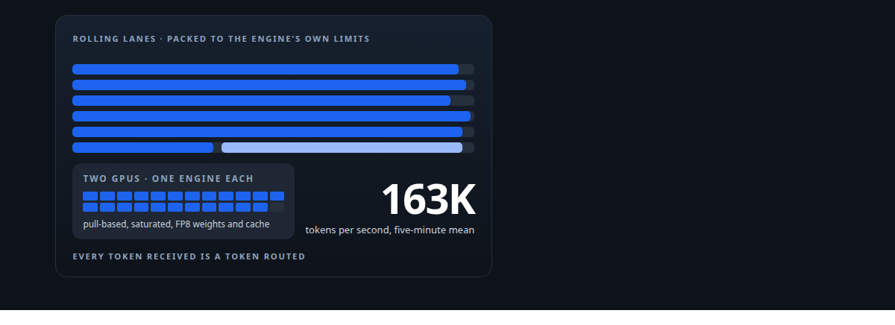
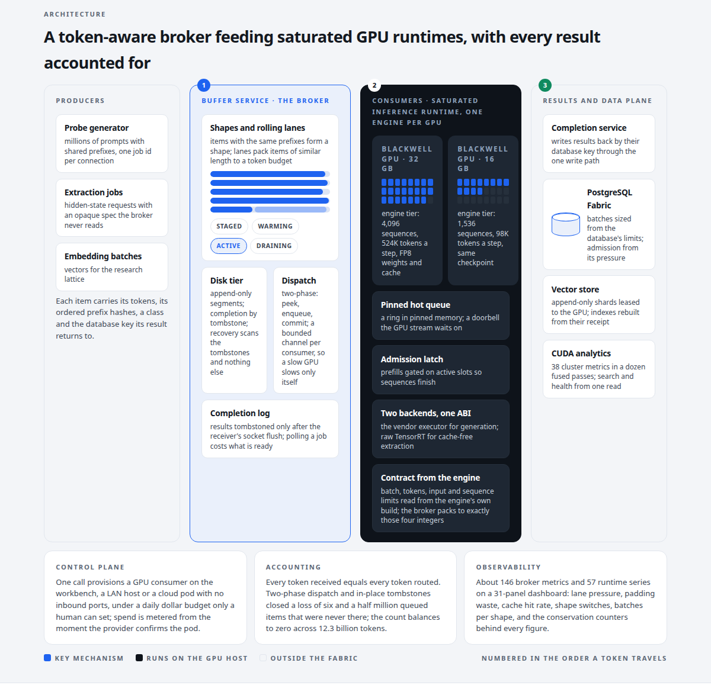
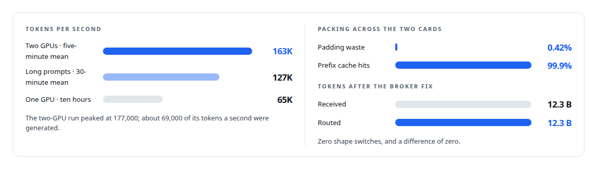
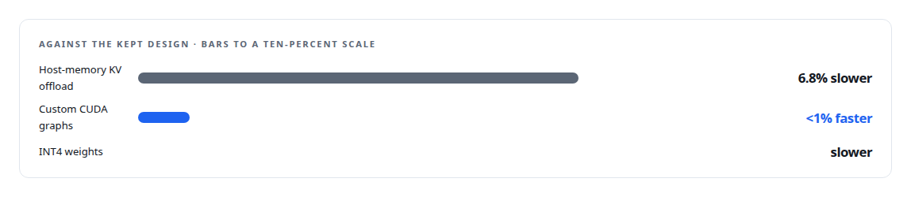

# Inference Fabric

**A throughput-first GPU inference pipeline on consumer NVIDIA hardware: broker, saturated runtime, completion, vector store**

Canonical: https://coreyjames.ai/systems/inference-fabric/  
Author: Corey James · Published: 2026-10-28 · Kind: system  
DOI: https://doi.org/10.5281/zenodo.23735148  
Technologies: [Append-only log and journal design](https://github.com/coreyjames-ai/portfolio/tree/main/technologies/append-only-log-and-journal-design) · [Approximate nearest-neighbour search](https://github.com/coreyjames-ai/portfolio/tree/main/technologies/approximate-nearest-neighbour-search) · [Binary wire protocol design](https://github.com/coreyjames-ai/portfolio/tree/main/technologies/binary-wire-protocol-design) · [Budget enforcement and cost governance](https://github.com/coreyjames-ai/portfolio/tree/main/technologies/budget-enforcement-and-cost-governance) · [C++](https://github.com/coreyjames-ai/portfolio/tree/main/technologies/c-plus-plus) · [CBOR](https://github.com/coreyjames-ai/portfolio/tree/main/technologies/cbor) · [CPU reference implementations and GPU equivalence testing](https://github.com/coreyjames-ai/portfolio/tree/main/technologies/cpu-reference-implementations-and-gpu-equivalence-testing) · [CUDA C++](https://github.com/coreyjames-ai/portfolio/tree/main/technologies/cuda-c-plus-plus) · [CUDA Driver API](https://github.com/coreyjames-ai/portfolio/tree/main/technologies/cuda-driver-api) · [Cargo](https://github.com/coreyjames-ai/portfolio/tree/main/technologies/cargo) · [Cluster-health metrics on the GPU](https://github.com/coreyjames-ai/portfolio/tree/main/technologies/cluster-health-metrics-on-the-gpu) · [Determinism and numerical reproducibility](https://github.com/coreyjames-ai/portfolio/tree/main/technologies/determinism-and-numerical-reproducibility) · [Distributed-systems reliability](https://github.com/coreyjames-ai/portfolio/tree/main/technologies/distributed-systems-reliability) · [Docker](https://github.com/coreyjames-ai/portfolio/tree/main/technologies/docker) · [FAISS](https://github.com/coreyjames-ai/portfolio/tree/main/technologies/faiss) · [Federated compute provisioning](https://github.com/coreyjames-ai/portfolio/tree/main/technologies/federated-compute-provisioning) · [GPU admission control and co-residency](https://github.com/coreyjames-ai/portfolio/tree/main/technologies/gpu-admission-control-and-co-residency) · [GPU memory management](https://github.com/coreyjames-ai/portfolio/tree/main/technologies/gpu-memory-management) · [GPU numerical kernel design](https://github.com/coreyjames-ai/portfolio/tree/main/technologies/gpu-numerical-kernel-design) · [Gaussian-kernel cluster analysis](https://github.com/coreyjames-ai/portfolio/tree/main/technologies/gaussian-kernel-cluster-analysis) · [Governed AI-assisted software engineering](https://github.com/coreyjames-ai/portfolio/tree/main/technologies/governed-ai-assisted-software-engineering) · [Grafana](https://github.com/coreyjames-ai/portfolio/tree/main/technologies/grafana) · [Hidden-state extraction](https://github.com/coreyjames-ai/portfolio/tree/main/technologies/hidden-state-extraction) · [Idempotency, exactly-once effects and crash recovery](https://github.com/coreyjames-ai/portfolio/tree/main/technologies/idempotency-exactly-once-effects-and-crash-recovery) · [Independent verification and adversarial review](https://github.com/coreyjames-ai/portfolio/tree/main/technologies/independent-verification-and-adversarial-review) · [KV-cache engineering](https://github.com/coreyjames-ai/portfolio/tree/main/technologies/kv-cache-engineering) · [Large-scale GPU data pipelines](https://github.com/coreyjames-ai/portfolio/tree/main/technologies/large-scale-gpu-data-pipelines) · [Lua](https://github.com/coreyjames-ai/portfolio/tree/main/technologies/lua) · [MessagePack](https://github.com/coreyjames-ai/portfolio/tree/main/technologies/messagepack) · [Model Context Protocol (MCP)](https://github.com/coreyjames-ai/portfolio/tree/main/technologies/model-context-protocol-mcp) · [Model families and types](https://github.com/coreyjames-ai/portfolio/tree/main/technologies/model-families-and-types) · [Model quantization](https://github.com/coreyjames-ai/portfolio/tree/main/technologies/model-quantization) · [NVIDIA Blackwell GPUs](https://github.com/coreyjames-ai/portfolio/tree/main/technologies/nvidia-blackwell-gpus) · [NVIDIA Nsight Systems](https://github.com/coreyjames-ai/portfolio/tree/main/technologies/nvidia-nsight-systems) · [NVIDIA TensorRT](https://github.com/coreyjames-ai/portfolio/tree/main/technologies/nvidia-tensorrt) · [NVIDIA TensorRT-LLM](https://github.com/coreyjames-ai/portfolio/tree/main/technologies/nvidia-tensorrt-llm) · [NVMe (cold-tier storage)](https://github.com/coreyjames-ai/portfolio/tree/main/technologies/nvme-cold-tier-storage) · [Observability and alerting](https://github.com/coreyjames-ai/portfolio/tree/main/technologies/observability-and-alerting) · [Performance engineering and benchmarking](https://github.com/coreyjames-ai/portfolio/tree/main/technologies/performance-engineering-and-benchmarking) · [PostgreSQL](https://github.com/coreyjames-ai/portfolio/tree/main/technologies/postgresql) · [PostgreSQL bulk-update engineering](https://github.com/coreyjames-ai/portfolio/tree/main/technologies/postgresql-bulk-update-engineering) · [Prometheus](https://github.com/coreyjames-ai/portfolio/tree/main/technologies/prometheus) · [Redis](https://github.com/coreyjames-ai/portfolio/tree/main/technologies/redis) · [RunPod](https://github.com/coreyjames-ai/portfolio/tree/main/technologies/runpod) · [Rust](https://github.com/coreyjames-ai/portfolio/tree/main/technologies/rust) · [Streaming statistics in CUDA](https://github.com/coreyjames-ai/portfolio/tree/main/technologies/streaming-statistics-in-cuda) · [TLS and mTLS](https://github.com/coreyjames-ai/portfolio/tree/main/technologies/tls-and-mtls) · [Tiled pairwise kernels](https://github.com/coreyjames-ai/portfolio/tree/main/technologies/tiled-pairwise-kernels) · [Token-aware GPU batch scheduling](https://github.com/coreyjames-ai/portfolio/tree/main/technologies/token-aware-gpu-batch-scheduling) · [Tokio](https://github.com/coreyjames-ai/portfolio/tree/main/technologies/tokio) · [Write-behind persistence](https://github.com/coreyjames-ai/portfolio/tree/main/technologies/write-behind-persistence) · [Zero-inbound network exposure](https://github.com/coreyjames-ai/portfolio/tree/main/technologies/zero-inbound-network-exposure) · [systemd](https://github.com/coreyjames-ai/portfolio/tree/main/technologies/systemd)  
Skills: [high-throughput batch inference](https://github.com/coreyjames-ai/portfolio/tree/main/skills/high-throughput-batch-inference) · [TensorRT and TensorRT-LLM engineering](https://github.com/coreyjames-ai/portfolio/tree/main/skills/tensorrt-and-tensorrt-llm-engineering) · [GPU inference optimisation](https://github.com/coreyjames-ai/portfolio/tree/main/skills/gpu-inference-optimisation) · [token-aware scheduling](https://github.com/coreyjames-ai/portfolio/tree/main/skills/token-aware-scheduling)  



## Result

| Figure | What it measures |
| --- | --- |
| **15** | hand-written CUDA kernel families, native Blackwell binaries, no JIT |
| **0** | allocations after the first second of a profile, down from 4,236 |
| **4.95 M** | tasks on one GPU over ten hours, zero retries |
| **126K** | lines of first-party Rust, C++ and CUDA across six trees |



## What was built

Large offline model workloads are throughput problems. Synthetic data, probe generation, hidden-state extraction and bulk embedding analytics do not care about response time; they care whether the GPU is busy. A request-and-response serving stack wastes GPU time on padding and idle gaps and ties producers to GPUs for hours. I built the Inference Fabric for throughput. Producers drop millions of tokenised tasks and walk away. A broker that understands tokens organises the work so GPUs barely pad. Pull-based GPU workers stay saturated on mixed hardware. Results land in the database when they finish. Vector outputs flow into a GPU-native store that searches and scores cluster quality. On two NVIDIA Blackwell GPUs it ran a 7-billion-parameter dense model in FP8 at 163,000 tokens per second.

## The idea

The token is the unit of scheduling. Work is grouped by shape so that each batch is shape-pure, packed to each GPU's declared limits, and dispatched so that shared prefixes stay hot in the engine's cache. A consumer describes itself with four numbers, and the broker packs for any card from those alone. See [A message broker that understands tokens](https://coreyjames.ai/stories/a-message-broker-that-understands-tokens).

Nothing waits on anything else. Each service restarts independently, and work retires only when its completion is acknowledged, so a full channel delays an item instead of losing it and a restart never re-runs work the GPUs already hold. See [Millions of queued items that were not there](https://coreyjames.ai/stories/millions-of-queued-items-that-were-not-there).

## What I built

The buffer service, a durable broker on memory-mapped append-only logs with an NVMe cold tier, token-shape-aware grouping and per-consumer packing.

The saturated inference runtime, a pull-based GPU consumer around NVIDIA TensorRT-LLM for generation and raw TensorRT for single-pass hidden-state extraction, with no custom model kernels. Every gain in [From 44K to 163K tokens per second](https://coreyjames.ai/stories/from-44k-to-163k-tokens-per-second) came from the layers around the engine.

The completion service, which closes the loop for submit-and-exit producers and dispatches results per function into the governed write-behind data plane.

The vector shard manager: vector storage leased to the GPU that stays verifiably tied to its relational source, with index-quality reporting so retrieval health is visible, and only results returning to the database.

A CUDA analytics engine written from Rust against the driver API: 38 per-cluster health metrics and exact, inverted-file and lattice vector search, each kernel with a CPU reference and equivalence tests.

Federated GPU provisioning: one call stands up a consumer node locally, on a LAN host over mutual TLS, or on rented cloud spot capacity, behind a fail-closed daily dollar budget.

About 126,000 lines of first-party Rust, C++ and CUDA across six trees. TensorRT, the CUDA driver, PostgreSQL, Redis, Docker and the monitoring stack are third-party; the orchestration, protocols, storage formats, scheduling, analytics kernels and operating discipline are mine.

## Same kernels, different supply chain

The runtime is a Rust and C++ saturation harness around stock TensorRT-LLM kernels, FP8 weights, cache and attention, and the gains come from workload supply: token-budget feeding, a ladder of backpressure in the decode loop, a zero-allocation hot path with pre-faulted pinned pools measured under Nsight (4,236 allocations in the first second of a sixty-second profile and none after), a sync discipline in which compute-stream synchronisation is physically rejected by the runtime, and a fail-closed engine loader that requires nine engine fields with no defaults. A failed worker exits fast and the orchestrator replaces it; one GPU runs one engine. The CUDA side is fifteen hand-written kernel families compiled to native Blackwell binaries with no PTX and no JIT, batched by compressed sparse rows, with a fused search-plus-health kernel. The codebase targets CUDA 13 and Blackwell SM 120, and its build also targets Ada and Hopper; the substrate it provisions reaches from Blackwell workstations to Hopper and datacentre Blackwell parts.


## Results

A 7-billion-parameter dense model in FP8 on NVIDIA Blackwell GPUs.



## The judgment in it

I measured three plausible ideas and rejected them, and they stay on the page next to the wins.



I took input-length filtering out of the broker because it stranded items and forced linear scans; the runtime fails oversized items back instead.

I kept the broker's hot path synchronous, one owner and a few blocking threads, because it was faster and easier to prove correct than an async design.

When six and a half million queued items turned out not to exist, I fixed the definition of "done" rather than the place the loss showed up.

## What it demonstrates

Performance engineering with a fixed model and one variable at a time; broker and protocol design around the economics of the hardware; distributed-systems accounting that balances to zero; and hand-written CUDA where it earns its place.

## Stories

[From 44K to 163K tokens per second](https://coreyjames.ai/stories/from-44k-to-163k-tokens-per-second) · [Engines for the card you have](https://coreyjames.ai/stories/engines-for-the-card-you-have) · [Every metric gets a CPU twin](https://coreyjames.ai/stories/every-metric-gets-a-cpu-twin) · [Removing the sampling caps](https://coreyjames.ai/stories/removing-the-sampling-caps) · [Where a cluster sits](https://coreyjames.ai/stories/where-a-cluster-sits) · [Diversity in three kernels](https://coreyjames.ai/stories/diversity-in-three-kernels) · [Physics as a lens on embeddings](https://coreyjames.ai/stories/physics-as-a-lens-on-embeddings) · [Two-means as a measuring instrument](https://coreyjames.ai/stories/two-means-as-a-measuring-instrument) · [From health scores to decisions](https://coreyjames.ai/stories/from-health-scores-to-decisions) · [Shapes have a lifecycle](https://coreyjames.ai/stories/shapes-have-a-lifecycle) · [The 128-lane wall](https://coreyjames.ai/stories/the-128-lane-wall) · [Done means delivered](https://coreyjames.ai/stories/done-means-delivered) · [Recovery that trusts only what happened](https://coreyjames.ai/stories/recovery-that-trusts-only-what-happened) · [Starting full and ending clean](https://coreyjames.ai/stories/starting-full-and-ending-clean) · [Throughput that finished nothing](https://coreyjames.ai/stories/throughput-that-finished-nothing) · [A second engine behind the same door](https://coreyjames.ai/stories/a-second-engine-behind-the-same-door) · [Asking the engine what it meant](https://coreyjames.ai/stories/asking-the-engine-what-it-meant) · [The thirteen percent that was never missing](https://coreyjames.ai/stories/the-thirteen-percent-that-was-never-missing) · [Tests that passed without a GPU](https://coreyjames.ai/stories/tests-that-passed-without-a-gpu) · [Machinery I built and then did not need](https://coreyjames.ai/stories/machinery-i-built-and-then-did-not-need) · [Ghost bytes in a zero-copy ring](https://coreyjames.ai/stories/ghost-bytes-in-a-zero-copy-ring) · [Twenty thousand rows a second](https://coreyjames.ai/stories/twenty-thousand-rows-a-second) · [Pricing writes by what they cost the database](https://coreyjames.ai/stories/pricing-writes-by-what-they-cost) · [An index you can rebuild from its receipt](https://coreyjames.ai/stories/an-index-you-can-rebuild-from-its-receipt) · [The database decides when an index goes stale](https://coreyjames.ai/stories/the-database-decides-when-an-index-goes-stale) · [Rebuild only what moved](https://coreyjames.ai/stories/rebuild-only-what-moved) · [Three shards that move together](https://coreyjames.ai/stories/three-shards-that-move-together) · [Storage that refuses to become a coordinator](https://coreyjames.ai/stories/storage-that-refuses-to-become-a-coordinator) · [The queue that should not exist](https://coreyjames.ai/stories/the-queue-that-should-not-exist) · [A doorbell the GPU waits on](https://coreyjames.ai/stories/a-doorbell-the-gpu-waits-on) · [A message broker that understands tokens](https://coreyjames.ai/stories/a-message-broker-that-understands-tokens) · [Millions of queued items that were not there](https://coreyjames.ai/stories/millions-of-queued-items-that-were-not-there) · [The workload that shaped the platform](https://coreyjames.ai/stories/the-workload-that-shaped-the-platform) · [Spend structure before spending waste](https://coreyjames.ai/stories/spend-structure-before-spending-waste) · [Thirty-eight metrics in a dozen passes](https://coreyjames.ai/stories/thirty-eight-metrics-in-a-dozen-passes) · [A detector for a silent corruption](https://coreyjames.ai/stories/a-detector-for-a-silent-corruption) · [Built for Blackwell](https://coreyjames.ai/stories/built-for-blackwell)

## Technologies

Rust · C++ · CUDA C++ · CUDA driver API · Cluster-health metrics on the GPU · Streaming statistics in CUDA · Tiled pairwise kernels · CPU reference implementations and GPU equivalence testing · Gaussian-kernel cluster analysis · TensorRT-LLM and TensorRT · FP8 inference · Memory-mapped append-only storage on NVMe · Custom TCP wire protocols · Approximate nearest-neighbour search · Prometheus, Grafana and DCGM · NVIDIA Blackwell GPUs · Cloud GPU spot provisioning

> I did not replace NVIDIA's inference; I fed it.

## What was verified

Each line is a claim the canonical page supports, with the figure as the page states it.

- High-throughput batch inference: a 7-billion-parameter dense model in FP8 at 163,000 tokens per second on two NVIDIA Blackwell GPUs, and 4.95 M tasks on one GPU over ten hours with zero retries.
- Token-aware scheduling: a durable broker on memory-mapped append-only logs that groups work by token shape and packs to each GPU's declared limits, with 0.42% padding waste and 99.9% prefix cache hits across two cards.
- TensorRT and TensorRT-LLM engineering: a pull-based saturation runtime around stock TensorRT-LLM kernels with a zero-allocation hot path, 4,236 allocations in the first second of an Nsight profile and none after.
- CUDA kernel development: fifteen hand-written kernel families compiled to native Blackwell binaries with no JIT, computing 38 per-cluster health metrics and exact, inverted-file and lattice vector search, each with a CPU reference.
- Distributed systems correctness: work retired only when its completion is acknowledged, so a restart never re-runs work the GPUs already hold, with 12.3 B tokens received and 12.3 B routed, a difference of zero.
- Cloud GPU provisioning with cost controls: one call stands up a consumer node locally, on a LAN host over mutual TLS or on rented cloud spot capacity, behind a fail-closed daily dollar budget.

## Related

- [From 44K to 163K tokens per second](https://github.com/coreyjames-ai/inference-fabric/tree/main/stories/from-44k-to-163k-tokens-per-second) · https://coreyjames.ai/stories/from-44k-to-163k-tokens-per-second/
- [A message broker that understands tokens](https://github.com/coreyjames-ai/inference-fabric/tree/main/stories/a-message-broker-that-understands-tokens) · https://coreyjames.ai/stories/a-message-broker-that-understands-tokens/
- [Millions of queued items that were not there](https://github.com/coreyjames-ai/inference-fabric/tree/main/stories/millions-of-queued-items-that-were-not-there) · https://coreyjames.ai/stories/millions-of-queued-items-that-were-not-there/
- [The workload that shaped the platform](https://github.com/coreyjames-ai/fafo-core/tree/main/stories/the-workload-that-shaped-the-platform) · https://coreyjames.ai/stories/the-workload-that-shaped-the-platform/
- [Spend structure before spending waste](https://github.com/coreyjames-ai/inference-fabric/tree/main/stories/spend-structure-before-spending-waste) · https://coreyjames.ai/stories/spend-structure-before-spending-waste/
- [Thirty-eight metrics in a dozen passes](https://github.com/coreyjames-ai/inference-fabric/tree/main/stories/thirty-eight-metrics-in-a-dozen-passes) · https://coreyjames.ai/stories/thirty-eight-metrics-in-a-dozen-passes/
- [A detector for a silent corruption](https://github.com/coreyjames-ai/inference-fabric/tree/main/stories/a-detector-for-a-silent-corruption) · https://coreyjames.ai/stories/a-detector-for-a-silent-corruption/
- [Built for Blackwell](https://github.com/coreyjames-ai/inference-fabric/tree/main/stories/built-for-blackwell) · https://coreyjames.ai/stories/built-for-blackwell/
- [Engines for the card you have](https://github.com/coreyjames-ai/inference-fabric/tree/main/stories/engines-for-the-card-you-have) · https://coreyjames.ai/stories/engines-for-the-card-you-have/
- [Every metric gets a CPU twin](https://github.com/coreyjames-ai/inference-fabric/tree/main/stories/every-metric-gets-a-cpu-twin) · https://coreyjames.ai/stories/every-metric-gets-a-cpu-twin/
- [Removing the sampling caps](https://github.com/coreyjames-ai/inference-fabric/tree/main/stories/removing-the-sampling-caps) · https://coreyjames.ai/stories/removing-the-sampling-caps/
- [Where a cluster sits](https://github.com/coreyjames-ai/inference-fabric/tree/main/stories/where-a-cluster-sits) · https://coreyjames.ai/stories/where-a-cluster-sits/
- [Diversity in three kernels](https://github.com/coreyjames-ai/inference-fabric/tree/main/stories/diversity-in-three-kernels) · https://coreyjames.ai/stories/diversity-in-three-kernels/
- [Physics as a lens on embeddings](https://github.com/coreyjames-ai/inference-fabric/tree/main/stories/physics-as-a-lens-on-embeddings) · https://coreyjames.ai/stories/physics-as-a-lens-on-embeddings/
- [Two-means as a measuring instrument](https://github.com/coreyjames-ai/inference-fabric/tree/main/stories/two-means-as-a-measuring-instrument) · https://coreyjames.ai/stories/two-means-as-a-measuring-instrument/
- [From health scores to decisions](https://github.com/coreyjames-ai/inference-fabric/tree/main/stories/from-health-scores-to-decisions) · https://coreyjames.ai/stories/from-health-scores-to-decisions/
- [Shapes have a lifecycle](https://github.com/coreyjames-ai/inference-fabric/tree/main/stories/shapes-have-a-lifecycle) · https://coreyjames.ai/stories/shapes-have-a-lifecycle/
- [The 128-lane wall](https://github.com/coreyjames-ai/inference-fabric/tree/main/stories/the-128-lane-wall) · https://coreyjames.ai/stories/the-128-lane-wall/
- [Done means delivered](https://github.com/coreyjames-ai/inference-fabric/tree/main/stories/done-means-delivered) · https://coreyjames.ai/stories/done-means-delivered/
- [Recovery that trusts only what happened](https://github.com/coreyjames-ai/inference-fabric/tree/main/stories/recovery-that-trusts-only-what-happened) · https://coreyjames.ai/stories/recovery-that-trusts-only-what-happened/
- [Starting full and ending clean](https://github.com/coreyjames-ai/inference-fabric/tree/main/stories/starting-full-and-ending-clean) · https://coreyjames.ai/stories/starting-full-and-ending-clean/
- [Throughput that finished nothing](https://github.com/coreyjames-ai/inference-fabric/tree/main/stories/throughput-that-finished-nothing) · https://coreyjames.ai/stories/throughput-that-finished-nothing/
- [A second engine behind the same door](https://github.com/coreyjames-ai/inference-fabric/tree/main/stories/a-second-engine-behind-the-same-door) · https://coreyjames.ai/stories/a-second-engine-behind-the-same-door/
- [Asking the engine what it meant](https://github.com/coreyjames-ai/inference-fabric/tree/main/stories/asking-the-engine-what-it-meant) · https://coreyjames.ai/stories/asking-the-engine-what-it-meant/
- [The thirteen percent that was never missing](https://github.com/coreyjames-ai/inference-fabric/tree/main/stories/the-thirteen-percent-that-was-never-missing) · https://coreyjames.ai/stories/the-thirteen-percent-that-was-never-missing/
- [Tests that passed without a GPU](https://github.com/coreyjames-ai/inference-fabric/tree/main/stories/tests-that-passed-without-a-gpu) · https://coreyjames.ai/stories/tests-that-passed-without-a-gpu/
- [Machinery I built and then did not need](https://github.com/coreyjames-ai/inference-fabric/tree/main/stories/machinery-i-built-and-then-did-not-need) · https://coreyjames.ai/stories/machinery-i-built-and-then-did-not-need/
- [Ghost bytes in a zero-copy ring](https://github.com/coreyjames-ai/inference-fabric/tree/main/stories/ghost-bytes-in-a-zero-copy-ring) · https://coreyjames.ai/stories/ghost-bytes-in-a-zero-copy-ring/
- [An index you can rebuild from its receipt](https://github.com/coreyjames-ai/inference-fabric/tree/main/stories/an-index-you-can-rebuild-from-its-receipt) · https://coreyjames.ai/stories/an-index-you-can-rebuild-from-its-receipt/
- [The database decides when an index goes stale](https://github.com/coreyjames-ai/inference-fabric/tree/main/stories/the-database-decides-when-an-index-goes-stale) · https://coreyjames.ai/stories/the-database-decides-when-an-index-goes-stale/
- [Rebuild only what moved](https://github.com/coreyjames-ai/inference-fabric/tree/main/stories/rebuild-only-what-moved) · https://coreyjames.ai/stories/rebuild-only-what-moved/
- [Three shards that move together](https://github.com/coreyjames-ai/inference-fabric/tree/main/stories/three-shards-that-move-together) · https://coreyjames.ai/stories/three-shards-that-move-together/
- [Storage that refuses to become a coordinator](https://github.com/coreyjames-ai/inference-fabric/tree/main/stories/storage-that-refuses-to-become-a-coordinator) · https://coreyjames.ai/stories/storage-that-refuses-to-become-a-coordinator/
- [The queue that should not exist](https://github.com/coreyjames-ai/inference-fabric/tree/main/stories/the-queue-that-should-not-exist) · https://coreyjames.ai/stories/the-queue-that-should-not-exist/
- [A doorbell the GPU waits on](https://github.com/coreyjames-ai/inference-fabric/tree/main/stories/a-doorbell-the-gpu-waits-on) · https://coreyjames.ai/stories/a-doorbell-the-gpu-waits-on/
- [Twenty thousand rows a second](https://github.com/coreyjames-ai/postgresql-fabric/tree/main/stories/twenty-thousand-rows-a-second) · https://coreyjames.ai/stories/twenty-thousand-rows-a-second/
- [Pricing writes by what they cost the database](https://github.com/coreyjames-ai/postgresql-fabric/tree/main/stories/pricing-writes-by-what-they-cost) · https://coreyjames.ai/stories/pricing-writes-by-what-they-cost/

## Skills demonstrated

Decided at build time against every page in this system, strongest first; each links to the page that earns it.

- [high-throughput batch inference](https://github.com/coreyjames-ai/portfolio/tree/main/skills/high-throughput-batch-inference) · [Inference Fabric](https://github.com/coreyjames-ai/inference-fabric)
- [token-aware scheduling](https://github.com/coreyjames-ai/portfolio/tree/main/skills/token-aware-scheduling) · [A message broker that understands tokens](https://github.com/coreyjames-ai/inference-fabric/tree/main/stories/a-message-broker-that-understands-tokens)
- [GPU inference optimisation](https://github.com/coreyjames-ai/portfolio/tree/main/skills/gpu-inference-optimisation) · [From 44K to 163K tokens per second](https://github.com/coreyjames-ai/inference-fabric/tree/main/stories/from-44k-to-163k-tokens-per-second)
- [CUDA kernel development](https://github.com/coreyjames-ai/portfolio/tree/main/skills/cuda-kernel-development) · [Thirty-eight metrics in a dozen passes](https://github.com/coreyjames-ai/inference-fabric/tree/main/stories/thirty-eight-metrics-in-a-dozen-passes)
- [embedding analytics and cluster metrics](https://github.com/coreyjames-ai/portfolio/tree/main/skills/embedding-analytics-and-cluster-metrics) · [Thirty-eight metrics in a dozen passes](https://github.com/coreyjames-ai/inference-fabric/tree/main/stories/thirty-eight-metrics-in-a-dozen-passes)
- [message broker and queue design](https://github.com/coreyjames-ai/portfolio/tree/main/skills/message-broker-and-queue-design) · [A message broker that understands tokens](https://github.com/coreyjames-ai/inference-fabric/tree/main/stories/a-message-broker-that-understands-tokens)
- [exactly-once delivery and crash recovery](https://github.com/coreyjames-ai/portfolio/tree/main/skills/exactly-once-delivery-and-crash-recovery) · [Done means delivered](https://github.com/coreyjames-ai/inference-fabric/tree/main/stories/done-means-delivered)
- [TensorRT and TensorRT-LLM engineering](https://github.com/coreyjames-ai/portfolio/tree/main/skills/tensorrt-and-tensorrt-llm-engineering) · [Inference Fabric](https://github.com/coreyjames-ai/inference-fabric)
- [append-only log design](https://github.com/coreyjames-ai/portfolio/tree/main/skills/append-only-log-design) · [Storage that refuses to become a coordinator](https://github.com/coreyjames-ai/inference-fabric/tree/main/stories/storage-that-refuses-to-become-a-coordinator)
- [Rust systems engineering](https://github.com/coreyjames-ai/portfolio/tree/main/skills/rust-systems-engineering) · [Built for Blackwell](https://github.com/coreyjames-ai/inference-fabric/tree/main/stories/built-for-blackwell)
- [observability and alerting](https://github.com/coreyjames-ai/portfolio/tree/main/skills/observability-and-alerting) · [Shapes have a lifecycle](https://github.com/coreyjames-ai/inference-fabric/tree/main/stories/shapes-have-a-lifecycle)
- [inference serving architecture](https://github.com/coreyjames-ai/portfolio/tree/main/skills/inference-serving-architecture) · [A message broker that understands tokens](https://github.com/coreyjames-ai/inference-fabric/tree/main/stories/a-message-broker-that-understands-tokens)
- [vector search and ANN indexes](https://github.com/coreyjames-ai/portfolio/tree/main/skills/vector-search-and-ann-indexes) · [Thirty-eight metrics in a dozen passes](https://github.com/coreyjames-ai/inference-fabric/tree/main/stories/thirty-eight-metrics-in-a-dozen-passes)
- [distributed systems correctness](https://github.com/coreyjames-ai/portfolio/tree/main/skills/distributed-systems-correctness) · [Millions of queued items that were not there](https://github.com/coreyjames-ai/inference-fabric/tree/main/stories/millions-of-queued-items-that-were-not-there)
- [NVIDIA Blackwell development](https://github.com/coreyjames-ai/portfolio/tree/main/skills/nvidia-blackwell-development) · [Built for Blackwell](https://github.com/coreyjames-ai/inference-fabric/tree/main/stories/built-for-blackwell)
- [GPU profiling (Nsight)](https://github.com/coreyjames-ai/portfolio/tree/main/skills/gpu-profiling-nsight) · [The thirteen percent that was never missing](https://github.com/coreyjames-ai/inference-fabric/tree/main/stories/the-thirteen-percent-that-was-never-missing)
- [PostgreSQL performance tuning](https://github.com/coreyjames-ai/portfolio/tree/main/skills/postgresql-performance-tuning) · [Rebuild only what moved](https://github.com/coreyjames-ai/inference-fabric/tree/main/stories/rebuild-only-what-moved)

## Engineering stories in Inference Fabric (34)

| Story | Result | Figure |
| --- | --- | --- |
| [A message broker that understands tokens](stories/a-message-broker-that-understands-tokens) | Scheduling GPU inference by the shape of the work, so two different cards ran at a 99.9 percent cache hit rate with almost no padding | 0.421% |
| [Millions of queued items that were not there](stories/millions-of-queued-items-that-were-not-there) | Fixing what 'done' meant in a GPU work broker until the token ledger balanced to zero | 6.5 M |
| [From 44K to 163K tokens per second](stories/from-44k-to-163k-tokens-per-second) | Raising one 7-billion-parameter model's throughput on consumer GPUs, one measured layer at a time | 44K |
| [Spend structure before spending waste](stories/spend-structure-before-spending-waste) | The lane-packing algorithms that let a GPU broker pad 0.4 percent and keep two different cards at a 99.9 percent cache hit rate | 2,048 |
| [Thirty-eight metrics in a dozen passes](stories/thirty-eight-metrics-in-a-dozen-passes) | A hand-written CUDA engine for Blackwell that scores thousands of embedding clusters at once and searches them with the same kernels | 11× |
| [A detector for a silent corruption](stories/a-detector-for-a-silent-corruption) | How the hidden-state extraction backend proves which token it is reading before it writes tens of millions of rows | 2 |
| [Built for Blackwell](stories/built-for-blackwell) | CUDA 13 on a Blackwell GPU at the bench, with a provisioning path that reaches datacentre Blackwell capacity in the cloud, and an honest line about what carries over | 300 |
| [Engines for the card you have](stories/engines-for-the-card-you-have) | One calibrated FP8 checkpoint, a dozen inference engines sized to two consumer Blackwell GPUs, and the benchmarks that decided what the tiers would be | 7.5 GB |
| [Every metric gets a CPU twin](stories/every-metric-gets-a-cpu-twin) | Thirty-eight GPU cluster metrics defined by a nine-thousand-line CPU reference library, and a three-way consistency check between kernels, references and documentation | 9,000 |
| [Removing the sampling caps](stories/removing-the-sampling-caps) | From kernels that looked at fifty members and twelve hundred pairs to exact statistics over a hundred thousand members, by redesigning every kernel into one of three scaling classes | 1,225 |
| [Where a cluster sits](stories/where-a-cluster-sits) | Ten neighbourhood metrics that place each cluster among the clusters around it, computed from precomputed neighbour lists in a handful of GPU launches | 6 |
| [Diversity in three kernels](stories/diversity-in-three-kernels) | Why entropy over pairwise distances needs a second pass, and how redundancy, information density, coverage and concept breadth come out of the same tiles | 16 × 64 |
| [Physics as a lens on embeddings](stories/physics-as-a-lens-on-embeddings) | A characteristic length scale from a histogram median, then potential depth, curvature, escape probability, superposition, interference and entanglement as cluster metrics | 256 |
| [Two-means as a measuring instrument](stories/two-means-as-a-measuring-instrument) | Exactly three Lloyd iterations, seeded at the first and last member, as the fixed definition behind clustering tendency, fragmentation, sub-cluster count and silhouette | 4 |
| [From health scores to decisions](stories/from-health-scores-to-decisions) | Five composite scores built from the per-cluster metrics with weights that live in a database table, feeding the pressure model that decides what the corpus does next | 38 |
| [Shapes have a lifecycle](stories/shapes-have-a-lifecycle) | Every switch of prompt shape costs a GPU its prefix cache, so the broker stages a shape until it is worth running, warms the next one before the current one drains, and alarms when a shape ran too briefly | 5 |
| [The 128-lane wall](stories/the-128-lane-wall) | Padding waste ran under one percent until every shape used all of its 128 lanes, then climbed past 95 percent on a 22-million-item load test; the fix was structural | 10B |
| [Done means delivered](stories/done-means-delivered) | A result counts as delivered only after it has been written to the receiver's socket, and polling a job costs what is ready rather than what is pending | 1 scan |
| [Recovery that trusts only what happened](stories/recovery-that-trusts-only-what-happened) | Tombstones as the single source of truth, a parallel scan on restart, a stale entry rewound before it is forgotten, a reconnecting GPU that reports what it still holds, and advisory checks that may never decide | 3 |
| [Starting full and ending clean](stories/starting-full-and-ending-clean) | A pressure gate holds dispatch until the first batches can be good, every batch closes on its token budget, and a cleanup mode drains the tail when the GPUs go quiet | 523 µs |
| [Throughput that finished nothing](stories/throughput-that-finished-nothing) | The runtime reported more tokens per second than it ever had while finished sequences fell below one per second; the fix gated new work on how many sequences were already alive | 4,096 |
| [A second engine behind the same door](stories/a-second-engine-behind-the-same-door) | The vendor's executor could not run engines with no key-value cache or an extra output, so a raw-TensorRT backend went in behind the same C interface, and the Rust side never knew | 8 KB |
| [Asking the engine what it meant](stories/asking-the-engine-what-it-meant) | One input's convention was ambiguous in the vendor's documentation, and guessing wrong would silently extract the wrong token; so at startup the runtime runs a tiny batch both ways and refuses to start unless exactly one answer is consistent | 3 |
| [The thirteen percent that was never missing](stories/the-thirteen-percent-that-was-never-missing) | A profile said thirteen percent of the GPU was idle; it was the share of time in non-matrix kernels. Reading what each metric measured before optimising found utilisation at 98.7 percent | 98.7% |
| [Tests that passed without a GPU](stories/tests-that-passed-without-a-gpu) | Stub builds returned fake tokens and every test went green; the build now refuses to produce a binary without the real engine library, and the generation contract was fixed at the engine boundary before a corpus was reused | 65,462 |
| [Machinery I built and then did not need](stories/machinery-i-built-and-then-did-not-need) | Fixed-size epochs and dense slots were built so decode steps could be captured as CUDA graphs; profiling showed the vendor's executor already does it. What I kept, what I stopped relying on, and the rule I took from it | −6.8% |
| [Ghost bytes in a zero-copy ring](stories/ghost-bytes-in-a-zero-copy-ring) | A pinned-memory ring deadlocked with the GPU idle and hundreds of thousands of items in flight, because wrap-around padding was never freed; and a GPU worker that registered twice was starved as dead | 62,400 |
| [An index you can rebuild from its receipt](stories/an-index-you-can-rebuild-from-its-receipt) | Approximate-nearest-neighbour indexes are usually irreproducible, so a different result cannot be told from a bug; three hashes, a hash-seeded sample, fixed iterations and a byte-identical rebuild test make mine reproducible | 100K |
| [The database decides when an index goes stale](stories/the-database-decides-when-an-index-goes-stale) | Index invalidation moved into SQL triggers and load-time checks, so a stale index cannot be served, and partial builds are failed before the daemon accepts its first connection | 2 |
| [Rebuild only what moved](stories/rebuild-only-what-moved) | Column-scoped change capture, a rule that chooses a full or a delta rebuild from the size of the change and never from its age, and a segment merge whose output is byte-identical to a full rebuild | 4 M |
| [Three shards that move together](stories/three-shards-that-move-together) | Cluster, member and phantom vector files are interdependent, so they activate together in one transaction or not at all, only after the files are confirmed on disk, with a single-active invariant the database enforces | 3 |
| [Storage that refuses to become a coordinator](stories/storage-that-refuses-to-become-a-coordinator) | A tensor store that appends, returns a stable address and knows nothing about its consumers; the coordinator tables it once had were removed and the boundary is enforced by checks in the build | 4 |
| [The queue that should not exist](stories/the-queue-that-should-not-exist) | I built an inference queue manager with two-stage backpressure and permit-carrying requests, then found the runtime already had a token-based queue, and reduced mine to a wrapper | 64 |
| [A doorbell the GPU waits on](stories/a-doorbell-the-gpu-waits-on) | Batches cross from the CPU to the GPU through a pinned ring and a 64-byte doorbell the GPU's stream waits on directly, with no CPU synchronisation; and why that path is used for the extraction engines and left off for the vendor's executor | 1 : 1 |

Part of [Corey James's portfolio](https://github.com/coreyjames-ai/portfolio): research, technologies, skills and the other systems. Canonical site: https://coreyjames.ai/

## Citation

Corey James. "Inference Fabric." coreyjames.ai, 2026. https://coreyjames.ai/systems/inference-fabric/ In: the Inference Fabric technical report, doi:10.5281/zenodo.23735148.

```bibtex
@misc{coreyjames-inference-fabric,
  author = {Corey James},
  title = {Inference Fabric},
  year = {2026},
  howpublished = {\url{https://coreyjames.ai/systems/inference-fabric/}},
  note = {GitHub copy: https://github.com/coreyjames-ai/inference-fabric},
  doi = {10.5281/zenodo.23735148}
}
```

Part of [Inference Fabric](https://github.com/coreyjames-ai/inference-fabric) and [Corey James's portfolio](https://github.com/coreyjames-ai/portfolio) · site: https://coreyjames.ai/ · MCP server: https://coreyjames.ai/mcp · agent card: https://coreyjames.ai/.well-known/agent.json
