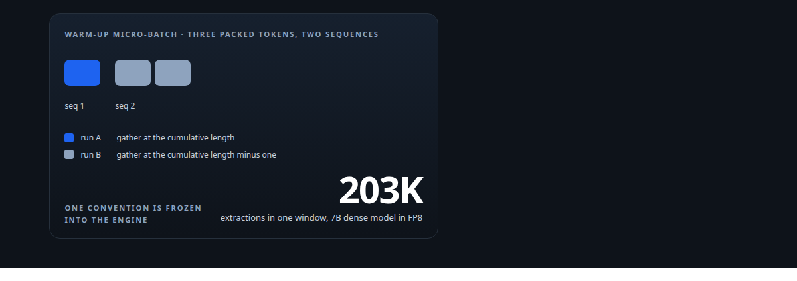
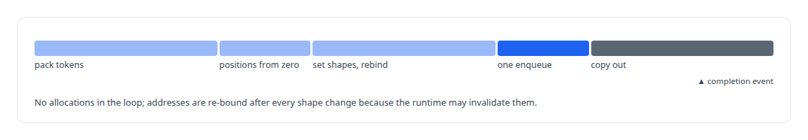
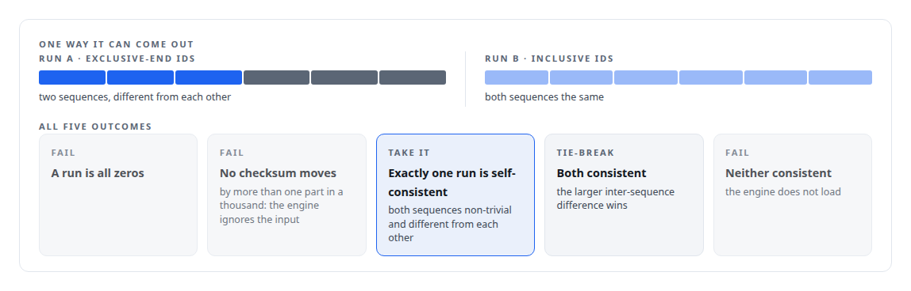
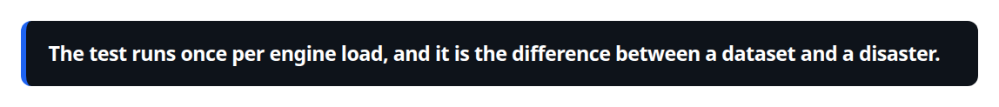
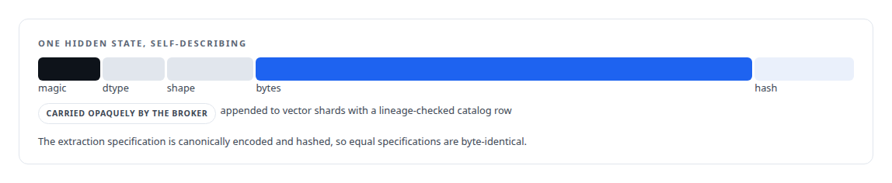

# A detector for a silent corruption

**How the hidden-state extraction backend proves which token it is reading before it writes tens of millions of rows**

Canonical: https://coreyjames.ai/stories/a-detector-for-a-silent-corruption/  
Author: Corey James · Published: 2026-10-28 · Kind: story  
Systems: [Inference Fabric](https://github.com/coreyjames-ai/inference-fabric)  
Technologies: [C++](https://github.com/coreyjames-ai/portfolio/tree/main/technologies/c-plus-plus) · [Hidden-state extraction](https://github.com/coreyjames-ai/portfolio/tree/main/technologies/hidden-state-extraction) · [NVIDIA Blackwell GPUs](https://github.com/coreyjames-ai/portfolio/tree/main/technologies/nvidia-blackwell-gpus) · [NVIDIA TensorRT](https://github.com/coreyjames-ai/portfolio/tree/main/technologies/nvidia-tensorrt)  
Skills: [TensorRT and TensorRT-LLM engineering](https://github.com/coreyjames-ai/portfolio/tree/main/skills/tensorrt-and-tensorrt-llm-engineering) · [AI-assisted engineering methodology](https://github.com/coreyjames-ai/portfolio/tree/main/skills/ai-assisted-engineering-methodology) · [distributed systems correctness](https://github.com/coreyjames-ai/portfolio/tree/main/skills/distributed-systems-correctness) · [inference serving architecture](https://github.com/coreyjames-ai/portfolio/tree/main/skills/inference-serving-architecture)  



## Result

| Figure | What it measures |
| --- | --- |
| **2** | plausible gather conventions, and the engine accepts either |
| **0.1%** | checksum change that proves the engine reads the input |
| **25,800** | tokens per second over 10.8 million tokens of extraction |

## What was built

The extraction mode of my inference runtime reads a model's internal representation, the input to its language-model head, for every probe, in one forward pass with no generation, at very large batch. The engine's packed-sequence interface takes an input that tells the attention plugin which token's state to gather for each sequence. Two conventions are plausible: the cumulative length, or the cumulative length minus one. The documentation did not settle which this engine expected. A wrong guess still produces well-formed vectors, just the wrong token's, or the next sequence's first token, for every probe. The result would be a silently corrupt dataset of tens of millions of rows. So the backend proves the convention before it extracts anything.

## The extraction path

The engine's build configuration is parsed at load, and a disabled key-value cache selects the raw TensorRT backend: no executor, no cache, a direct enqueue on a deserialised engine. Every tensor binding is classified by role, packed per-token, per-batch, static with dynamic dimensions or output, and by location. Device and pinned host buffers are sized for the maximum shape and allocated once; a failure frees everything. A warm-up pass with one token populates the buffers, because zero-initialised context lengths and token ids crash the attention plugin. Per-batch metadata reuses capacity reserved at warm-up, so there are no per-batch allocations.



## The detector

At warm-up the backend builds a two-sequence micro-batch with lengths one and two, three packed tokens, and runs it twice: once with exclusive-end ids and once with inclusive ids. For each run it decodes each sequence's output vector from half-precision bits on the host, handling denormals, infinities and not-a-number explicitly, and forms a cheap checksum, the sum of absolute values.



The chosen mode is frozen into the engine, a single function becomes the only producer of these ids, and an unknown mode at batch time is a hard error.

The checksum is a fingerprint rather than a full comparison, and the both-consistent tie-break is a heuristic rather than a proof.



## Downstream



## What this demonstrates

The habit of asking what a wrong answer would look like before producing a hundred million of them, and building the check into the load path where it cannot be skipped. It is the same instinct as [The observer that changed the answer](https://coreyjames.ai/stories/the-observer-that-changed-the-answer), applied to a data pipeline instead of a profiler.

> The test runs once per engine load, and it is the difference between a dataset and a disaster.

## What was verified

Each line is a claim the canonical page supports, with the figure as the page states it.

- TensorRT and TensorRT-LLM engineering: a raw TensorRT hidden-state extraction backend at 25,800 tokens per second over 10.8 million tokens of extraction.
- Numerical verification of inference engines: a warm-up detector that tries both of 2 plausible gather conventions and needs a 0.1% checksum change to prove the engine reads its input.
- Data provenance for ML pipelines: each hidden state written as a self-describing payload with magic, dtype, shape and hash, appended with a lineage-checked catalog row.

## Related

- [The workload that shaped the platform](https://github.com/coreyjames-ai/fafo-core/tree/main/stories/the-workload-that-shaped-the-platform) · https://coreyjames.ai/stories/the-workload-that-shaped-the-platform/
- [From 44K to 163K tokens per second](https://github.com/coreyjames-ai/inference-fabric/tree/main/stories/from-44k-to-163k-tokens-per-second) · https://coreyjames.ai/stories/from-44k-to-163k-tokens-per-second/
- [The observer that changed the answer](https://github.com/coreyjames-ai/activekv/tree/main/stories/the-observer-that-changed-the-answer) · https://coreyjames.ai/stories/the-observer-that-changed-the-answer/

## Citation

Corey James. "A detector for a silent corruption." coreyjames.ai, 2026. https://coreyjames.ai/stories/a-detector-for-a-silent-corruption/

```bibtex
@misc{coreyjames-a-detector-for-a-silent-corruption,
  author = {Corey James},
  title = {A detector for a silent corruption},
  year = {2026},
  howpublished = {\url{https://coreyjames.ai/stories/a-detector-for-a-silent-corruption/}},
  note = {GitHub copy: https://github.com/coreyjames-ai/inference-fabric/tree/main/stories/a-detector-for-a-silent-corruption}
}
```

Part of [Inference Fabric](https://github.com/coreyjames-ai/inference-fabric) and [Corey James's portfolio](https://github.com/coreyjames-ai/portfolio) · site: https://coreyjames.ai/ · MCP server: https://coreyjames.ai/mcp · agent card: https://coreyjames.ai/.well-known/agent.json
