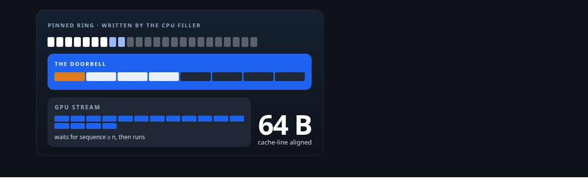
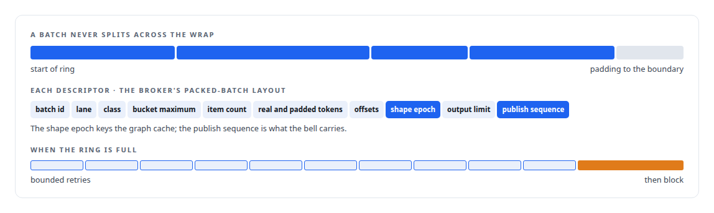
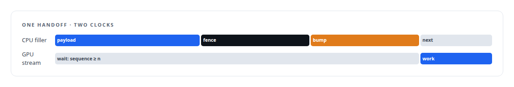
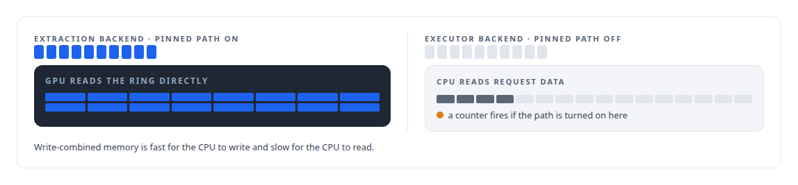

# A doorbell the GPU waits on

**Batches cross from the CPU to the GPU through a pinned ring and a 64-byte doorbell the GPU's stream waits on directly, with no CPU synchronisation; and why that path is used for the extraction engines and left off for the vendor's executor**

Canonical: https://coreyjames.ai/stories/a-doorbell-the-gpu-waits-on/  
Author: Corey James · Published: 2026-10-28 · Kind: story  
Systems: [Inference Fabric](https://github.com/coreyjames-ai/inference-fabric)  
Technologies: [Binary wire protocol design](https://github.com/coreyjames-ai/portfolio/tree/main/technologies/binary-wire-protocol-design) · [C++](https://github.com/coreyjames-ai/portfolio/tree/main/technologies/c-plus-plus) · [CUDA Driver API](https://github.com/coreyjames-ai/portfolio/tree/main/technologies/cuda-driver-api) · [GPU memory management](https://github.com/coreyjames-ai/portfolio/tree/main/technologies/gpu-memory-management) · [Rust](https://github.com/coreyjames-ai/portfolio/tree/main/technologies/rust)  
Skills: [GPU inference optimisation](https://github.com/coreyjames-ai/portfolio/tree/main/skills/gpu-inference-optimisation) · [vLLM internals](https://github.com/coreyjames-ai/portfolio/tree/main/skills/vllm-internals) · [inference serving architecture](https://github.com/coreyjames-ai/portfolio/tree/main/skills/inference-serving-architecture)  



## Result

| Figure | What it measures |
| --- | --- |
| **1 : 1** | one producer, the filler thread; one consumer, the decode thread |
| **10** | retries of 1 ms on a full ring, then a block; a batch is never dropped |
| **0** | host threads between a publish and the GPU starting work |

## What was built

The batch filler writes a batch into memory the GPU can read directly, and the GPU's stream begins work the instant the batch is published, without a host thread noticing and launching anything. The CUDA driver has a primitive for exactly this, a stream operation that blocks until a 64-bit value in memory reaches a threshold, and the runtime's hot queue is built around it.


## The ring and the bell

Batches live in a ring of pinned host memory, mapped for direct GPU access and write-combined for fast CPU writes, with pages pre-faulted at warm-up so no first-touch fault lands on the hot path. The ring pads to the boundary so a batch is never split across the wrap, and its descriptors mirror the broker's packed-batch layout. Backpressure never drops a batch.



The doorbell is a cache-line-aligned slot in mapped pinned memory holding a sequence number, the payload offset and length, and the batch id.



## Where it is used, and where it is not

The doorbell is the right design for the raw-TensorRT extraction backend in [A second engine behind the same door](https://coreyjames.ai/stories/a-second-engine-behind-the-same-door), which reads its inputs on the device. The vendor's executor backend reads request data on the CPU, so for that backend the pinned path stays off. The accounting bug that once deadlocked the ring is in [Ghost bytes in a zero-copy ring](https://coreyjames.ai/stories/ghost-bytes-in-a-zero-copy-ring).



## What this demonstrates

Using the driver's own synchronisation primitives to remove the CPU from a handoff, and matching the memory model to the consumer: a design that is right for one backend is stated as wrong for the other rather than switched on everywhere.

The handoff design and the backend rule were mine; AI coding agents, a mix of frontier and open-source models, implemented the ring and the doorbell under my governance system.

> The fastest handoff from a CPU producer to a GPU consumer is one in which neither side waits on the other's clock.

## What was verified

Each line is a claim the canonical page supports, with the figure as the page states it.

- CUDA driver programming: a stream operation that waits on a 64-byte doorbell in mapped pinned memory, so the GPU starts a batch with no host thread in the loop.
- Lock-free and zero-copy data paths: a single-producer single-consumer pinned ring of write-combined, pre-faulted pages that pads at the wrap and never drops a batch, 10 bounded retries then a block.
- GPU memory management: the pinned path enabled for a device-reading extraction backend and kept off for a CPU-reading executor, with a counter that fires on a mismatch.

## Related

- [Ghost bytes in a zero-copy ring](https://github.com/coreyjames-ai/inference-fabric/tree/main/stories/ghost-bytes-in-a-zero-copy-ring) · https://coreyjames.ai/stories/ghost-bytes-in-a-zero-copy-ring/
- [A second engine behind the same door](https://github.com/coreyjames-ai/inference-fabric/tree/main/stories/a-second-engine-behind-the-same-door) · https://coreyjames.ai/stories/a-second-engine-behind-the-same-door/
- [Built for Blackwell](https://github.com/coreyjames-ai/inference-fabric/tree/main/stories/built-for-blackwell) · https://coreyjames.ai/stories/built-for-blackwell/

## Citation

Corey James. "A doorbell the GPU waits on." coreyjames.ai, 2026. https://coreyjames.ai/stories/a-doorbell-the-gpu-waits-on/

```bibtex
@misc{coreyjames-a-doorbell-the-gpu-waits-on,
  author = {Corey James},
  title = {A doorbell the GPU waits on},
  year = {2026},
  howpublished = {\url{https://coreyjames.ai/stories/a-doorbell-the-gpu-waits-on/}},
  note = {GitHub copy: https://github.com/coreyjames-ai/inference-fabric/tree/main/stories/a-doorbell-the-gpu-waits-on}
}
```

Part of [Inference Fabric](https://github.com/coreyjames-ai/inference-fabric) and [Corey James's portfolio](https://github.com/coreyjames-ai/portfolio) · site: https://coreyjames.ai/ · MCP server: https://coreyjames.ai/mcp · agent card: https://coreyjames.ai/.well-known/agent.json
