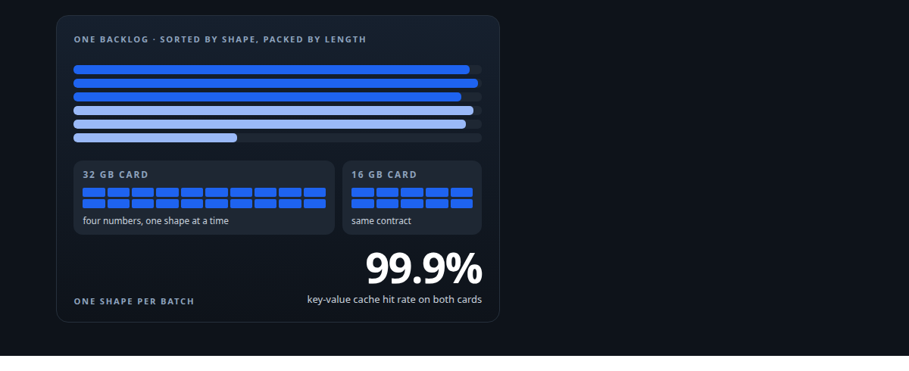
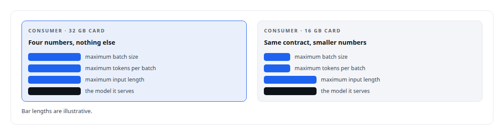
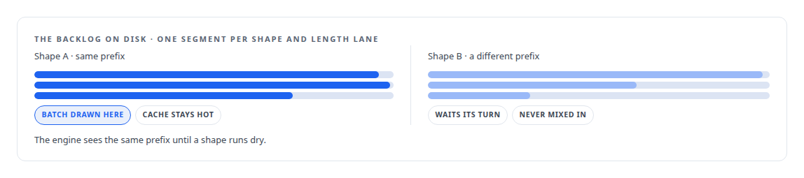
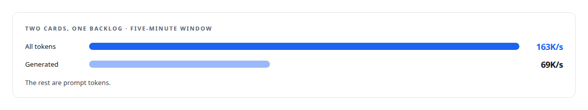

# A message broker that understands tokens

**Scheduling GPU inference by the shape of the work, so two different cards ran at a 99.9 percent cache hit rate with almost no padding**

Canonical: https://coreyjames.ai/stories/a-message-broker-that-understands-tokens/  
Author: Corey James · Published: 2026-10-28 · Kind: story  
Systems: [Inference Fabric](https://github.com/coreyjames-ai/inference-fabric)  
Technologies: [Append-only log and journal design](https://github.com/coreyjames-ai/portfolio/tree/main/technologies/append-only-log-and-journal-design) · [Binary wire protocol design](https://github.com/coreyjames-ai/portfolio/tree/main/technologies/binary-wire-protocol-design) · [CBOR](https://github.com/coreyjames-ai/portfolio/tree/main/technologies/cbor) · [Grafana](https://github.com/coreyjames-ai/portfolio/tree/main/technologies/grafana) · [KV-cache engineering](https://github.com/coreyjames-ai/portfolio/tree/main/technologies/kv-cache-engineering) · [MessagePack](https://github.com/coreyjames-ai/portfolio/tree/main/technologies/messagepack) · [NVIDIA Blackwell GPUs](https://github.com/coreyjames-ai/portfolio/tree/main/technologies/nvidia-blackwell-gpus) · [NVIDIA TensorRT](https://github.com/coreyjames-ai/portfolio/tree/main/technologies/nvidia-tensorrt) · [NVIDIA TensorRT-LLM](https://github.com/coreyjames-ai/portfolio/tree/main/technologies/nvidia-tensorrt-llm) · [NVMe (cold-tier storage)](https://github.com/coreyjames-ai/portfolio/tree/main/technologies/nvme-cold-tier-storage) · [Prometheus](https://github.com/coreyjames-ai/portfolio/tree/main/technologies/prometheus) · [RunPod](https://github.com/coreyjames-ai/portfolio/tree/main/technologies/runpod) · [Rust](https://github.com/coreyjames-ai/portfolio/tree/main/technologies/rust) · [Token-aware GPU batch scheduling](https://github.com/coreyjames-ai/portfolio/tree/main/technologies/token-aware-gpu-batch-scheduling)  
Skills: [token-aware scheduling](https://github.com/coreyjames-ai/portfolio/tree/main/skills/token-aware-scheduling) · [message broker and queue design](https://github.com/coreyjames-ai/portfolio/tree/main/skills/message-broker-and-queue-design) · [GPU inference optimisation](https://github.com/coreyjames-ai/portfolio/tree/main/skills/gpu-inference-optimisation) · [inference serving architecture](https://github.com/coreyjames-ai/portfolio/tree/main/skills/inference-serving-architecture)  



## Result

| Figure | What it measures |
| --- | --- |
| **0.421%** | padding waste across one shared backlog |
| **0** | shape switches mid-stream |
| **24,000** | lines of Rust in four crates |

## What was built

A general-purpose queue moves bytes and knows nothing about what they cost to run. GPU inference cost depends almost entirely on the shape of the work: how long the prompts are, how much each prompt shares with its neighbours, how much padding a batch carries. I built a broker whose unit of scheduling is the token. It organises incoming work so that each batch is shape-pure, packs batches to each GPU's declared limits, and delivers them so the engine's cache keeps hitting.

## The challenge

I had a backlog of billions of tokens to generate and two GPUs of different sizes to do it with. A conventional queue would hand each card whatever came next. The large card would waste capacity on small batches; the small card would be handed work it could not fit; batches would mix prompt shapes and the engine's cache would thrash. The ceiling was in what the engine was being fed.

## Constraints

Nobody waits: producers never block on the GPUs and the GPUs never block on producers, and a backlog of billions of tokens survives restarts on disk. The broker must not know the model; it schedules work it cannot interpret. Different engines run on each GPU. And the hot path is the product, because every microsecond in the dispatch loop is paid billions of times.

## My approach

Make the token the broker's unit and reduce each GPU to a contract. A consumer declares four numbers: maximum batch size, maximum tokens per batch, maximum input length, and the model it serves. From those the broker can pack a batch that fits any card without knowing anything else about it. Incoming work is organised so that a batch drawn for a card is shape-pure: the same prefix, similar lengths, minimal padding, maximal cache reuse.



## What I built

A four-crate Rust broker of about 24,000 lines with adaptive packing per consumer from the four-number contract, and a guard that refuses to mix shapes in a single batch.

A disk-backed, shape-pure backlog on memory-mapped segments, so that billions of queued tokens survive a restart and are read in the order the GPUs want them.



Per-consumer dispatch threads with a synchronous hot path: a single-owner actor and blocking threads, chosen over an async design because the loop is small and hot and easier to reason about without a scheduler in the middle.

Per-GPU engine tiers, so each card runs the engine configuration that suits its memory.

Accounting panels that show padding waste, cache hit rate, shape switches and throughput per consumer in real time.

## Difficult decisions

Taking length filtering out of the broker. An early version filtered oversized items before dispatch. It stranded items that fit no consumer and forced linear scans of the backlog. I removed it: the runtime fails an oversized item back, and the broker never scans.

A math-only contract. It would have been easy to teach the broker about each card by name.


Synchronous on purpose. The fashionable choice was an async runtime. One owner, one loop and a few blocking threads was measurably faster and much easier to prove correct.

## Results

Serving a 7-billion-parameter dense model in FP8 on two NVIDIA Blackwell GPUs:



## Technologies used

Rust · Custom TCP wire protocol · Memory-mapped segment storage on NVMe · Token-geometry-aware batch scheduling · TensorRT-LLM · Prometheus and Grafana · NVIDIA Blackwell GPUs

## What this demonstrates

I design infrastructure around the economics of the hardware it feeds, and I abstract at exactly the level the problem needs: four integers and a shape-pure backlog, and two mismatched consumer cards behave like one well-fed machine.

> Four integers describe any consumer, including ones that do not exist yet.

## What was verified

Each line is a claim the canonical page supports, with the figure as the page states it.

- Token-aware scheduling: a Rust broker that batches GPU inference by prompt shape, with 0.421% padding waste across one shared backlog and 0 shape switches mid-stream.
- Message broker and queue design: a four-crate Rust broker of about 24,000 lines with a disk-backed, shape-pure backlog that survives restarts.
- Inference serving architecture: every consumer described by four numbers, so a 32 GB and a 16 GB NVIDIA Blackwell card drained one backlog at a 99.9 percent cache hit rate.

## Related

- [From 44K to 163K tokens per second](https://github.com/coreyjames-ai/inference-fabric/tree/main/stories/from-44k-to-163k-tokens-per-second) · https://coreyjames.ai/stories/from-44k-to-163k-tokens-per-second/
- [Millions of queued items that were not there](https://github.com/coreyjames-ai/inference-fabric/tree/main/stories/millions-of-queued-items-that-were-not-there) · https://coreyjames.ai/stories/millions-of-queued-items-that-were-not-there/
- [The workload that shaped the platform](https://github.com/coreyjames-ai/fafo-core/tree/main/stories/the-workload-that-shaped-the-platform) · https://coreyjames.ai/stories/the-workload-that-shaped-the-platform/

## Citation

Corey James. "A message broker that understands tokens." coreyjames.ai, 2026. https://coreyjames.ai/stories/a-message-broker-that-understands-tokens/

```bibtex
@misc{coreyjames-a-message-broker-that-understands-tokens,
  author = {Corey James},
  title = {A message broker that understands tokens},
  year = {2026},
  howpublished = {\url{https://coreyjames.ai/stories/a-message-broker-that-understands-tokens/}},
  note = {GitHub copy: https://github.com/coreyjames-ai/inference-fabric/tree/main/stories/a-message-broker-that-understands-tokens}
}
```

Part of [Inference Fabric](https://github.com/coreyjames-ai/inference-fabric) and [Corey James's portfolio](https://github.com/coreyjames-ai/portfolio) · site: https://coreyjames.ai/ · MCP server: https://coreyjames.ai/mcp · agent card: https://coreyjames.ai/.well-known/agent.json
