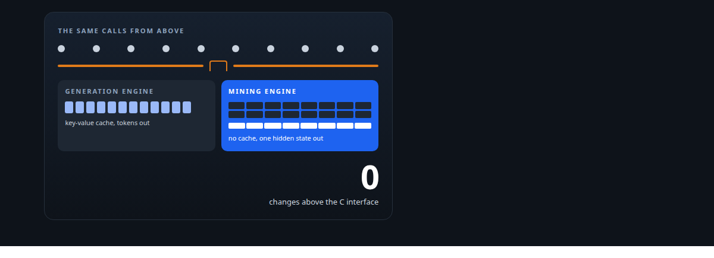
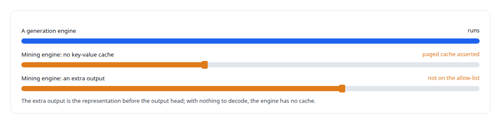
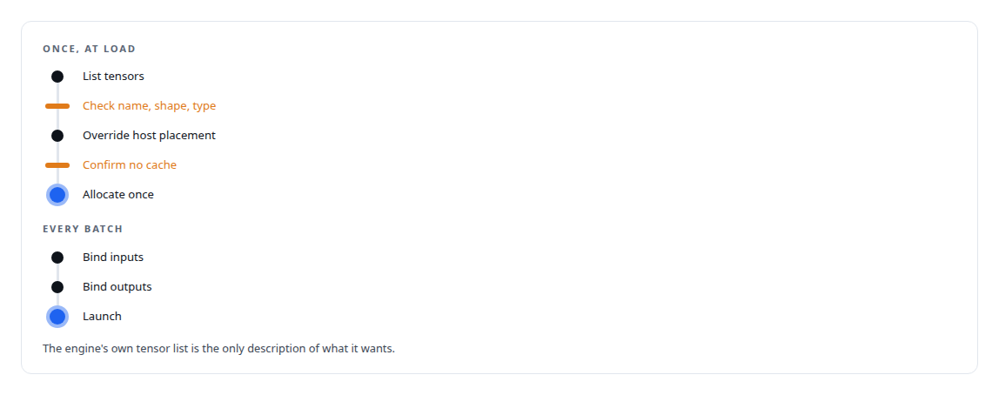
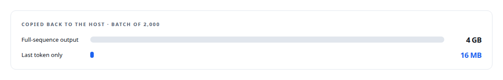
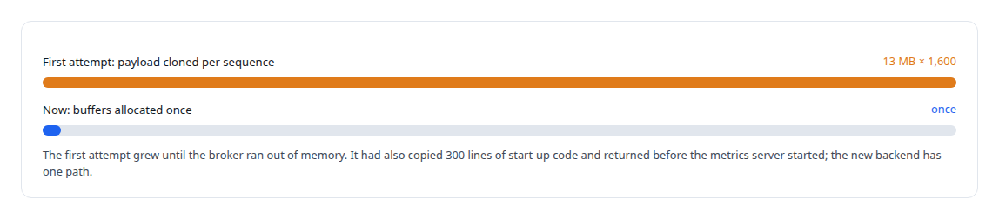

# A second engine behind the same door

**The vendor's executor could not run engines with no key-value cache or an extra output, so a raw-TensorRT backend went in behind the same C interface, and the Rust side never knew**

Canonical: https://coreyjames.ai/stories/a-second-engine-behind-the-same-door/  
Author: Corey James · Published: 2026-10-28 · Kind: story  
Systems: [Inference Fabric](https://github.com/coreyjames-ai/inference-fabric)  
Technologies: [C++](https://github.com/coreyjames-ai/portfolio/tree/main/technologies/c-plus-plus) · [Contract-first interface design](https://github.com/coreyjames-ai/portfolio/tree/main/technologies/contract-first-interface-design) · [Hidden-state extraction](https://github.com/coreyjames-ai/portfolio/tree/main/technologies/hidden-state-extraction) · [NVIDIA TensorRT](https://github.com/coreyjames-ai/portfolio/tree/main/technologies/nvidia-tensorrt) · [NVIDIA TensorRT-LLM](https://github.com/coreyjames-ai/portfolio/tree/main/technologies/nvidia-tensorrt-llm)  
Skills: [inference serving architecture](https://github.com/coreyjames-ai/portfolio/tree/main/skills/inference-serving-architecture) · [GPU inference optimisation](https://github.com/coreyjames-ai/portfolio/tree/main/skills/gpu-inference-optimisation) · [vLLM internals](https://github.com/coreyjames-ai/portfolio/tree/main/skills/vllm-internals) · [AI-assisted engineering methodology](https://github.com/coreyjames-ai/portfolio/tree/main/skills/ai-assisted-engineering-methodology)  



## Result

| Figure | What it measures |
| --- | --- |
| **8 KB** | copied back to the host per sequence |
| **128** | tokens into a mining engine, for one forward pass |
| **6 lines** | changed in the vendor's model graph to gather the output to the last token |

## What was built

Hidden-state extraction needs an engine that generates nothing. I built those engines, in [Engines for the card you have](https://coreyjames.ai/stories/engines-for-the-card-you-have), and the vendor's executor refused to run them.



## The constraint I set

The runtime has a Rust half that talks to the broker and a C++ half that talks to the GPU, joined by a C interface.


So the rule for the second backend was no new configuration surface, no Rust-visible behaviour, and the engine's own tensor enumeration as the only source of truth about what it wants.

## The backend

The C++ library detects the backend kind from the engine's configuration and, for a mining engine, loads it through the raw TensorRT runtime rather than the executor. All of the work happens once, at load.



The output is already gathered to the last token inside the model graph.



## What the first attempt taught

The earlier mining path lived in the Rust half, and it broke a rule I keep: one path.



One contract survives from that work: an extraction failure never blocks completion, so a sequence whose extraction fails completes with no payload and the pipeline keeps moving.

## What this demonstrates

Extending a vendor runtime at the layer where the extension is invisible to everything above it, with the engine itself as the authority on its own interface, and the discipline to delete a working first version that broke the architecture.

The backend boundary and its guardrails were my design; AI coding agents, a mix of frontier and open-source models, implemented it under my governance system.

> I did not want the Rust half, the provisioner or the broker to know that mining engines were different.

## What was verified

Each line is a claim the canonical page supports, with the figure as the page states it.

- TensorRT and TensorRT-LLM engineering: a raw TensorRT backend behind the same C interface for engines with no key-value cache and an extra output, invisible to the Rust side.
- Hidden-state extraction: output gathered to the last token by a 6-line graph change, so a batch of 2,000 copies 16 MB to the host instead of 4 GB.
- Zero-allocation inference paths: every tensor checked and every buffer allocated once at load, each batch bound in three phases with nothing resolved by name at run time.
- Architecture discipline: a first mining path that cloned 13 MB per sequence across 1,600 sequences and copied 300 lines of start-up code was deleted for one path.

## Related

- [The workload that shaped the platform](https://github.com/coreyjames-ai/fafo-core/tree/main/stories/the-workload-that-shaped-the-platform) · https://coreyjames.ai/stories/the-workload-that-shaped-the-platform/
- [Engines for the card you have](https://github.com/coreyjames-ai/inference-fabric/tree/main/stories/engines-for-the-card-you-have) · https://coreyjames.ai/stories/engines-for-the-card-you-have/
- [Asking the engine what it meant](https://github.com/coreyjames-ai/inference-fabric/tree/main/stories/asking-the-engine-what-it-meant) · https://coreyjames.ai/stories/asking-the-engine-what-it-meant/

## Citation

Corey James. "A second engine behind the same door." coreyjames.ai, 2026. https://coreyjames.ai/stories/a-second-engine-behind-the-same-door/

```bibtex
@misc{coreyjames-a-second-engine-behind-the-same-door,
  author = {Corey James},
  title = {A second engine behind the same door},
  year = {2026},
  howpublished = {\url{https://coreyjames.ai/stories/a-second-engine-behind-the-same-door/}},
  note = {GitHub copy: https://github.com/coreyjames-ai/inference-fabric/tree/main/stories/a-second-engine-behind-the-same-door}
}
```

Part of [Inference Fabric](https://github.com/coreyjames-ai/inference-fabric) and [Corey James's portfolio](https://github.com/coreyjames-ai/portfolio) · site: https://coreyjames.ai/ · MCP server: https://coreyjames.ai/mcp · agent card: https://coreyjames.ai/.well-known/agent.json
