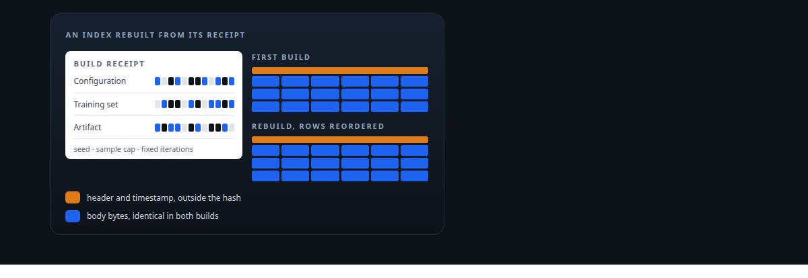
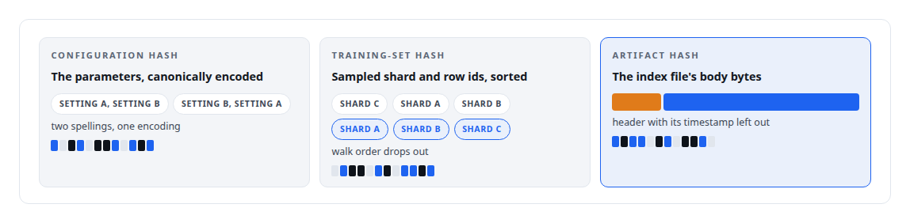
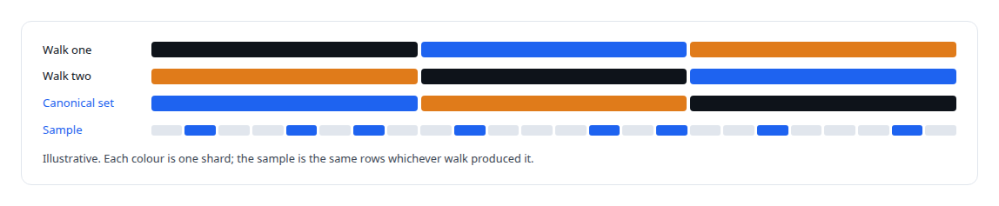
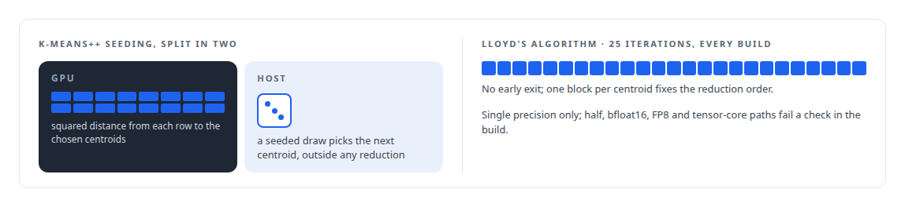
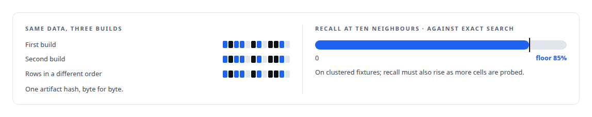

# An index you can rebuild from its receipt

**Approximate-nearest-neighbour indexes are usually irreproducible, so a different result cannot be told from a bug; three hashes, a hash-seeded sample, fixed iterations and a byte-identical rebuild test make mine reproducible**

Canonical: https://coreyjames.ai/stories/an-index-you-can-rebuild-from-its-receipt/  
Author: Corey James · Published: 2026-10-28 · Kind: story  
DOI: https://doi.org/10.5281/zenodo.23735148 (this page is a chapter of the system's report)  
Systems: [Inference Fabric](https://github.com/coreyjames-ai/inference-fabric)  
Technologies: [Approximate nearest-neighbour search](https://github.com/coreyjames-ai/portfolio/tree/main/technologies/approximate-nearest-neighbour-search) · [CBOR](https://github.com/coreyjames-ai/portfolio/tree/main/technologies/cbor) · [CUDA C++](https://github.com/coreyjames-ai/portfolio/tree/main/technologies/cuda-c-plus-plus) · [Determinism and numerical reproducibility](https://github.com/coreyjames-ai/portfolio/tree/main/technologies/determinism-and-numerical-reproducibility) · [Rust](https://github.com/coreyjames-ai/portfolio/tree/main/technologies/rust)  
Skills: [vector search and ANN indexes](https://github.com/coreyjames-ai/portfolio/tree/main/skills/vector-search-and-ann-indexes) · [AI-assisted engineering methodology](https://github.com/coreyjames-ai/portfolio/tree/main/skills/ai-assisted-engineering-methodology)  



## Result

| Figure | What it measures |
| --- | --- |
| **100K** | rows, the default cap on the training sample |
| **4,096** | cells at most; a configuration outside the bounds is refused |
| **32** | vectors at least in every cell |

## What was built

An approximate index trades exactness for speed, and most implementations trade reproducibility away with it: random seeds from the clock, training samples that depend on traversal order, floating-point reductions whose result depends on which thread finished first. When such an index returns different neighbours after a rebuild, nobody can say whether the data changed, the build changed, or something broke.


## Three hashes

Every build produces three hashes. The configuration hash is over a canonical binary encoding of the parameters, so two builds with the same settings have the same hash regardless of how the settings were written. The training-set hash is over the length-prefixed, sorted list of shard and row identifiers that were sampled, so it does not depend on the order in which the shards were walked. The artifact hash is over the body bytes of the index file, excluding the header, which carries a wall-clock timestamp that would otherwise make every build unique. A build is checked by recomputing the artifact hash from the written bytes before it is catalogued.



## A sample that does not depend on order

The training sample is a reservoir sample over the shard set, seeded by a hash of the build seed, the sorted shard set, the sample cap and each shard's row count. The shard set is canonicalised first, sorted and de-duplicated, and the selections are sorted before hashing, so the same data in a different order yields the same sample and the same hash.



## Fixed arithmetic

The seeding of k-means++ splits its work: the GPU computes each row's squared distance to the centroids chosen so far, and the host draws the next seed with a seeded generator, so the random step happens outside any floating-point reduction. Lloyd's algorithm then runs a fixed count of iterations with no early exit, with its reduction order fixed by the launch geometry of one block per centroid. Everything is single precision; half precision, bfloat16, FP8 and tensor-core paths are banned by a check in the build.



## The test that proves it

An integration test builds the index twice and asserts a byte-identical artifact hash, then builds it again from the same data in a different order and asserts the same. A second test fixes a recall floor: the index must find a fixed share of what exact search finds.



## What this demonstrates

Treating reproducibility as a property to be engineered into an approximate algorithm, with the receipt, the sample, the arithmetic and the test each closed against a source of variation, so that a changed result is always a question with an answer.

The determinism contract was my design; AI coding agents, a mix of frontier and open-source models, implemented and tested it under my governance system.

> I wanted an index whose receipt is enough to rebuild it byte for byte.

## What was verified

Each line is a claim the canonical page supports, with the figure as the page states it.

- Vector search and ANN indexes: an approximate index rebuilt byte for byte from a receipt of three hashes over its configuration, its training set and its artifact body.
- Deterministic GPU computation: k-means++ seeding split so the GPU computes distances and the host draws seeds, then 25 fixed Lloyd iterations in single precision with a fixed reduction order.
- Reproducible sampling: a reservoir sample seeded by a hash of the build seed and the sorted shard set, capped at 100K rows, so the same data in any order yields the same sample.
- Regression testing for ML indexes: builds repeated and shuffled with one artifact hash asserted, plus a recall floor of 85% at ten neighbours against exact search.

## Related

- [Thirty-eight metrics in a dozen passes](https://github.com/coreyjames-ai/inference-fabric/tree/main/stories/thirty-eight-metrics-in-a-dozen-passes) · https://coreyjames.ai/stories/thirty-eight-metrics-in-a-dozen-passes/
- [The database decides when an index goes stale](https://github.com/coreyjames-ai/inference-fabric/tree/main/stories/the-database-decides-when-an-index-goes-stale) · https://coreyjames.ai/stories/the-database-decides-when-an-index-goes-stale/
- [Every metric gets a CPU twin](https://github.com/coreyjames-ai/inference-fabric/tree/main/stories/every-metric-gets-a-cpu-twin) · https://coreyjames.ai/stories/every-metric-gets-a-cpu-twin/

## Citation

Corey James. "An index you can rebuild from its receipt." coreyjames.ai, 2026. https://coreyjames.ai/stories/an-index-you-can-rebuild-from-its-receipt/ In: the Inference Fabric technical report, doi:10.5281/zenodo.23735148.

```bibtex
@misc{coreyjames-an-index-you-can-rebuild-from-its-receipt,
  author = {Corey James},
  title = {An index you can rebuild from its receipt},
  year = {2026},
  howpublished = {\url{https://coreyjames.ai/stories/an-index-you-can-rebuild-from-its-receipt/}},
  note = {GitHub copy: https://github.com/coreyjames-ai/inference-fabric/tree/main/stories/an-index-you-can-rebuild-from-its-receipt},
  doi = {10.5281/zenodo.23735148}
}
```

Part of [Inference Fabric](https://github.com/coreyjames-ai/inference-fabric) and [Corey James's portfolio](https://github.com/coreyjames-ai/portfolio) · site: https://coreyjames.ai/ · MCP server: https://coreyjames.ai/mcp · agent card: https://coreyjames.ai/.well-known/agent.json
