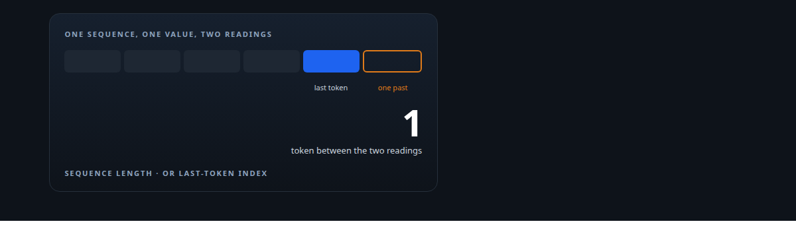
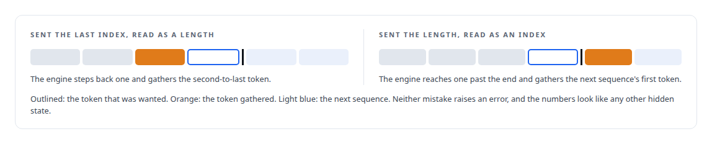
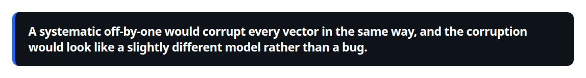
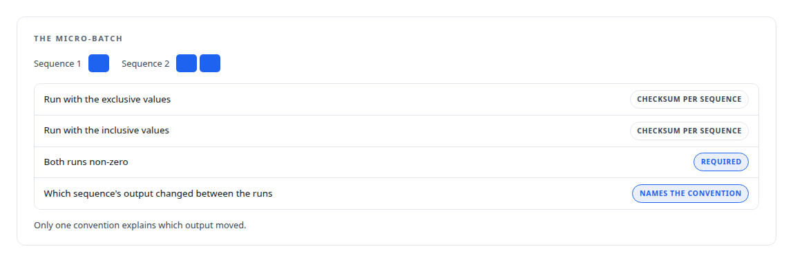
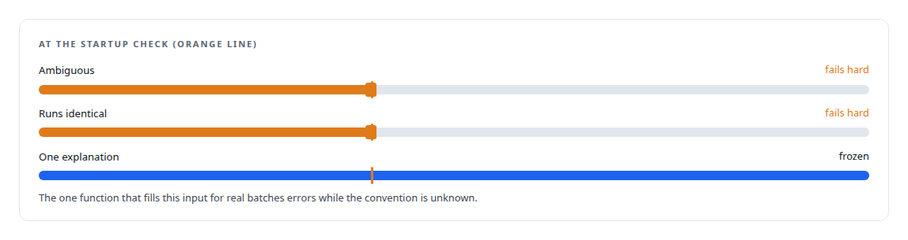

# Asking the engine what it meant

**One input's convention was ambiguous in the vendor's documentation, and guessing wrong would silently extract the wrong token; so at startup the runtime runs a tiny batch both ways and refuses to start unless exactly one answer is consistent**

Canonical: https://coreyjames.ai/stories/asking-the-engine-what-it-meant/  
Author: Corey James · Published: 2026-10-28 · Kind: story  
Systems: [Inference Fabric](https://github.com/coreyjames-ai/inference-fabric)  
Technologies: [C++](https://github.com/coreyjames-ai/portfolio/tree/main/technologies/c-plus-plus) · [Determinism and numerical reproducibility](https://github.com/coreyjames-ai/portfolio/tree/main/technologies/determinism-and-numerical-reproducibility) · [Hidden-state extraction](https://github.com/coreyjames-ai/portfolio/tree/main/technologies/hidden-state-extraction) · [NVIDIA TensorRT](https://github.com/coreyjames-ai/portfolio/tree/main/technologies/nvidia-tensorrt)  
Skills: [AI-assisted engineering methodology](https://github.com/coreyjames-ai/portfolio/tree/main/skills/ai-assisted-engineering-methodology) · [inference serving architecture](https://github.com/coreyjames-ai/portfolio/tree/main/skills/inference-serving-architecture) · [evidence-gated acceptance](https://github.com/coreyjames-ai/portfolio/tree/main/skills/evidence-gated-acceptance) · [tool synthesis and governed API integration](https://github.com/coreyjames-ai/portfolio/tree/main/skills/tool-synthesis-and-governed-api-integration)  



## Result

| Figure | What it measures |
| --- | --- |
| **3** | tokens spent at startup to settle the question |
| **2** | runs of the same micro-batch, one per convention |
| **64** | output values checksummed per sequence |

## What was built

The mining engine takes an input that tells it which token's hidden state to gather for each sequence. The vendor's documentation leaves its convention open.



## Why guessing was not acceptable

Those hidden states feed a corpus of hundreds of millions of vectors that my research clusters and measures.



The silent kind of error, which the detector in [A detector for a silent corruption](https://coreyjames.ai/stories/a-detector-for-a-silent-corruption) exists to catch after the fact, is the kind worth refusing to risk at all.

## The test at startup

So the runtime asks the engine, during warm-up. The output is decoded in software for the checksum, so no assumption about the output format leaks into the test.





## What this demonstrates

Treating a vendor's under-specified interface as a hypothesis to test rather than a fact to assume, and making the runtime refuse to run rather than run wrong.

The decision to detect rather than assume was mine; the detection was implemented by AI coding agents, a mix of frontier and open-source models, under my governance system.

> A systematic off-by-one would corrupt every vector in the same way, and the corruption would look like a slightly different model rather than a bug.

## What was verified

Each line is a claim the canonical page supports, with the figure as the page states it.

- Defensive integration with vendor runtimes: a startup self-test that runs a 3-token micro-batch under both readings of an ambiguous engine input and refuses to start unless exactly one is consistent.
- Data integrity for embedding corpora: hundreds of millions of hidden-state vectors guarded against a systematic off-by-one that would look like a different model rather than a bug.
- Numerical verification: checksums over the first 64 output values per sequence, decoded in software, with the proven convention frozen for the life of the process.

## Related

- [A second engine behind the same door](https://github.com/coreyjames-ai/inference-fabric/tree/main/stories/a-second-engine-behind-the-same-door) · https://coreyjames.ai/stories/a-second-engine-behind-the-same-door/
- [A detector for a silent corruption](https://github.com/coreyjames-ai/inference-fabric/tree/main/stories/a-detector-for-a-silent-corruption) · https://coreyjames.ai/stories/a-detector-for-a-silent-corruption/
- [The workload that shaped the platform](https://github.com/coreyjames-ai/fafo-core/tree/main/stories/the-workload-that-shaped-the-platform) · https://coreyjames.ai/stories/the-workload-that-shaped-the-platform/

## Citation

Corey James. "Asking the engine what it meant." coreyjames.ai, 2026. https://coreyjames.ai/stories/asking-the-engine-what-it-meant/

```bibtex
@misc{coreyjames-asking-the-engine-what-it-meant,
  author = {Corey James},
  title = {Asking the engine what it meant},
  year = {2026},
  howpublished = {\url{https://coreyjames.ai/stories/asking-the-engine-what-it-meant/}},
  note = {GitHub copy: https://github.com/coreyjames-ai/inference-fabric/tree/main/stories/asking-the-engine-what-it-meant}
}
```

Part of [Inference Fabric](https://github.com/coreyjames-ai/inference-fabric) and [Corey James's portfolio](https://github.com/coreyjames-ai/portfolio) · site: https://coreyjames.ai/ · MCP server: https://coreyjames.ai/mcp · agent card: https://coreyjames.ai/.well-known/agent.json
