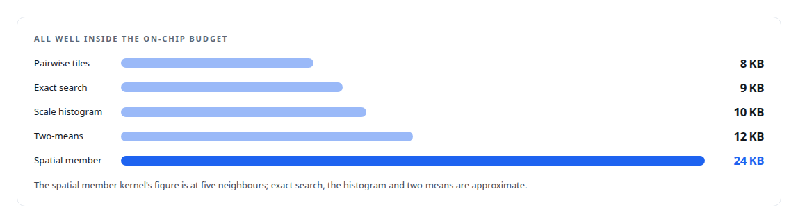
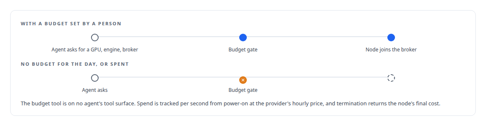

# Built for Blackwell

**CUDA 13 on a Blackwell GPU at the bench, with a provisioning path that reaches datacentre Blackwell capacity in the cloud, and an honest line about what carries over**

Canonical: https://coreyjames.ai/stories/built-for-blackwell/  
Author: Corey James · Published: 2026-10-28 · Kind: story  
Systems: [Inference Fabric](https://github.com/coreyjames-ai/inference-fabric) · [FAFO Core and Function Forge](https://github.com/coreyjames-ai/fafo-core)  
Technologies: [CUDA C++](https://github.com/coreyjames-ai/portfolio/tree/main/technologies/cuda-c-plus-plus) · [CUDA Driver API](https://github.com/coreyjames-ai/portfolio/tree/main/technologies/cuda-driver-api) · [Federated compute provisioning](https://github.com/coreyjames-ai/portfolio/tree/main/technologies/federated-compute-provisioning) · [NVIDIA Blackwell GPUs](https://github.com/coreyjames-ai/portfolio/tree/main/technologies/nvidia-blackwell-gpus) · [NVIDIA TensorRT-LLM](https://github.com/coreyjames-ai/portfolio/tree/main/technologies/nvidia-tensorrt-llm) · [RunPod](https://github.com/coreyjames-ai/portfolio/tree/main/technologies/runpod)  
Skills: [CUDA kernel development](https://github.com/coreyjames-ai/portfolio/tree/main/skills/cuda-kernel-development) · [Rust systems engineering](https://github.com/coreyjames-ai/portfolio/tree/main/skills/rust-systems-engineering) · [NVIDIA Blackwell development](https://github.com/coreyjames-ai/portfolio/tree/main/skills/nvidia-blackwell-development) · [tool synthesis and governed API integration](https://github.com/coreyjames-ai/portfolio/tree/main/skills/tool-synthesis-and-governed-api-integration)  


## Result

| Figure | What it measures |
| --- | --- |
| **300** | lines of safe Rust over the CUDA 13 driver API |
| **64 × 128** | lattice search tile in use, chosen over a 128-row tile |
| **32** | minimum rows per cell, bounding float-atomic contention |
| **3** | budget warnings, at 80, 90 and 95 percent, before the gate denies |

## What was built

My GPU work targets NVIDIA's Blackwell generation from the toolchain up. The CUDA engine builds with CUDA 13.1 and compiles every kernel to native SM 120 binaries, the consumer Blackwell architecture of both cards, with no PTX embedded and no just-in-time path to another architecture. The inference runtime's TensorRT-LLM image is built for the same target. And the provisioning path that stands up a GPU consumer node can ask a cloud provider for datacentre Blackwell capacity through the same call that starts a container on my workbench, under a budget gate that an agent cannot raise.

## Why the driver API

When I started, no Rust CUDA crate supported CUDA 13 or SM 120. Instead of waiting I generated bindings over the CUDA 13 headers at build time and wrote a safe wrapper over the driver API: eager module loading of cubins with every function resolved at engine construction, primary-context retain and set-current on every executor call because asynchronous worker threads carry no context, host memory registration for pinned leases, a device memset that pre-fills the fused side-band buffer with NaN, and the stream and event calls. The inference runtime adds a GPU-side doorbell through a stream wait on a 64-bit value, a path used for the extraction backend and kept off for the vendor's executor, which reads its requests on the CPU. Every CUDA integration test begins with a hardware gate that refuses to run on anything whose compute capability is not exactly 12.0 or whose driver predates CUDA 13, so a green test means it ran on the generation it was written for.

## Kernel decisions tied to the SM 120 budget

Shared memory per block is kept small by design so that several blocks stay resident per streaming multiprocessor.



The lattice search tile was chosen over a 128-row tile to keep register and shared-memory pressure stable before real lattice workloads were in hand, with larger variants kept behind a benchmark feature. The inverted-file centroid update relies on shared-memory float atomics being a fast native operation on SM 120 when uncontended.

The instruction choice is deliberately conservative. Everything is scalar single precision: no FP16, BF16 or FP8 paths in the metrics engine, no tensor-core matrix instructions, no thread-block clusters, no asynchronous tensor-memory copies, and a sweep in the build enforces the absence of tensor-core code in the search kernels. I chose determinism and bit-level equivalence with the CPU references over the generation's tensor-core throughput.


## The inference runtime on Blackwell

TensorRT-LLM was built from source into a base image for Blackwell only, a build of several hours that includes the FP8 key-value cache fix the release line needed. The runtime's own C++ library builds for SM 120 inside the container, and its default architecture list already covers Ada, Hopper and datacentre Blackwell. Engines for a 7-billion-parameter dense model with FP8 weights and FP8 cache are built per card with per-card limits, a tier for the larger card with batches to 4,096 and up to 524,288 tokens per step, a tier for the smaller card with batches to 1,536 and up to 98,304 tokens, in separate images per card. That is the fleet that reached 163,000 tokens per second across the two cards, in [From 44K to 163K tokens per second](https://coreyjames.ai/stories/from-44k-to-163k-tokens-per-second).

## From the bench to datacentre Blackwell

Consumer Blackwell is compute capability 12.0. Datacentre Blackwell parts are 10.0 and 10.3. They are different instruction targets, and a binary built only for one does not load on the other.


The provisioning path itself is built for that move.



A cloud base image for Blackwell covers consumer and datacentre Blackwell on the same CUDA line. The full path is in [One call to a GPU anywhere](https://coreyjames.ai/stories/one-call-to-a-gpu-anywhere).

## What this demonstrates

Targeting a new GPU generation deliberately rather than by accident: a toolchain and a hardware gate that say which silicon the code was proven on, kernel budgets chosen for that silicon, and a clear, written line between what carries to the datacentre parts and what must be rebuilt.

> The engine's job is to produce numbers I can verify.

## What was verified

Each line is a claim the canonical page supports, with the figure as the page states it.

- NVIDIA Blackwell development: CUDA 13.1 kernels compiled to native SM 120 binaries with no PTX, behind a test gate that refuses any device whose compute capability is not exactly 12.0.
- Rust systems engineering: 300 lines of safe Rust over the CUDA 13 driver API, written when no Rust CUDA crate supported the new generation.
- Cloud GPU provisioning with cost controls: one call stands up a GPU consumer node behind a budget gate, with 3 warnings at 80, 90 and 95 percent before it denies.
- CUDA kernel development: a 64 x 128 lattice search tile and a minimum of 32 rows per cell to bound float-atomic contention.

## Related

- [Thirty-eight metrics in a dozen passes](https://github.com/coreyjames-ai/inference-fabric/tree/main/stories/thirty-eight-metrics-in-a-dozen-passes) · https://coreyjames.ai/stories/thirty-eight-metrics-in-a-dozen-passes/
- [From 44K to 163K tokens per second](https://github.com/coreyjames-ai/inference-fabric/tree/main/stories/from-44k-to-163k-tokens-per-second) · https://coreyjames.ai/stories/from-44k-to-163k-tokens-per-second/
- [A message broker that understands tokens](https://github.com/coreyjames-ai/inference-fabric/tree/main/stories/a-message-broker-that-understands-tokens) · https://coreyjames.ai/stories/a-message-broker-that-understands-tokens/
- [One call to a GPU anywhere](https://github.com/coreyjames-ai/fafo-core/tree/main/stories/one-call-to-a-gpu-anywhere) · https://coreyjames.ai/stories/one-call-to-a-gpu-anywhere/

## Citation

Corey James. "Built for Blackwell." coreyjames.ai, 2026. https://coreyjames.ai/stories/built-for-blackwell/

```bibtex
@misc{coreyjames-built-for-blackwell,
  author = {Corey James},
  title = {Built for Blackwell},
  year = {2026},
  howpublished = {\url{https://coreyjames.ai/stories/built-for-blackwell/}},
  note = {GitHub copy: https://github.com/coreyjames-ai/inference-fabric/tree/main/stories/built-for-blackwell}
}
```

Part of [Inference Fabric](https://github.com/coreyjames-ai/inference-fabric) and [Corey James's portfolio](https://github.com/coreyjames-ai/portfolio) · site: https://coreyjames.ai/ · MCP server: https://coreyjames.ai/mcp · agent card: https://coreyjames.ai/.well-known/agent.json
