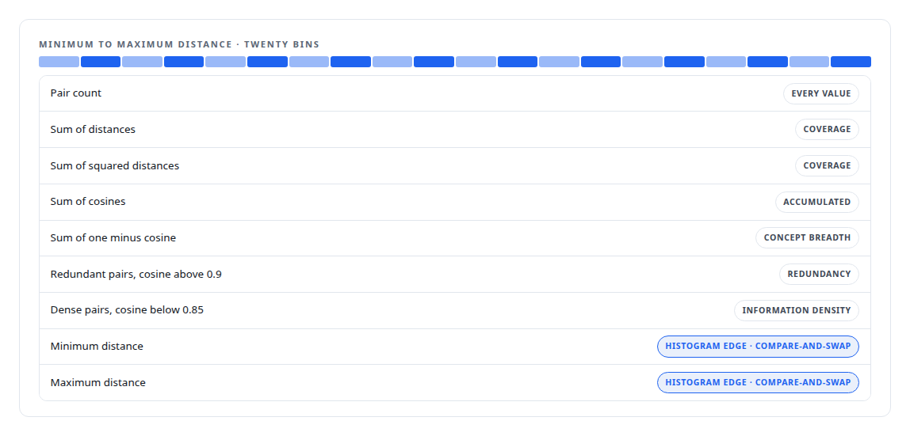
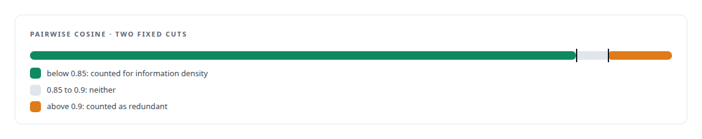

# Diversity in three kernels

**Why entropy over pairwise distances needs a second pass, and how redundancy, information density, coverage and concept breadth come out of the same tiles**

Canonical: https://coreyjames.ai/stories/diversity-in-three-kernels/  
Author: Corey James · Published: 2026-10-28 · Kind: story  
DOI: https://doi.org/10.5281/zenodo.23735148 (this page is a chapter of the system's report)  
Systems: [Inference Fabric](https://github.com/coreyjames-ai/inference-fabric)  
Technologies: [CPU reference implementations and GPU equivalence testing](https://github.com/coreyjames-ai/portfolio/tree/main/technologies/cpu-reference-implementations-and-gpu-equivalence-testing) · [CUDA C++](https://github.com/coreyjames-ai/portfolio/tree/main/technologies/cuda-c-plus-plus) · [Cluster-health metrics on the GPU](https://github.com/coreyjames-ai/portfolio/tree/main/technologies/cluster-health-metrics-on-the-gpu) · [Determinism and numerical reproducibility](https://github.com/coreyjames-ai/portfolio/tree/main/technologies/determinism-and-numerical-reproducibility) · [GPU numerical kernel design](https://github.com/coreyjames-ai/portfolio/tree/main/technologies/gpu-numerical-kernel-design) · [Gaussian-kernel cluster analysis](https://github.com/coreyjames-ai/portfolio/tree/main/technologies/gaussian-kernel-cluster-analysis) · [Streaming statistics in CUDA](https://github.com/coreyjames-ai/portfolio/tree/main/technologies/streaming-statistics-in-cuda) · [Tiled pairwise kernels](https://github.com/coreyjames-ai/portfolio/tree/main/technologies/tiled-pairwise-kernels)  
Skills: [embedding analytics and cluster metrics](https://github.com/coreyjames-ai/portfolio/tree/main/skills/embedding-analytics-and-cluster-metrics) · [CUDA kernel development](https://github.com/coreyjames-ai/portfolio/tree/main/skills/cuda-kernel-development) · [GPU inference optimisation](https://github.com/coreyjames-ai/portfolio/tree/main/skills/gpu-inference-optimisation) · [AI-assisted engineering methodology](https://github.com/coreyjames-ai/portfolio/tree/main/skills/ai-assisted-engineering-methodology)  


## Result

| Figure | What it measures |
| --- | --- |
| **16 × 64** | pair tiles, one atomic per tile for the minimum and maximum |
| **20** | histogram bins in shared memory, flushed once per block |
| **5 B** | pairwise distances recomputed rather than stored |
| **1** | entropy score for a perfectly even spread |

## What was built

A cluster of embeddings can be tight and still be useless, because every member says the same thing. The diversity family measures the opposite of redundancy: how much of the cluster is distinct, how evenly its members are spread, and how broad the concept it covers is. Five of those metrics come from pairwise distances, and one of them, entropy, forced the design into three kernels where one would have been nicer.

## The problem with entropy

Entropy of the pairwise distances needs a histogram, and a histogram needs its bin edges before the first distance is counted. The edges come from the minimum and maximum distance in the cluster, which are not known until every pair has been visited.


## Pass one: statistics

The first kernel walks the cluster's pairs and accumulates nine quantities per cluster. The minimum and maximum are the awkward ones. CUDA has no atomic minimum or maximum for floating point, so the library carries both as compare-and-swap loops on the bit pattern.



## Pass two: the histogram

With the range known, the second kernel recomputes every pairwise distance and bins it into the histogram. A degenerate cluster whose maximum equals its minimum exits early with a documented result rather than dividing by zero.

## Pass three: the metrics

The finalize kernel turns the accumulators into five values per cluster. Entropy is the Shannon entropy of the histogram normalised by the logarithm of twenty. Coverage is the coefficient of variation of the distances. Concept breadth is the mean of one minus cosine over all pairs.



## Why the thresholds are fixed

The thresholds at 0.9 and 0.85 are part of the metric definitions, written into the CPU reference and the lineage file, and no run can change them. A diversity score that depended on a tunable threshold would not be comparable between runs, and comparability is the point: the pressure model that decides whether to split or merge a cluster reads these values across the whole corpus.

## What this demonstrates

Letting the mathematics dictate the kernel structure. Two passes exist because entropy needs its range first, the float atomics exist because the hardware lacks them, and the thresholds are frozen because the values must be comparable.

> One pass cannot do both.

## What was verified

Each line is a claim the canonical page supports, with the figure as the page states it.

- CUDA kernel development: a diversity family split into a statistics pass, a histogram pass and a finalize, because entropy needs its range before its bins.
- GPU numerical methods: float minimum and maximum carried as compare-and-swap loops with one atomic per 16 x 64 tile, and a 20-bin shared-memory histogram.
- Embedding analytics and cluster metrics: entropy, coverage, redundancy, information density and concept breadth from the same tiles, thresholds fixed at 0.9 and 0.85 so scores compare across runs.
- GPU memory trade-offs: 5 billion pairwise distances recomputed rather than stored.

## Related

- [Thirty-eight metrics in a dozen passes](https://github.com/coreyjames-ai/inference-fabric/tree/main/stories/thirty-eight-metrics-in-a-dozen-passes) · https://coreyjames.ai/stories/thirty-eight-metrics-in-a-dozen-passes/
- [Removing the sampling caps](https://github.com/coreyjames-ai/inference-fabric/tree/main/stories/removing-the-sampling-caps) · https://coreyjames.ai/stories/removing-the-sampling-caps/
- [Every metric gets a CPU twin](https://github.com/coreyjames-ai/inference-fabric/tree/main/stories/every-metric-gets-a-cpu-twin) · https://coreyjames.ai/stories/every-metric-gets-a-cpu-twin/

## Citation

Corey James. "Diversity in three kernels." coreyjames.ai, 2026. https://coreyjames.ai/stories/diversity-in-three-kernels/ In: the Inference Fabric technical report, doi:10.5281/zenodo.23735148.

```bibtex
@misc{coreyjames-diversity-in-three-kernels,
  author = {Corey James},
  title = {Diversity in three kernels},
  year = {2026},
  howpublished = {\url{https://coreyjames.ai/stories/diversity-in-three-kernels/}},
  note = {GitHub copy: https://github.com/coreyjames-ai/inference-fabric/tree/main/stories/diversity-in-three-kernels},
  doi = {10.5281/zenodo.23735148}
}
```

Part of [Inference Fabric](https://github.com/coreyjames-ai/inference-fabric) and [Corey James's portfolio](https://github.com/coreyjames-ai/portfolio) · site: https://coreyjames.ai/ · MCP server: https://coreyjames.ai/mcp · agent card: https://coreyjames.ai/.well-known/agent.json
