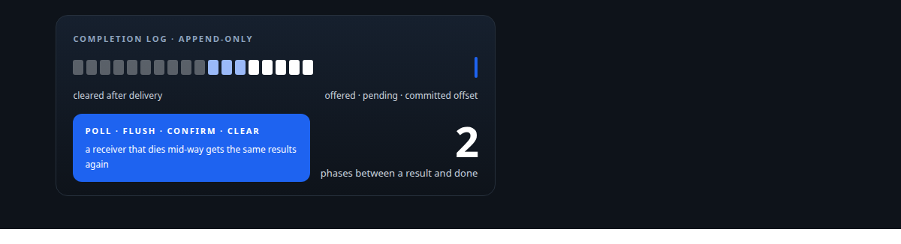
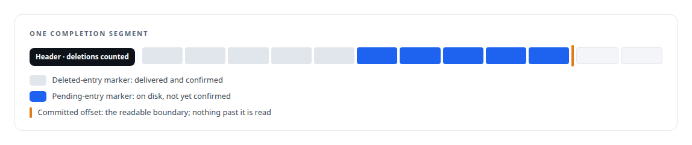
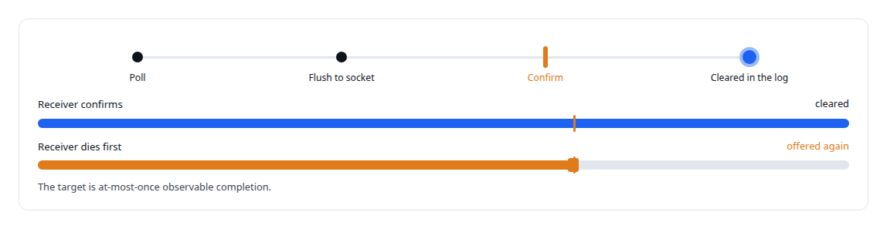
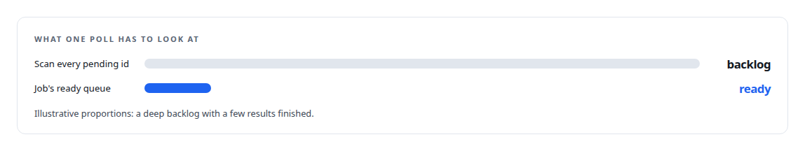

# Done means delivered

**A result counts as delivered only after it has been written to the receiver's socket, and polling a job costs what is ready rather than what is pending**

Canonical: https://coreyjames.ai/stories/done-means-delivered/  
Author: Corey James · Published: 2026-10-28 · Kind: story  
Systems: [Inference Fabric](https://github.com/coreyjames-ai/inference-fabric)  
Technologies: [Append-only log and journal design](https://github.com/coreyjames-ai/portfolio/tree/main/technologies/append-only-log-and-journal-design) · [Binary wire protocol design](https://github.com/coreyjames-ai/portfolio/tree/main/technologies/binary-wire-protocol-design) · [Idempotency, exactly-once effects and crash recovery](https://github.com/coreyjames-ai/portfolio/tree/main/technologies/idempotency-exactly-once-effects-and-crash-recovery) · [Rust](https://github.com/coreyjames-ai/portfolio/tree/main/technologies/rust)  
Skills: [exactly-once delivery and crash recovery](https://github.com/coreyjames-ai/portfolio/tree/main/skills/exactly-once-delivery-and-crash-recovery) · [append-only log design](https://github.com/coreyjames-ai/portfolio/tree/main/skills/append-only-log-design) · [distributed systems correctness](https://github.com/coreyjames-ai/portfolio/tree/main/skills/distributed-systems-correctness) · [message broker and queue design](https://github.com/coreyjames-ai/portfolio/tree/main/skills/message-broker-and-queue-design)  



## Result

| Figure | What it measures |
| --- | --- |
| **1 scan** | rebuilds every result after a restart |
| **1 job id** | set once per connection scopes every poll |

## What was built

The input side of my broker is told in [Millions of queued items that were not there](https://coreyjames.ai/stories/millions-of-queued-items-that-were-not-there): two-phase dispatch and in-place tombstones made the count of tokens received equal the count routed, to the token. The output side had the same disease in mirror image. A result could be marked finished, handed to a poller, and lost between the broker's memory and the receiver's hands. So the completion side got the same discipline, and polling got a data structure that scales with what is ready.

## A log for results

Results from the GPUs are written to completion segments, append-only files. Recovery after a restart is a scan of those segments, so a result that reached disk is never forgotten by a crash. The pending registry, the hot path that tracks what is in flight, stays in memory as a hash map, and the completion store is a separate pluggable backend, so the two memory profiles never compete.



## Two phases on the way out

Delivery has two phases, and nothing leaves the log until the second one has happened.




## Polling that costs what is ready

The original poll checked every pending sequence id for a job, which cost as much as the backlog. The producer now sets a job id once per connection, every completion is appended to its job's ready queue, and polling a job returns up to a requested number of ready results. A multi-job service polls all ready queues at once. The queues are rebuilt from the stored job ids on restart. A work item carries the database primary key it came from, so the completion can be written straight back to its row.



## What this demonstrates

Applying one accounting rule to both ends of a pipeline: nothing is counted as done until the physical event that makes it done has happened, and the structures that answer "what is finished" are sized by the answer rather than by the question.

The delivery rule and the job-scoped queues were my design; AI coding agents, a mix of frontier and open-source models, implemented them under my governance system.

> A result can be re-offered, and it is never silently gone.

## What was verified

Each line is a claim the canonical page supports, with the figure as the page states it.

- Exactly-once delivery and crash recovery: a result counts as delivered only after it is flushed to the receiver's socket and confirmed, so a receiver that dies is offered the same results again.
- Append-only log design: results written to completion segments that 1 scan rebuilds after a restart, with a committed offset as the readable boundary.
- Message broker and queue design: a job id set once per connection and job-scoped ready queues, so a poll costs what is ready rather than the whole pending backlog.

## Related

- [Millions of queued items that were not there](https://github.com/coreyjames-ai/inference-fabric/tree/main/stories/millions-of-queued-items-that-were-not-there) · https://coreyjames.ai/stories/millions-of-queued-items-that-were-not-there/
- [A message broker that understands tokens](https://github.com/coreyjames-ai/inference-fabric/tree/main/stories/a-message-broker-that-understands-tokens) · https://coreyjames.ai/stories/a-message-broker-that-understands-tokens/
- [Recovery that trusts only what happened](https://github.com/coreyjames-ai/inference-fabric/tree/main/stories/recovery-that-trusts-only-what-happened) · https://coreyjames.ai/stories/recovery-that-trusts-only-what-happened/

## Citation

Corey James. "Done means delivered." coreyjames.ai, 2026. https://coreyjames.ai/stories/done-means-delivered/

```bibtex
@misc{coreyjames-done-means-delivered,
  author = {Corey James},
  title = {Done means delivered},
  year = {2026},
  howpublished = {\url{https://coreyjames.ai/stories/done-means-delivered/}},
  note = {GitHub copy: https://github.com/coreyjames-ai/inference-fabric/tree/main/stories/done-means-delivered}
}
```

Part of [Inference Fabric](https://github.com/coreyjames-ai/inference-fabric) and [Corey James's portfolio](https://github.com/coreyjames-ai/portfolio) · site: https://coreyjames.ai/ · MCP server: https://coreyjames.ai/mcp · agent card: https://coreyjames.ai/.well-known/agent.json
