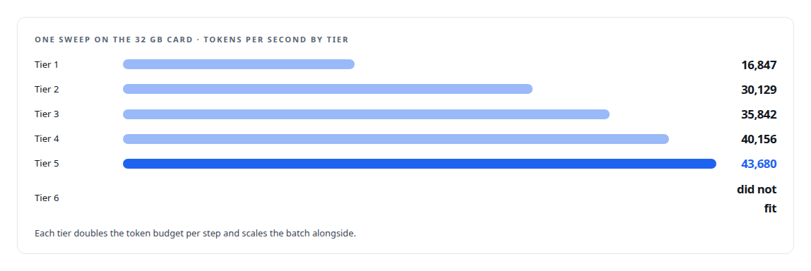
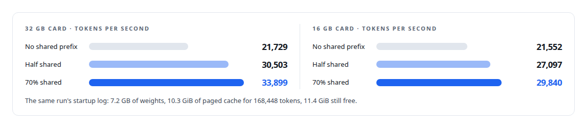
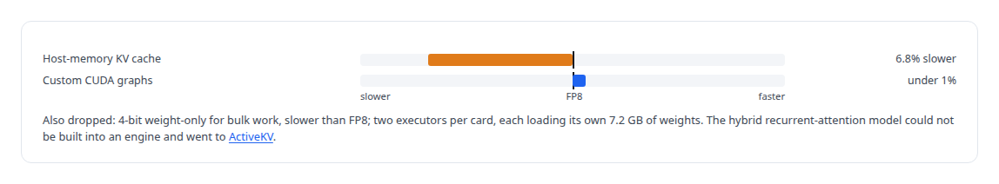

# Engines for the card you have

**One calibrated FP8 checkpoint, a dozen inference engines sized to two consumer Blackwell GPUs, and the benchmarks that decided what the tiers would be**

Canonical: https://coreyjames.ai/stories/engines-for-the-card-you-have/  
Author: Corey James · Published: 2026-10-28 · Kind: story  
Systems: [Inference Fabric](https://github.com/coreyjames-ai/inference-fabric)  
Technologies: [Docker](https://github.com/coreyjames-ai/portfolio/tree/main/technologies/docker) · [GPU inference engine engineering](https://github.com/coreyjames-ai/portfolio/tree/main/technologies/gpu-inference-engine-engineering) · [KV-cache engineering](https://github.com/coreyjames-ai/portfolio/tree/main/technologies/kv-cache-engineering) · [Model quantization](https://github.com/coreyjames-ai/portfolio/tree/main/technologies/model-quantization) · [NVIDIA TensorRT](https://github.com/coreyjames-ai/portfolio/tree/main/technologies/nvidia-tensorrt) · [NVIDIA TensorRT-LLM](https://github.com/coreyjames-ai/portfolio/tree/main/technologies/nvidia-tensorrt-llm) · [Performance engineering and benchmarking](https://github.com/coreyjames-ai/portfolio/tree/main/technologies/performance-engineering-and-benchmarking)  
Skills: [GPU inference optimisation](https://github.com/coreyjames-ai/portfolio/tree/main/skills/gpu-inference-optimisation) · [TensorRT and TensorRT-LLM engineering](https://github.com/coreyjames-ai/portfolio/tree/main/skills/tensorrt-and-tensorrt-llm-engineering) · [inference serving architecture](https://github.com/coreyjames-ai/portfolio/tree/main/skills/inference-serving-architecture) · [AI-assisted engineering methodology](https://github.com/coreyjames-ai/portfolio/tree/main/skills/ai-assisted-engineering-methodology)  


## Result

| Figure | What it measures |
| --- | --- |
| **7.5 GB** | engine footprint on disk, every tier |
| **3.5 s** | engine load time |
| **+56%** | throughput at a 70 percent shared prefix on the larger card |
| **6** | lines changed in the vendor model graph |

## What was built

A built inference engine is a commitment to one GPU, one precision and one set of limits. It will load on that card and refuse any other, it holds exactly the batch and token budget it was built for, and it carries the key-value cache layout it was given. The fleet that reached 163,000 tokens per second in [From 44K to 163K tokens per second](https://coreyjames.ai/stories/from-44k-to-163k-tokens-per-second) ran on engines I built this way, a dozen of them from one checkpoint, each sized to the card in front of me.

## One checkpoint, many engines

The model is a 7-billion-parameter dense instruction model. I quantize it once: FP8 weights and an FP8 key-value cache, calibrated, with the output head left in high precision. Every engine is then built from that one checkpoint, so the engines differ only in their limits and cache layout. They share paged key-value memory and FP8 context attention. The base image they run in was built from source for consumer Blackwell only, and the model graph in it carries one small change of mine, described below.

## Tier by token budget, then by batch

Sweeps established that tokens per step, the number of tokens the engine processes in one forward pass, is the dominant lever on these cards. So tiers double the token budget and scale the batch alongside until the next tier runs out of memory. On the larger card, with 32 GB of memory, the tiers climb to 4,096 sequences and 524,288 tokens per step. On the smaller card, with 16 GB, they stop at 1,536 sequences and 98,304 tokens, with a halved variant at 49,152 kept for headroom.



Most tiers cap each sequence at 1,024 input tokens and 128 output tokens, which keeps every sequence's cache small and the number of slots large. Separate long-sequence tiers accept 3,840 input tokens with larger cache blocks, for the prompts that need them.

## The contract travels with the engine


The broker and the provisioner read it, and the runtime refuses to load an engine without one. A node is configured by the engine it loads, which is what lets [One call to a GPU anywhere](https://coreyjames.ai/stories/one-call-to-a-gpu-anywhere) start a consumer anywhere with an engine path and nothing else.

## Caching measured on the real prompt structure

My workload shares long prefixes across prompts, so I measured what block reuse was worth at the geometry I actually run: batch 768, a 98,304-token engine, 128 tokens in and 128 out.




## Ideas tested and dropped

Several plausible ideas were benchmarked and rejected.



## Six lines in the vendor graph

For hidden-state extraction I needed the representation after the final normalisation and before the output head. The only change I carry in the vendor tree marks that tensor as an extra engine output, so every decoder model built from the tree exposes it without altering the inference path, and the runtime validates its shape at load. From there the extraction engines strip the model down: 128-token inputs, one generated token, then no key-value cache and no generation at all, at batches up to 8,192 sequences and a million tokens per forward pass. The workload those engines serve is in [The workload that shaped the platform](https://coreyjames.ai/stories/the-workload-that-shaped-the-platform).

## What this demonstrates

Treating an inference engine as an engineered artifact with a target, a precision, a set of limits and a contract, choosing those limits by measurement, and publishing the ideas that lost alongside the ones that won.

> Those numbers are why the broker groups batches by prefix.

## What was verified

Each line is a claim the canonical page supports, with the figure as the page states it.

- TensorRT and TensorRT-LLM engineering: 12 engines from one quantized FP8 checkpoint, sized per card, each 7.5 GB on disk with a 3.5 s load.
- GPU inference optimisation: a token-budget tier sweep on the 32 GB card from 16,847 to 43,680 tokens per second.
- KV-cache engineering: caching measured on the real prompt structure, +56% throughput at a 70 percent shared prefix on the larger card.
- Hidden-state extraction from LLMs: 6 lines changed in the vendor model graph so every decoder model built from the tree exposes its hidden state.

## Related

- [A message broker that understands tokens](https://github.com/coreyjames-ai/inference-fabric/tree/main/stories/a-message-broker-that-understands-tokens) · https://coreyjames.ai/stories/a-message-broker-that-understands-tokens/
- [The workload that shaped the platform](https://github.com/coreyjames-ai/fafo-core/tree/main/stories/the-workload-that-shaped-the-platform) · https://coreyjames.ai/stories/the-workload-that-shaped-the-platform/
- [Built for Blackwell](https://github.com/coreyjames-ai/inference-fabric/tree/main/stories/built-for-blackwell) · https://coreyjames.ai/stories/built-for-blackwell/
- [Trying the industrial path first](https://github.com/coreyjames-ai/capabilities-model/tree/main/stories/trying-the-industrial-path-first) · https://coreyjames.ai/stories/trying-the-industrial-path-first/
- [From 44K to 163K tokens per second](https://github.com/coreyjames-ai/inference-fabric/tree/main/stories/from-44k-to-163k-tokens-per-second) · https://coreyjames.ai/stories/from-44k-to-163k-tokens-per-second/
- [One call to a GPU anywhere](https://github.com/coreyjames-ai/fafo-core/tree/main/stories/one-call-to-a-gpu-anywhere) · https://coreyjames.ai/stories/one-call-to-a-gpu-anywhere/

## Citation

Corey James. "Engines for the card you have." coreyjames.ai, 2026. https://coreyjames.ai/stories/engines-for-the-card-you-have/

```bibtex
@misc{coreyjames-engines-for-the-card-you-have,
  author = {Corey James},
  title = {Engines for the card you have},
  year = {2026},
  howpublished = {\url{https://coreyjames.ai/stories/engines-for-the-card-you-have/}},
  note = {GitHub copy: https://github.com/coreyjames-ai/inference-fabric/tree/main/stories/engines-for-the-card-you-have}
}
```

Part of [Inference Fabric](https://github.com/coreyjames-ai/inference-fabric) and [Corey James's portfolio](https://github.com/coreyjames-ai/portfolio) · site: https://coreyjames.ai/ · MCP server: https://coreyjames.ai/mcp · agent card: https://coreyjames.ai/.well-known/agent.json
