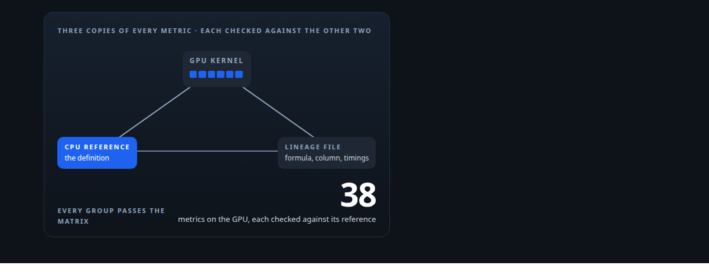
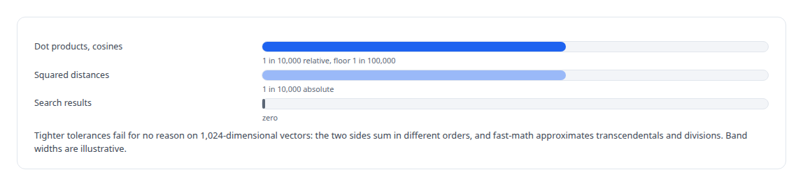
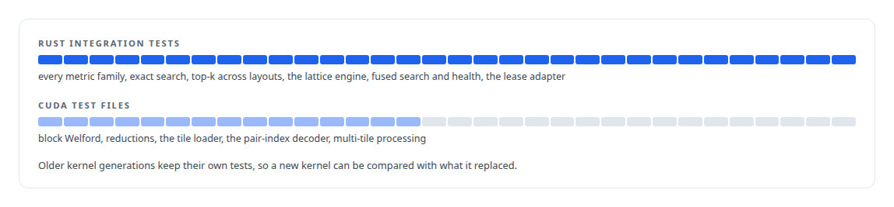

# Every metric gets a CPU twin

**Thirty-eight GPU cluster metrics defined by a nine-thousand-line CPU reference library, and a three-way consistency check between kernels, references and documentation**

Canonical: https://coreyjames.ai/stories/every-metric-gets-a-cpu-twin/  
Author: Corey James · Published: 2026-10-28 · Kind: story  
Systems: [Inference Fabric](https://github.com/coreyjames-ai/inference-fabric)  
Technologies: [CPU reference implementations and GPU equivalence testing](https://github.com/coreyjames-ai/portfolio/tree/main/technologies/cpu-reference-implementations-and-gpu-equivalence-testing) · [CUDA C++](https://github.com/coreyjames-ai/portfolio/tree/main/technologies/cuda-c-plus-plus) · [Cluster-health metrics on the GPU](https://github.com/coreyjames-ai/portfolio/tree/main/technologies/cluster-health-metrics-on-the-gpu) · [Determinism and numerical reproducibility](https://github.com/coreyjames-ai/portfolio/tree/main/technologies/determinism-and-numerical-reproducibility) · [GPU numerical kernel design](https://github.com/coreyjames-ai/portfolio/tree/main/technologies/gpu-numerical-kernel-design) · [Gaussian-kernel cluster analysis](https://github.com/coreyjames-ai/portfolio/tree/main/technologies/gaussian-kernel-cluster-analysis) · [ML evaluation methodology](https://github.com/coreyjames-ai/portfolio/tree/main/technologies/ml-evaluation-methodology) · [Rust](https://github.com/coreyjames-ai/portfolio/tree/main/technologies/rust) · [Streaming statistics in CUDA](https://github.com/coreyjames-ai/portfolio/tree/main/technologies/streaming-statistics-in-cuda) · [Tiled pairwise kernels](https://github.com/coreyjames-ai/portfolio/tree/main/technologies/tiled-pairwise-kernels)  
Skills: [Rust systems engineering](https://github.com/coreyjames-ai/portfolio/tree/main/skills/rust-systems-engineering) · [embedding analytics and cluster metrics](https://github.com/coreyjames-ai/portfolio/tree/main/skills/embedding-analytics-and-cluster-metrics) · [tool synthesis and governed API integration](https://github.com/coreyjames-ai/portfolio/tree/main/skills/tool-synthesis-and-governed-api-integration) · [AI-assisted engineering methodology](https://github.com/coreyjames-ai/portfolio/tree/main/skills/ai-assisted-engineering-methodology)  



## Result

| Figure | What it measures |
| --- | --- |
| **9,000** | lines of plain Rust that define every metric |
| **32** | Rust integration tests, plus fifteen CUDA test files |
| **3** | spectral metrics that exist only as the CPU reference |

## What was built

A GPU kernel that computes a statistic is a poor definition of that statistic. It is tuned for throughput and it reorders its reductions. So every metric my CUDA engine computes exists twice: once as a kernel and once as plain Rust on the CPU, and the CPU version is the definition. The reference library is about 9,000 lines across thirteen modules, cohesion, diversity, substructure, spatial, dual-space, quantum, spectral, sigma, composites, exact search and top-k among them. The kernels are checked against it, and the documentation is checked against both.

## What the twin is for

The reference is written for clarity, not speed, so a reader can confirm the formula by inspection. It is also where the edge cases are decided, and the kernel must match the reference on them.


Three metrics in the spectral family live only in the reference. They need the eigenvalues of a Gaussian Gram matrix, which caps them at 2,000 members, and until the kernel exists the CPU version is the metric.

## The tolerance



## The triangle

A kernel, its reference and its lineage file can each drift from the other two. The lineage file for every kernel group records the formula, the kernel, the Rust wrapper, the destination column in PostgreSQL, the edge-case conventions and the measured timings. A consistency matrix checks all three against each other for every group: GPU against CPU, CPU against the documented formula, documented formula against the GPU. Every group passes. When the check was first run it found the gaps it was built to find, including metric identifiers that meant different things in the database layer and in the kernels.

## Tests as the proof



## What this demonstrates

Numerical GPU code held to a written definition rather than to its own output. The reference library is the contract, the tolerance is derived from the arithmetic, and the consistency check keeps code, reference and documentation from drifting apart.

> When a kernel is wrong, it is wrong at speed.

## What was verified

Each line is a claim the canonical page supports, with the figure as the page states it.

- Numerical verification of GPU code: every GPU metric checked against a CPU reference, about 9,000 lines of plain Rust that defines each metric.
- Test engineering for CUDA: 32 Rust integration tests and fifteen CUDA test files, with tolerances derived from the arithmetic rather than tuned to pass.
- Deterministic GPU computation: search results held to zero tolerance by position tie-breaks and a seeded host-side draw.

## Related

- [Thirty-eight metrics in a dozen passes](https://github.com/coreyjames-ai/inference-fabric/tree/main/stories/thirty-eight-metrics-in-a-dozen-passes) · https://coreyjames.ai/stories/thirty-eight-metrics-in-a-dozen-passes/
- [Removing the sampling caps](https://github.com/coreyjames-ai/inference-fabric/tree/main/stories/removing-the-sampling-caps) · https://coreyjames.ai/stories/removing-the-sampling-caps/
- [Bit-identical across batch compositions](https://github.com/coreyjames-ai/capabilities-model/tree/main/stories/bit-identical-across-batch-compositions) · https://coreyjames.ai/stories/bit-identical-across-batch-compositions/
- [Proving a rewrite is the same system](https://github.com/coreyjames-ai/activekv/tree/main/stories/proving-a-rewrite-is-the-same-system) · https://coreyjames.ai/stories/proving-a-rewrite-is-the-same-system/

## Citation

Corey James. "Every metric gets a CPU twin." coreyjames.ai, 2026. https://coreyjames.ai/stories/every-metric-gets-a-cpu-twin/

```bibtex
@misc{coreyjames-every-metric-gets-a-cpu-twin,
  author = {Corey James},
  title = {Every metric gets a CPU twin},
  year = {2026},
  howpublished = {\url{https://coreyjames.ai/stories/every-metric-gets-a-cpu-twin/}},
  note = {GitHub copy: https://github.com/coreyjames-ai/inference-fabric/tree/main/stories/every-metric-gets-a-cpu-twin}
}
```

Part of [Inference Fabric](https://github.com/coreyjames-ai/inference-fabric) and [Corey James's portfolio](https://github.com/coreyjames-ai/portfolio) · site: https://coreyjames.ai/ · MCP server: https://coreyjames.ai/mcp · agent card: https://coreyjames.ai/.well-known/agent.json
