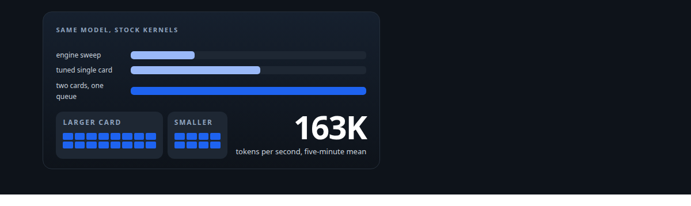
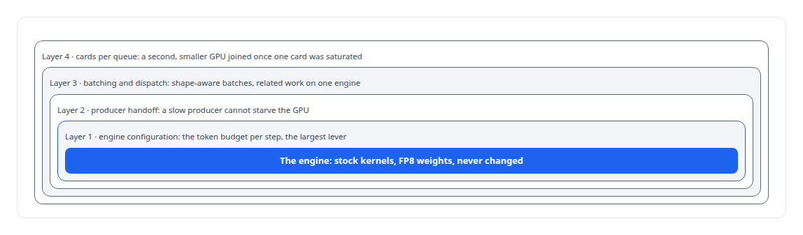
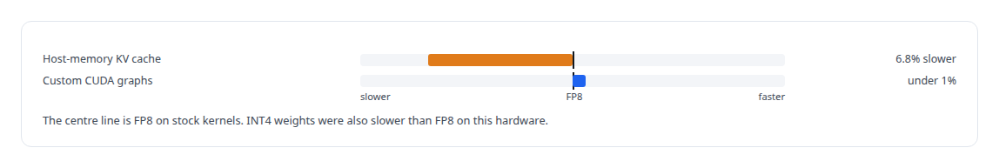
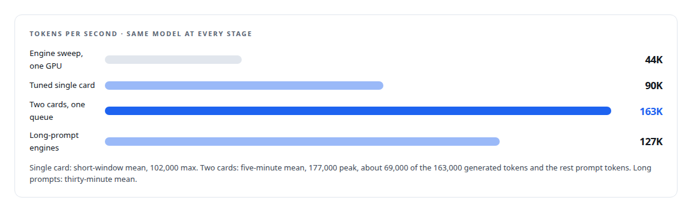

# From 44K to 163K tokens per second

**Raising one 7-billion-parameter model's throughput on consumer GPUs, one measured layer at a time**

Canonical: https://coreyjames.ai/stories/from-44k-to-163k-tokens-per-second/  
Author: Corey James · Published: 2026-10-28 · Kind: story  
Systems: [Inference Fabric](https://github.com/coreyjames-ai/inference-fabric)  
Technologies: [C++](https://github.com/coreyjames-ai/portfolio/tree/main/technologies/c-plus-plus) · [GPU admission control and co-residency](https://github.com/coreyjames-ai/portfolio/tree/main/technologies/gpu-admission-control-and-co-residency) · [GPU inference engine engineering](https://github.com/coreyjames-ai/portfolio/tree/main/technologies/gpu-inference-engine-engineering) · [Grafana](https://github.com/coreyjames-ai/portfolio/tree/main/technologies/grafana) · [Hidden-state extraction](https://github.com/coreyjames-ai/portfolio/tree/main/technologies/hidden-state-extraction) · [KV-cache engineering](https://github.com/coreyjames-ai/portfolio/tree/main/technologies/kv-cache-engineering) · [Model families and types](https://github.com/coreyjames-ai/portfolio/tree/main/technologies/model-families-and-types) · [Model quantization](https://github.com/coreyjames-ai/portfolio/tree/main/technologies/model-quantization) · [NVIDIA Blackwell GPUs](https://github.com/coreyjames-ai/portfolio/tree/main/technologies/nvidia-blackwell-gpus) · [NVIDIA Nsight Systems](https://github.com/coreyjames-ai/portfolio/tree/main/technologies/nvidia-nsight-systems) · [NVIDIA TensorRT-LLM](https://github.com/coreyjames-ai/portfolio/tree/main/technologies/nvidia-tensorrt-llm) · [Observability and alerting](https://github.com/coreyjames-ai/portfolio/tree/main/technologies/observability-and-alerting) · [Performance engineering and benchmarking](https://github.com/coreyjames-ai/portfolio/tree/main/technologies/performance-engineering-and-benchmarking) · [Prometheus](https://github.com/coreyjames-ai/portfolio/tree/main/technologies/prometheus) · [Rust](https://github.com/coreyjames-ai/portfolio/tree/main/technologies/rust) · [Token-aware GPU batch scheduling](https://github.com/coreyjames-ai/portfolio/tree/main/technologies/token-aware-gpu-batch-scheduling)  
Skills: [GPU inference optimisation](https://github.com/coreyjames-ai/portfolio/tree/main/skills/gpu-inference-optimisation) · [TensorRT and TensorRT-LLM engineering](https://github.com/coreyjames-ai/portfolio/tree/main/skills/tensorrt-and-tensorrt-llm-engineering) · [high-throughput batch inference](https://github.com/coreyjames-ai/portfolio/tree/main/skills/high-throughput-batch-inference) · [token-aware scheduling](https://github.com/coreyjames-ai/portfolio/tree/main/skills/token-aware-scheduling)  



## Result

| Figure | What it measures |
| --- | --- |
| **44K** | tokens per second from the clean engine sweep, the baseline |
| **4.95 M** | tasks in a ten-hour run on one GPU, zero retries |
| **96.9%** | streaming-multiprocessor use of the larger card in the two-card window |
| **3** | plausible ideas measured and dropped |

## What was built

Stock TensorRT-LLM, set up the obvious way, left most of a consumer GPU idle on bulk generation. I was building a pipeline that would generate and mine tens of millions of items, so idle capacity was the whole cost. I took one model, a 7-billion-parameter dense model in FP8, from about 44,000 tokens per second on a single NVIDIA Blackwell GPU to a five-minute mean of 163,000 across two NVIDIA Blackwell GPUs, with no custom model kernels. Each step was a change to one layer of the serving stack, measured before and after, and the changes that made things slower are on this page next to the ones that worked.

## The challenge

The ceiling was never the engine. It was everything around the engine: how work was fed to it, how batches were shaped, how producers and GPUs were coupled, and how many cards could share one queue.

## Constraints

The same model throughout, so the comparison means something. Consumer hardware, a Blackwell GPU and later a second, smaller Blackwell GPU, with no datacentre interconnect. No custom model kernels. And a dated capture behind every number.


## My approach

Change one layer at a time and measure it. I worked through four layers in order, with a dashboard that made each layer's effect visible, and I kept a table of everything that did not help.



## What I built

An engine tier sweep that found the largest single engine-side lever, the token budget the engine is allowed per step.

Producer decoupling, so the processes generating work are separated from the engine's consumption and a slow producer can never starve the GPU.

A shape-aware broker that groups requests by token geometry so batches waste almost no padding and the key-value cache is reused instead of rebuilt. The broker is its own story, [A message broker that understands tokens](https://coreyjames.ai/stories/a-message-broker-that-understands-tokens).

Cache-coherent dispatch, keeping related work on the same engine so that shared prefixes stay hot.

A second GPU on the same queue. Once the single-card path was saturated, a smaller Blackwell GPU joined the first as a second consumer, with the broker balancing between them.

Dashboards that made every step visible and gave me the captures this page is built from.

## Difficult decisions

Rejecting three plausible ideas on evidence. Each was tried, measured, written down and dropped.



Choosing the baseline honestly. A thirty-minute run on an early version of my own runtime had a stall bug. I do not use it as the baseline, because a depressed starting point would inflate the improvement. The baseline is the clean engine sweep.

## Results



The long-prompt run briefly touched readings above 250,000 across the two cards, and I report the thirty-minute mean. A separate ten-hour run on one Blackwell GPU held about 65,000 tokens per second.

## Technologies used

TensorRT-LLM · FP8 quantised inference · CUDA profiling with Nsight Systems · Prometheus and Grafana · Rust and C++ services · Token-geometry-aware batching · NVIDIA Blackwell GPUs

## What this demonstrates

A fixed model, one variable at a time, a capture for every number, and the failures published beside the wins. A single card's throughput doubled and a second card took the pair to 163,000, without touching a kernel. That is what disciplined systems work above the engine looks like.

TensorRT-LLM and the GPU drivers are NVIDIA's; the broker, runtime and dispatch design are mine.

> A throughput figure without its window and hardware is a rumour.

## What was verified

Each line is a claim the canonical page supports, with the figure as the page states it.

- GPU inference optimisation: a 7B dense model in FP8 taken from about 44,000 tokens per second on one NVIDIA Blackwell GPU to a five-minute mean of 163,000 across two, with no custom model kernels.
- TensorRT and TensorRT-LLM engineering: an engine tier sweep that found the token budget per step to be the largest engine-side lever, with a tuned single card at 90K tokens per second on stock kernels.
- Token-aware scheduling: a shape-aware broker with cache-coherent dispatch feeding a second Blackwell GPU on the same queue, the larger card at 96.9% streaming-multiprocessor use in the two-card window.
- High-throughput batch inference: producers decoupled from the engine so a slow producer can never starve the GPU, and 4.95 M tasks in a ten-hour run on one GPU with zero retries.
- Performance benchmarking methodology: one layer changed at a time against the clean engine sweep, not a stalled early run, with host-memory KV cache (6.8% slower) and custom CUDA graphs (under 1%) measured and dropped.
- LLM quantization: FP8 weights kept on stock kernels after INT4 weights measured slower than FP8 on this hardware.

## Related

- [A message broker that understands tokens](https://github.com/coreyjames-ai/inference-fabric/tree/main/stories/a-message-broker-that-understands-tokens) · https://coreyjames.ai/stories/a-message-broker-that-understands-tokens/
- [Millions of queued items that were not there](https://github.com/coreyjames-ai/inference-fabric/tree/main/stories/millions-of-queued-items-that-were-not-there) · https://coreyjames.ai/stories/millions-of-queued-items-that-were-not-there/
- [Trying the industrial path first](https://github.com/coreyjames-ai/capabilities-model/tree/main/stories/trying-the-industrial-path-first) · https://coreyjames.ai/stories/trying-the-industrial-path-first/
- [The workload that shaped the platform](https://github.com/coreyjames-ai/fafo-core/tree/main/stories/the-workload-that-shaped-the-platform) · https://coreyjames.ai/stories/the-workload-that-shaped-the-platform/

## Citation

Corey James. "From 44K to 163K tokens per second." coreyjames.ai, 2026. https://coreyjames.ai/stories/from-44k-to-163k-tokens-per-second/

```bibtex
@misc{coreyjames-from-44k-to-163k-tokens-per-second,
  author = {Corey James},
  title = {From 44K to 163K tokens per second},
  year = {2026},
  howpublished = {\url{https://coreyjames.ai/stories/from-44k-to-163k-tokens-per-second/}},
  note = {GitHub copy: https://github.com/coreyjames-ai/inference-fabric/tree/main/stories/from-44k-to-163k-tokens-per-second}
}
```

Part of [Inference Fabric](https://github.com/coreyjames-ai/inference-fabric) and [Corey James's portfolio](https://github.com/coreyjames-ai/portfolio) · site: https://coreyjames.ai/ · MCP server: https://coreyjames.ai/mcp · agent card: https://coreyjames.ai/.well-known/agent.json
