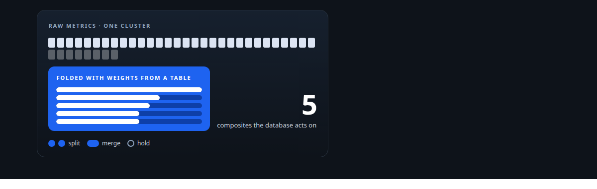
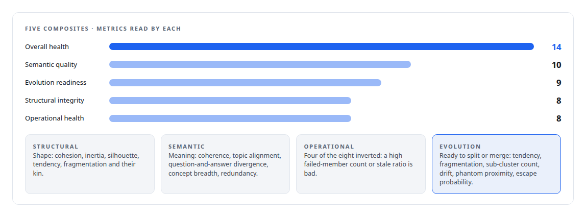
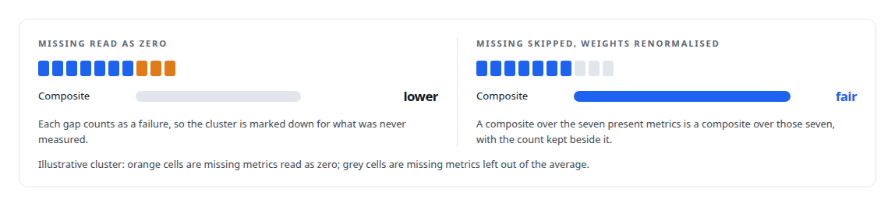
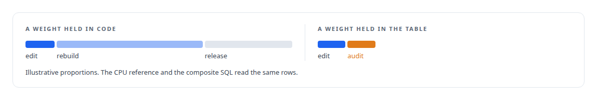
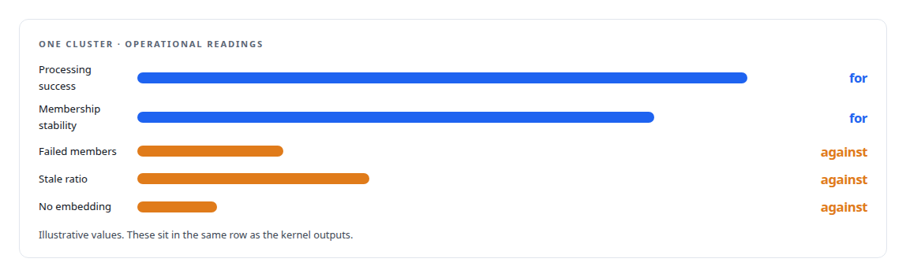
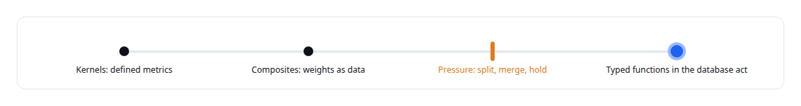

# From health scores to decisions

**Five composite scores built from the per-cluster metrics with weights that live in a database table, feeding the pressure model that decides what the corpus does next**

Canonical: https://coreyjames.ai/stories/from-health-scores-to-decisions/  
Author: Corey James · Published: 2026-10-28 · Kind: story  
DOI: https://doi.org/10.5281/zenodo.23735148 (this page is a chapter of the system's report)  
Systems: [Inference Fabric](https://github.com/coreyjames-ai/inference-fabric)  
Technologies: [CPU reference implementations and GPU equivalence testing](https://github.com/coreyjames-ai/portfolio/tree/main/technologies/cpu-reference-implementations-and-gpu-equivalence-testing) · [Cluster-health metrics on the GPU](https://github.com/coreyjames-ai/portfolio/tree/main/technologies/cluster-health-metrics-on-the-gpu) · [Gaussian-kernel cluster analysis](https://github.com/coreyjames-ai/portfolio/tree/main/technologies/gaussian-kernel-cluster-analysis) · [ML evaluation methodology](https://github.com/coreyjames-ai/portfolio/tree/main/technologies/ml-evaluation-methodology) · [PostgreSQL](https://github.com/coreyjames-ai/portfolio/tree/main/technologies/postgresql) · [Rust](https://github.com/coreyjames-ai/portfolio/tree/main/technologies/rust) · [SQL](https://github.com/coreyjames-ai/portfolio/tree/main/technologies/sql) · [Streaming statistics in CUDA](https://github.com/coreyjames-ai/portfolio/tree/main/technologies/streaming-statistics-in-cuda) · [Tiled pairwise kernels](https://github.com/coreyjames-ai/portfolio/tree/main/technologies/tiled-pairwise-kernels)  
Skills: [embedding analytics and cluster metrics](https://github.com/coreyjames-ai/portfolio/tree/main/skills/embedding-analytics-and-cluster-metrics) · [AI-assisted engineering methodology](https://github.com/coreyjames-ai/portfolio/tree/main/skills/ai-assisted-engineering-methodology) · [inference serving architecture](https://github.com/coreyjames-ai/portfolio/tree/main/skills/inference-serving-architecture)  



## Result

| Figure | What it measures |
| --- | --- |
| **38** | raw metrics per cluster, a diagnosis rather than a decision |
| **2,000** | members, above which the spectral metrics are left null |
| **1 row** | per composite and metric holds every weight |

## What was built

Thirty-eight metrics per cluster is a diagnosis. The decisions, split this cluster, merge those two, leave that one alone, are made inside the database by a pressure model, and the pressure model reads five composite scores rather than thirty-eight raw values. This is how the composites are built and why their weights are data rather than code.

## Five composites

Each composite is a weighted average over a named subset of the metrics, and each subset answers one question about the cluster.



## Skip-null averaging

A metric can be missing for a cluster: the spectral metrics above 2,000 members, a question-and-answer metric on a cluster with no pairs, a neighbourhood metric on a cluster with no neighbours yet. The averaging skips nulls and renormalises over the weights that are present, and the metric count that went into a composite is stored beside it.




## Weights in a table

The weights are authoritative in a PostgreSQL table, one row per composite and metric. The CPU reference reads them, the SQL that computes the composites in the database reads them, and changing a weight is a data change with an audit row rather than a release. The reason is practical: the right balance between structural and semantic signals is something I tune by looking at a corpus, and I wanted to tune it without rebuilding anything.



## Operational metrics beside the geometry

The operational metrics are about the cluster's life in the database rather than its geometry: membership stability, processing success rate, data completeness, failed and stale member counts, the ratio of members with no embedding, and hours since the last activity. They sit in the same row as the kernel outputs so a composite can weigh a cluster's shape and its health together.



## From score to action

The pressure model in [Redistribution inside the database](https://coreyjames.ai/stories/redistribution-inside-the-database) converts the composites and a few raw metrics into split, merge and hold pressures, and the typed Rust functions inside the database act on them. Every step is reproducible from the definition of the metric upward.



## What this demonstrates

Closing the loop from measurement to action with each layer kept honest: metrics defined by reference code, composites that skip what is missing instead of guessing, and weights held as audited data.

The composite design and the rule that weights are data were my decisions; the implementation was done by AI coding agents, a mix of frontier and open-source models, under my governance system.

> A composite that treated a missing value as zero would punish the cluster for the gap.

## What was verified

Each line is a claim the canonical page supports, with the figure as the page states it.

- Embedding analytics and cluster metrics: 38 raw metrics per cluster folded into five composite health scores that a pressure model reads to split, merge or hold a cluster.
- Robust scoring with missing data: skip-null averaging that renormalises over the weights present and stores the metric count beside each composite instead of reading a gap as zero.
- Configuration as audited data: composite weights held as one row per composite and metric in PostgreSQL, read by both the CPU reference and the SQL that computes the composites.
- Data-driven automation: typed functions inside the database act on split, merge and hold pressures derived from kernel metrics, every step reproducible from the metric definitions.

## Related

- [Redistribution inside the database](https://github.com/coreyjames-ai/fafo-core/tree/main/stories/redistribution-inside-the-database) · https://coreyjames.ai/stories/redistribution-inside-the-database/
- [Thirty-eight metrics in a dozen passes](https://github.com/coreyjames-ai/inference-fabric/tree/main/stories/thirty-eight-metrics-in-a-dozen-passes) · https://coreyjames.ai/stories/thirty-eight-metrics-in-a-dozen-passes/
- [Where a cluster sits](https://github.com/coreyjames-ai/inference-fabric/tree/main/stories/where-a-cluster-sits) · https://coreyjames.ai/stories/where-a-cluster-sits/

## Citation

Corey James. "From health scores to decisions." coreyjames.ai, 2026. https://coreyjames.ai/stories/from-health-scores-to-decisions/ In: the Inference Fabric technical report, doi:10.5281/zenodo.23735148.

```bibtex
@misc{coreyjames-from-health-scores-to-decisions,
  author = {Corey James},
  title = {From health scores to decisions},
  year = {2026},
  howpublished = {\url{https://coreyjames.ai/stories/from-health-scores-to-decisions/}},
  note = {GitHub copy: https://github.com/coreyjames-ai/inference-fabric/tree/main/stories/from-health-scores-to-decisions},
  doi = {10.5281/zenodo.23735148}
}
```

Part of [Inference Fabric](https://github.com/coreyjames-ai/inference-fabric) and [Corey James's portfolio](https://github.com/coreyjames-ai/portfolio) · site: https://coreyjames.ai/ · MCP server: https://coreyjames.ai/mcp · agent card: https://coreyjames.ai/.well-known/agent.json
