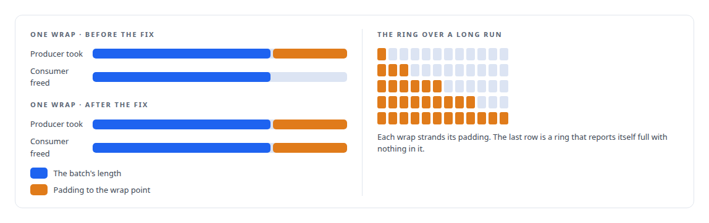
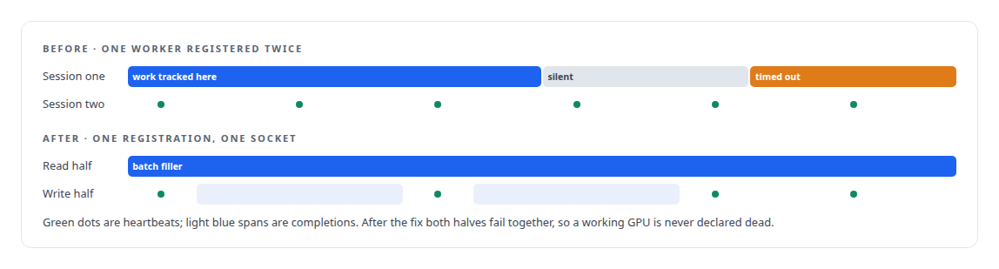
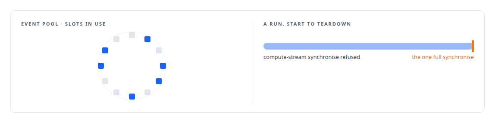

# Ghost bytes in a zero-copy ring

**A pinned-memory ring deadlocked with the GPU idle and hundreds of thousands of items in flight, because wrap-around padding was never freed; and a GPU worker that registered twice was starved as dead**

Canonical: https://coreyjames.ai/stories/ghost-bytes-in-a-zero-copy-ring/  
Author: Corey James · Published: 2026-10-28 · Kind: story  
DOI: https://doi.org/10.5281/zenodo.23735148 (this page is a chapter of the system's report)  
Systems: [Inference Fabric](https://github.com/coreyjames-ai/inference-fabric)  
Technologies: [C++](https://github.com/coreyjames-ai/portfolio/tree/main/technologies/c-plus-plus) · [Distributed-systems reliability](https://github.com/coreyjames-ai/portfolio/tree/main/technologies/distributed-systems-reliability) · [GPU memory management](https://github.com/coreyjames-ai/portfolio/tree/main/technologies/gpu-memory-management) · [Rust](https://github.com/coreyjames-ai/portfolio/tree/main/technologies/rust)  
Skills: [message broker and queue design](https://github.com/coreyjames-ai/portfolio/tree/main/skills/message-broker-and-queue-design) · [distributed systems correctness](https://github.com/coreyjames-ai/portfolio/tree/main/skills/distributed-systems-correctness) · [Intel GPU and SYCL/oneAPI engineering](https://github.com/coreyjames-ai/portfolio/tree/main/skills/intel-gpu-and-sycl-oneapi-engineering)  


## Result

| Figure | What it measures |
| --- | --- |
| **62,400** | items dispatched and unresolved when the ring stalled |
| **0** | pending tokens at that moment, with the GPU idle |
| **27** | tests covering the event pool's checks |

## What was built

Batches reach the GPU through a hot queue in pinned host memory: mapped, write-combined, pre-faulted pages holding a ring of batch descriptors, with a doorbell the producer rings to publish and the GPU waits on. No copies, no allocation after warm-up, and one accounting error that stopped two GPUs.

## The deadlock

When a batch does not fit before the end of the ring, the producer pads to the wrap point and writes the batch at the start. Every wrap left a few ghost bytes allocated and unreleasable, and over a long run they accumulated until the ring reported itself full with nothing in it, with a second consumer starving behind the first. The fix was a padding field on the descriptor that the acknowledgement adds back. One field, and the invariant that what the producer takes the consumer returns.



## One worker, one session

A second accounting error lived in the broker connection. Each GPU worker registered twice, once for batches and once for completions, which the broker saw as two consumers. Heartbeats arrived on one session while work was tracked on the other, the session with the work timed out, and working GPUs were declared dead and had their work reclaimed. The fix collapsed the two into one registration on one socket, with the rule that both halves fail together, so the broker's view of a consumer is one session that is either alive or gone. The broker's side of the same relationship is in [Recovery that trusts only what happened](https://coreyjames.ai/stories/recovery-that-trusts-only-what-happened).



## Streams and events, by rule

The same runtime keeps its CUDA streams on written rules that the code enforces rather than documents: synchronising a compute stream is refused at run time, any capture state on a managed stream is rejected, exactly one named function may synchronise everything and only at teardown, and events come from a pool with generation counters, bounds checks and an owner-thread check, covered by their own tests. Completions survive a broker outage: the worker keeps its finished work durably while the broker is away and hands it over when the connection returns.



## What this demonstrates


Both fixes were small, both invariants are now written down, and both appear as metrics.

The ring design and the single-session rule were mine; AI coding agents, a mix of frontier and open-source models, implemented the fixes under my governance system.

> Zero-copy and lock-free paths fail by accounting rather than by crashing, and the failures show up as a system that is quiet when it should be busy.

## What was verified

Each line is a claim the canonical page supports, with the figure as the page states it.

- Lock-free and zero-copy data paths: a pinned-memory ring between CPU and GPU deadlocked by wrap-around padding never released, fixed by a padding field the acknowledgement returns.
- Distributed systems debugging: a stall with 62,400 items dispatched and unresolved, 0 pending tokens and the GPU idle, traced to an accounting error rather than a crash.
- Message broker and queue design: each GPU worker registered once on one socket split into read and write halves that fail together, so working GPUs stop being declared dead.
- CUDA stream and event discipline: compute-stream synchronisation refused at run time and events drawn from a pool with generation counters and owner-thread checks, covered by 27 tests.

## Related

- [Recovery that trusts only what happened](https://github.com/coreyjames-ai/inference-fabric/tree/main/stories/recovery-that-trusts-only-what-happened) · https://coreyjames.ai/stories/recovery-that-trusts-only-what-happened/
- [Throughput that finished nothing](https://github.com/coreyjames-ai/inference-fabric/tree/main/stories/throughput-that-finished-nothing) · https://coreyjames.ai/stories/throughput-that-finished-nothing/
- [From 44K to 163K tokens per second](https://github.com/coreyjames-ai/inference-fabric/tree/main/stories/from-44k-to-163k-tokens-per-second) · https://coreyjames.ai/stories/from-44k-to-163k-tokens-per-second/

## Citation

Corey James. "Ghost bytes in a zero-copy ring." coreyjames.ai, 2026. https://coreyjames.ai/stories/ghost-bytes-in-a-zero-copy-ring/ In: the Inference Fabric technical report, doi:10.5281/zenodo.23735148.

```bibtex
@misc{coreyjames-ghost-bytes-in-a-zero-copy-ring,
  author = {Corey James},
  title = {Ghost bytes in a zero-copy ring},
  year = {2026},
  howpublished = {\url{https://coreyjames.ai/stories/ghost-bytes-in-a-zero-copy-ring/}},
  note = {GitHub copy: https://github.com/coreyjames-ai/inference-fabric/tree/main/stories/ghost-bytes-in-a-zero-copy-ring},
  doi = {10.5281/zenodo.23735148}
}
```

Part of [Inference Fabric](https://github.com/coreyjames-ai/inference-fabric) and [Corey James's portfolio](https://github.com/coreyjames-ai/portfolio) · site: https://coreyjames.ai/ · MCP server: https://coreyjames.ai/mcp · agent card: https://coreyjames.ai/.well-known/agent.json
