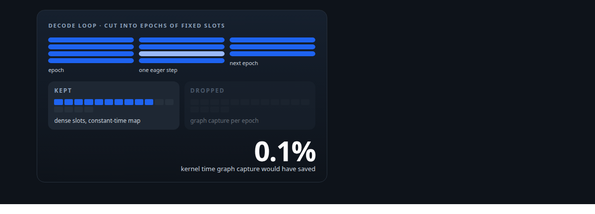
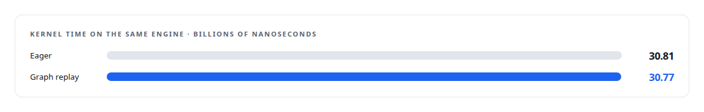
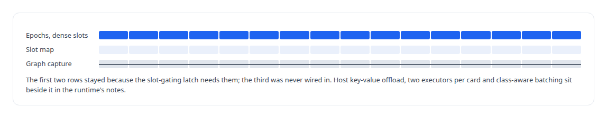

# Machinery I built and then did not need

**Fixed-size epochs and dense slots were built so decode steps could be captured as CUDA graphs; profiling showed the vendor's executor already does it. What I kept, what I stopped relying on, and the rule I took from it**

Canonical: https://coreyjames.ai/stories/machinery-i-built-and-then-did-not-need/  
Author: Corey James · Published: 2026-10-28 · Kind: story  
DOI: https://doi.org/10.5281/zenodo.23735148 (this page is a chapter of the system's report)  
Systems: [Inference Fabric](https://github.com/coreyjames-ai/inference-fabric)  
Technologies: [GPU memory management](https://github.com/coreyjames-ai/portfolio/tree/main/technologies/gpu-memory-management) · [NVIDIA TensorRT-LLM](https://github.com/coreyjames-ai/portfolio/tree/main/technologies/nvidia-tensorrt-llm) · [Performance engineering and benchmarking](https://github.com/coreyjames-ai/portfolio/tree/main/technologies/performance-engineering-and-benchmarking) · [Rust](https://github.com/coreyjames-ai/portfolio/tree/main/technologies/rust)  
Skills: [TensorRT and TensorRT-LLM engineering](https://github.com/coreyjames-ai/portfolio/tree/main/skills/tensorrt-and-tensorrt-llm-engineering) · [GPU inference optimisation](https://github.com/coreyjames-ai/portfolio/tree/main/skills/gpu-inference-optimisation) · [AI-assisted engineering methodology](https://github.com/coreyjames-ai/portfolio/tree/main/skills/ai-assisted-engineering-methodology) · [inference serving architecture](https://github.com/coreyjames-ai/portfolio/tree/main/skills/inference-serving-architecture)  



## Result

| Figure | What it measures |
| --- | --- |
| **−6.8%** | host key-value offload, set aside as a rejected idea |
| **−7.5%** | class-aware batching on average, also rejected |
| **−36%** | class-aware batching at peak |

## What was built

CUDA graphs capture a sequence of kernel launches once and replay it without launch overhead, and a decode loop that runs the same step hundreds of thousands of times looks like the ideal candidate. Capture has a condition, though: the shapes must be stable. So I built the machinery that would make the runtime's decode steps capturable.

## What was built

An epoch is a span of steps with a fixed number of active slots. Slots are dense, so a batch of a given size always has the same layout; the map from sequence to slot is a bit vector with constant-time lookup; and a change in key-value-cache bucket falls back to eager execution for that step without ending the epoch. The design was correct, tested, and ready for graphs to be captured per epoch and replayed.


## What the profile said

Before wiring capture in, I profiled graph execution against eager execution on the same engine.



The vendor's executor already captures and replays graphs internally, and the launch overhead I was going to remove had been removed before I started. The same profile, in [The thirteen percent that was never missing](https://coreyjames.ai/stories/the-thirteen-percent-that-was-never-missing), is the one that corrected a misread utilisation figure.

## What stayed

The epoch and slot machinery stayed, because it had a second job: slot integrity. A fixed slot count per epoch, dense slots and a constant-time map are what make the slot-gating latch in [Throughput that finished nothing](https://coreyjames.ai/stories/throughput-that-finished-nothing) cheap and exact. Graph capture was dropped as a lever, and the runtime's notes set the result beside the other rejected ideas.



## The rule


The epoch work cost days and bought slot integrity; the graph work it was built for would have cost more and bought a tenth of a percent. The notes are kept so the next person who looks at that decode loop and thinks of CUDA graphs can read why not.

## What this demonstrates

Engineering judgment applied to my own work: a sound design, a measurement that removed its reason, a decision to keep the part that still earned its place, and a written account of what was tried and why it stopped.

The decision to measure first and the disposition of the machinery were mine; AI coding agents, a mix of frontier and open-source models, built and profiled it under my governance system.

> Read the library before reimplementing it, and measure before building the thing the measurement would justify.

## What was verified

Each line is a claim the canonical page supports, with the figure as the page states it.

- GPU profiling and performance analysis: CUDA graph replay measured against eager execution before capture was wired in, kernel time 30.77 against 30.81 billion nanoseconds.
- TensorRT and TensorRT-LLM engineering: established that the vendor's executor already captures and replays graphs internally, so the planned graph-capture work was dropped.
- Inference runtime design: epochs with a fixed slot count, dense slots and a constant-time bit-vector slot map, kept for slot integrity after their first purpose went away.
- Performance benchmarking methodology: rejected ideas kept with their measurements, host key-value offload at -6.8% and class-aware batching at -7.5% on average and -36% at peak.

## Related

- [The thirteen percent that was never missing](https://github.com/coreyjames-ai/inference-fabric/tree/main/stories/the-thirteen-percent-that-was-never-missing) · https://coreyjames.ai/stories/the-thirteen-percent-that-was-never-missing/
- [Throughput that finished nothing](https://github.com/coreyjames-ai/inference-fabric/tree/main/stories/throughput-that-finished-nothing) · https://coreyjames.ai/stories/throughput-that-finished-nothing/
- [Trying the industrial path first](https://github.com/coreyjames-ai/capabilities-model/tree/main/stories/trying-the-industrial-path-first) · https://coreyjames.ai/stories/trying-the-industrial-path-first/

## Citation

Corey James. "Machinery I built and then did not need." coreyjames.ai, 2026. https://coreyjames.ai/stories/machinery-i-built-and-then-did-not-need/ In: the Inference Fabric technical report, doi:10.5281/zenodo.23735148.

```bibtex
@misc{coreyjames-machinery-i-built-and-then-did-not-need,
  author = {Corey James},
  title = {Machinery I built and then did not need},
  year = {2026},
  howpublished = {\url{https://coreyjames.ai/stories/machinery-i-built-and-then-did-not-need/}},
  note = {GitHub copy: https://github.com/coreyjames-ai/inference-fabric/tree/main/stories/machinery-i-built-and-then-did-not-need},
  doi = {10.5281/zenodo.23735148}
}
```

Part of [Inference Fabric](https://github.com/coreyjames-ai/inference-fabric) and [Corey James's portfolio](https://github.com/coreyjames-ai/portfolio) · site: https://coreyjames.ai/ · MCP server: https://coreyjames.ai/mcp · agent card: https://coreyjames.ai/.well-known/agent.json
