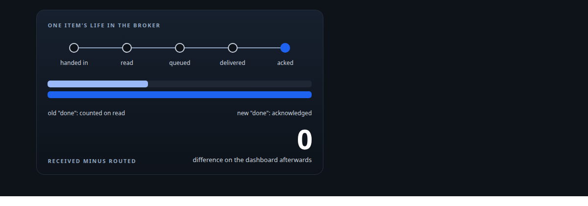
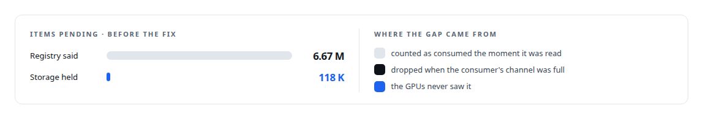
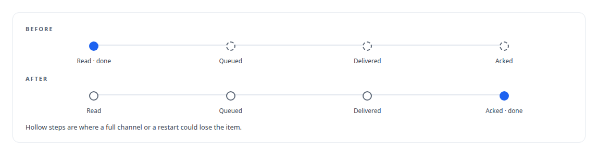
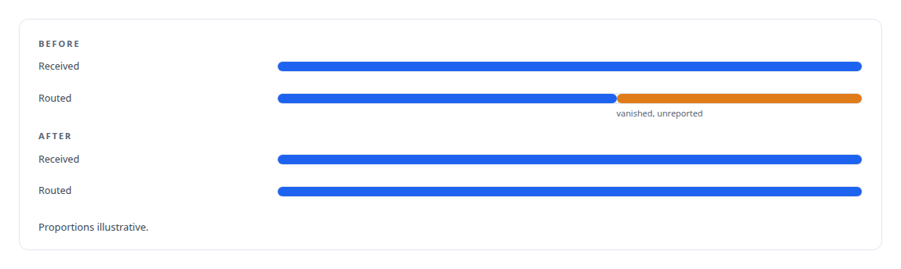

# Millions of queued items that were not there

**Fixing what 'done' meant in a GPU work broker until the token ledger balanced to zero**

Canonical: https://coreyjames.ai/stories/millions-of-queued-items-that-were-not-there/  
Author: Corey James · Published: 2026-10-28 · Kind: story  
Systems: [Inference Fabric](https://github.com/coreyjames-ai/inference-fabric)  
Technologies: [Append-only log and journal design](https://github.com/coreyjames-ai/portfolio/tree/main/technologies/append-only-log-and-journal-design) · [Binary wire protocol design](https://github.com/coreyjames-ai/portfolio/tree/main/technologies/binary-wire-protocol-design) · [Distributed-systems reliability](https://github.com/coreyjames-ai/portfolio/tree/main/technologies/distributed-systems-reliability) · [Grafana](https://github.com/coreyjames-ai/portfolio/tree/main/technologies/grafana) · [Idempotency, exactly-once effects and crash recovery](https://github.com/coreyjames-ai/portfolio/tree/main/technologies/idempotency-exactly-once-effects-and-crash-recovery) · [NVMe (cold-tier storage)](https://github.com/coreyjames-ai/portfolio/tree/main/technologies/nvme-cold-tier-storage) · [Observability and alerting](https://github.com/coreyjames-ai/portfolio/tree/main/technologies/observability-and-alerting) · [Prometheus](https://github.com/coreyjames-ai/portfolio/tree/main/technologies/prometheus) · [Rust](https://github.com/coreyjames-ai/portfolio/tree/main/technologies/rust) · [Token-aware GPU batch scheduling](https://github.com/coreyjames-ai/portfolio/tree/main/technologies/token-aware-gpu-batch-scheduling) · [systemd](https://github.com/coreyjames-ai/portfolio/tree/main/technologies/systemd)  
Skills: [exactly-once delivery and crash recovery](https://github.com/coreyjames-ai/portfolio/tree/main/skills/exactly-once-delivery-and-crash-recovery) · [observability and alerting](https://github.com/coreyjames-ai/portfolio/tree/main/skills/observability-and-alerting) · [distributed systems correctness](https://github.com/coreyjames-ai/portfolio/tree/main/skills/distributed-systems-correctness) · [message broker and queue design](https://github.com/coreyjames-ai/portfolio/tree/main/skills/message-broker-and-queue-design)  



## Result

| Figure | What it measures |
| --- | --- |
| **6.5 M** | items that had ceased to exist between handoff and GPU |
| **12.3 B** | tokens received afterwards, and the same routed |
| **2** | failures with one root: loss under load, duplicates after a restart |

## What was built

The broker's registry and its storage disagreed by millions of items. Somewhere between a producer handing work in and a GPU finishing it, that work had ceased to exist without a trace. I traced it to a definition: the broker counted an item as consumed the moment it was read, and dropped it if the consumer's channel happened to be full. I redefined "done" as acknowledged on completion, and rebuilt the accounting around that until received and routed agreed to the token.

## The challenge

Two problems with one root. Work disappeared under load and nothing reported it: the registry believed the items were pending, the storage no longer had them, and the GPUs had never seen them. And when the broker restarted it forgot what it had already dispatched while the GPU workers still held that work, so a restart risked running the same inference twice. The broker's idea of where work was did not match where work actually was.



## Constraints

A busy GPU fleet, so the fix had to go in under load. No distributed transactions and no shared state store on the hot path; the broker's speed came from having neither. Backward compatibility, because older consumers had to keep working against the new broker.

## My approach

Fix the semantics. An item is done when the result has been delivered and the receiver has acknowledged it. Everything else is in flight, and in-flight work must survive both a full channel and a restart.



## What I built

Accounting rebuilt around acknowledged completion, so a full channel delays work instead of losing it and a restart no longer re-runs work the GPUs already hold.

Accounting panels that show tokens received, routed, finished and acknowledged side by side, so a discrepancy is visible within seconds instead of after millions of items.

## Difficult decisions

Paying for bookkeeping on the read path. Completion-only retirement costs more at read time than retire-on-read.


Trusting evidence of what physically happened in recovery, and never the broker's own last known state.

Documenting the residual windows. There remain small windows where at-most-once delivery is possible. I did not pay for exactly-once semantics; I wrote down where the windows are.

## Results



## Technologies used

Rust · Append-only memory-mapped logs · TCP protocol design · Prometheus accounting panels

## What this demonstrates

I root-cause data loss in a custom distributed system from a quantified symptom, fix the definition that caused it rather than the place it showed up, and leave behind a balanced count and a written map of the risk that remains.

The recovery design is one of my filed inventions, described on the [research page](https://coreyjames.ai/research).

> The alternative was a system that was fast and occasionally lost millions of items.

## What was verified

Each line is a claim the canonical page supports, with the figure as the page states it.

- Exactly-once delivery and crash recovery: done redefined as delivered and acknowledged in a GPU work broker, so a full channel delays work and a restart leaves work held by GPU workers alone.
- Distributed systems correctness: 6.5 M items that had ceased to exist between handoff and GPU traced to one root, the broker's definition of done.
- Observability and alerting: accounting panels that show tokens received and routed side by side, 12.3 B of each afterwards with a difference of zero.

## Related

- [A message broker that understands tokens](https://github.com/coreyjames-ai/inference-fabric/tree/main/stories/a-message-broker-that-understands-tokens) · https://coreyjames.ai/stories/a-message-broker-that-understands-tokens/
- [From 44K to 163K tokens per second](https://github.com/coreyjames-ai/inference-fabric/tree/main/stories/from-44k-to-163k-tokens-per-second) · https://coreyjames.ai/stories/from-44k-to-163k-tokens-per-second/

## Citation

Corey James. "Millions of queued items that were not there." coreyjames.ai, 2026. https://coreyjames.ai/stories/millions-of-queued-items-that-were-not-there/

```bibtex
@misc{coreyjames-millions-of-queued-items-that-were-not-there,
  author = {Corey James},
  title = {Millions of queued items that were not there},
  year = {2026},
  howpublished = {\url{https://coreyjames.ai/stories/millions-of-queued-items-that-were-not-there/}},
  note = {GitHub copy: https://github.com/coreyjames-ai/inference-fabric/tree/main/stories/millions-of-queued-items-that-were-not-there}
}
```

Part of [Inference Fabric](https://github.com/coreyjames-ai/inference-fabric) and [Corey James's portfolio](https://github.com/coreyjames-ai/portfolio) · site: https://coreyjames.ai/ · MCP server: https://coreyjames.ai/mcp · agent card: https://coreyjames.ai/.well-known/agent.json
