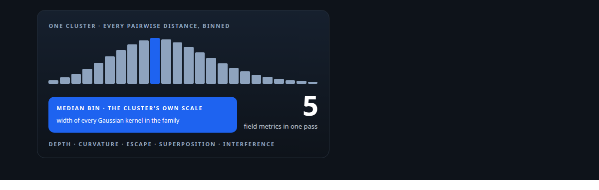
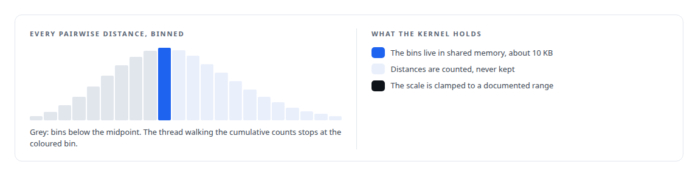
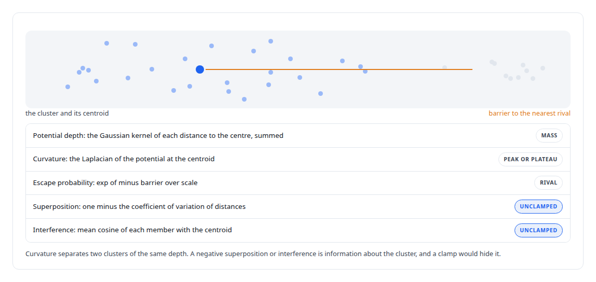
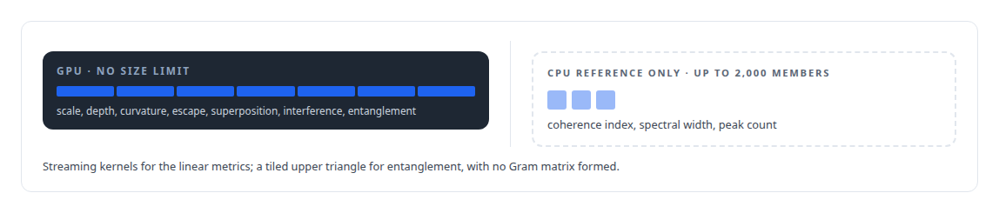

# Physics as a lens on embeddings

**A characteristic length scale from a histogram median, then potential depth, curvature, escape probability, superposition, interference and entanglement as cluster metrics**

Canonical: https://coreyjames.ai/stories/physics-as-a-lens-on-embeddings/  
Author: Corey James · Published: 2026-10-28 · Kind: story  
Systems: [Inference Fabric](https://github.com/coreyjames-ai/inference-fabric)  
Technologies: [CPU reference implementations and GPU equivalence testing](https://github.com/coreyjames-ai/portfolio/tree/main/technologies/cpu-reference-implementations-and-gpu-equivalence-testing) · [CUDA C++](https://github.com/coreyjames-ai/portfolio/tree/main/technologies/cuda-c-plus-plus) · [Cluster-health metrics on the GPU](https://github.com/coreyjames-ai/portfolio/tree/main/technologies/cluster-health-metrics-on-the-gpu) · [GPU numerical kernel design](https://github.com/coreyjames-ai/portfolio/tree/main/technologies/gpu-numerical-kernel-design) · [Gaussian-kernel cluster analysis](https://github.com/coreyjames-ai/portfolio/tree/main/technologies/gaussian-kernel-cluster-analysis) · [ML evaluation methodology](https://github.com/coreyjames-ai/portfolio/tree/main/technologies/ml-evaluation-methodology) · [Streaming statistics in CUDA](https://github.com/coreyjames-ai/portfolio/tree/main/technologies/streaming-statistics-in-cuda) · [Tiled pairwise kernels](https://github.com/coreyjames-ai/portfolio/tree/main/technologies/tiled-pairwise-kernels)  
Skills: [embedding analytics and cluster metrics](https://github.com/coreyjames-ai/portfolio/tree/main/skills/embedding-analytics-and-cluster-metrics) · [CUDA kernel development](https://github.com/coreyjames-ai/portfolio/tree/main/skills/cuda-kernel-development) · [AI-assisted engineering methodology](https://github.com/coreyjames-ai/portfolio/tree/main/skills/ai-assisted-engineering-methodology) · [GPU inference optimisation](https://github.com/coreyjames-ai/portfolio/tree/main/skills/gpu-inference-optimisation)  



## Result

| Figure | What it measures |
| --- | --- |
| **256** | histogram bins find each cluster's median distance |
| **0.4%** | resolution of the median, with no distance ever stored |
| **2,000** | member cap on the three spectral metrics, kept on the CPU |

## What was built

Distances between embeddings are the raw material of every cluster metric, and most metrics use them directly. I wanted a family that treated a cluster as a field: each member a point charge, the centroid a probe, and the shape of the resulting potential as the description of the cluster. The vocabulary is borrowed from physics, the formulas are plain Gaussian kernels, and the metrics turned out to say things the direct statistics do not.

## The length scale first

A Gaussian kernel needs a width, and a fixed width would make the metrics depend on the embedding model's scale. So each cluster gets its own characteristic scale: a constant times the median of its pairwise distances. The median of millions of distances is found without storing them. A tiled kernel bins every pairwise distance into a histogram in shared memory, and one thread walks the cumulative counts to the midpoint. Every metric in this family reads the result.



## Five metrics in one pass

With the centroid and its squared norm in shared memory, a streaming kernel computes five values in a single sweep over the members. Each asks a different question of the same field.



## Entanglement over pairs

Entanglement is the mean off-diagonal Gaussian kernel over all pairs of members, the one metric in the family that is quadratic. It runs as a tiled kernel over the upper triangle with the same tile machinery as the diversity family and never forms the Gram matrix.

## The three that stayed on the CPU

Three spectral metrics need the eigenvalues of the Gaussian Gram matrix: the coherence index, the largest eigenvalue over the trace; the spectral width, the eigenvalues' coefficient of variation; and the peak count above a threshold. They exist as CPU reference code with a hard limit, because the Gram matrix grows with the square of the member count.




## Why borrow the vocabulary

The names are a lens. Depth, curvature and escape probability are three different questions about the same cluster that a mean and a variance cannot separate: how much is at the centre, how sharply it falls away, and how close the nearest competitor is. Naming them after physical quantities keeps the questions distinct for the people reading the dashboards.

## What this demonstrates

Designing metrics with an explicit model behind them and the engineering to make them cheap: a scale derived per cluster without materialising its distances, five field metrics in one pass, a quadratic one bounded by tiling, and three left off the GPU until they can run without a hidden cap.

> I kept them out of the GPU count rather than put a kernel with a silent size limit on the card.

## What was verified

Each line is a claim the canonical page supports, with the figure as the page states it.

- Embedding analytics and cluster metrics: physics-style field metrics for embedding clusters, depth, curvature, escape probability, superposition and interference, computed in one streaming pass over the members.
- CUDA kernel development: each cluster's length scale found from a 256-bin shared-memory histogram of its pairwise distances, at 0.4% resolution with no distance ever stored.
- Quadratic GPU kernels without materialised matrices: entanglement computed over a tiled upper triangle of member pairs with no Gram matrix formed.
- Engineering judgment on GPU limits: three spectral metrics kept as CPU reference code with a 2,000-member cap rather than a GPU kernel with a silent size limit.

## Related

- [Thirty-eight metrics in a dozen passes](https://github.com/coreyjames-ai/inference-fabric/tree/main/stories/thirty-eight-metrics-in-a-dozen-passes) · https://coreyjames.ai/stories/thirty-eight-metrics-in-a-dozen-passes/
- [Where a cluster sits](https://github.com/coreyjames-ai/inference-fabric/tree/main/stories/where-a-cluster-sits) · https://coreyjames.ai/stories/where-a-cluster-sits/
- [Every metric gets a CPU twin](https://github.com/coreyjames-ai/inference-fabric/tree/main/stories/every-metric-gets-a-cpu-twin) · https://coreyjames.ai/stories/every-metric-gets-a-cpu-twin/

## Citation

Corey James. "Physics as a lens on embeddings." coreyjames.ai, 2026. https://coreyjames.ai/stories/physics-as-a-lens-on-embeddings/

```bibtex
@misc{coreyjames-physics-as-a-lens-on-embeddings,
  author = {Corey James},
  title = {Physics as a lens on embeddings},
  year = {2026},
  howpublished = {\url{https://coreyjames.ai/stories/physics-as-a-lens-on-embeddings/}},
  note = {GitHub copy: https://github.com/coreyjames-ai/inference-fabric/tree/main/stories/physics-as-a-lens-on-embeddings}
}
```

Part of [Inference Fabric](https://github.com/coreyjames-ai/inference-fabric) and [Corey James's portfolio](https://github.com/coreyjames-ai/portfolio) · site: https://coreyjames.ai/ · MCP server: https://coreyjames.ai/mcp · agent card: https://coreyjames.ai/.well-known/agent.json
