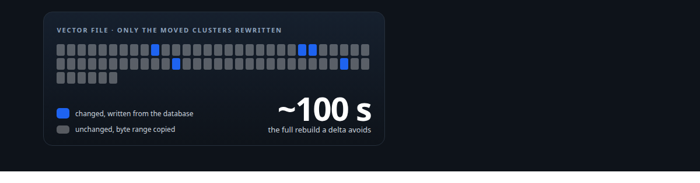
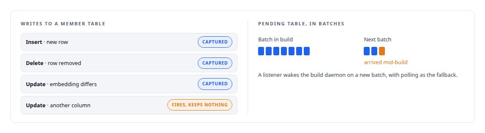
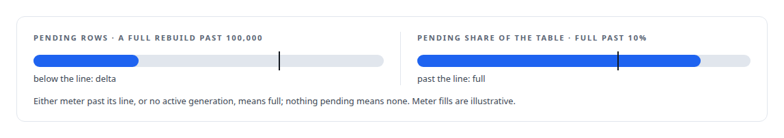
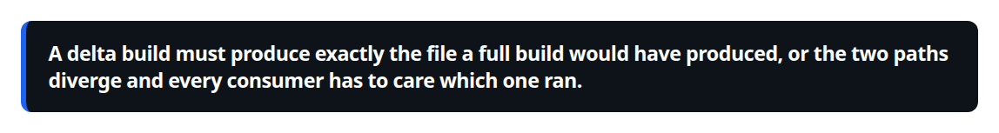
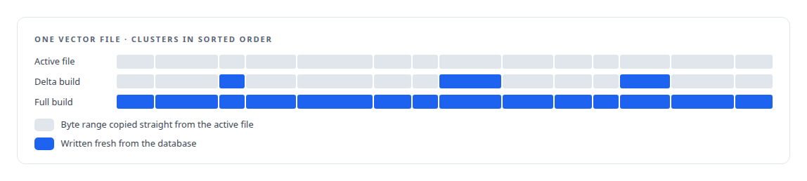
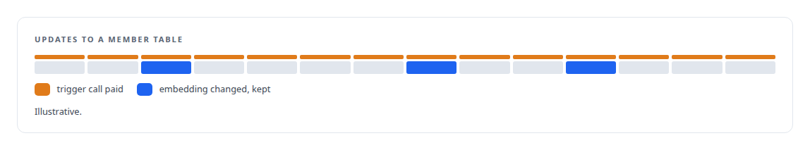

# Rebuild only what moved

**Column-scoped change capture, a rule that chooses a full or a delta rebuild from the size of the change and never from its age, and a segment merge whose output is byte-identical to a full rebuild**

Canonical: https://coreyjames.ai/stories/rebuild-only-what-moved/  
Author: Corey James · Published: 2026-10-28 · Kind: story  
DOI: https://doi.org/10.5281/zenodo.23735148 (this page is a chapter of the system's report)  
Systems: [Inference Fabric](https://github.com/coreyjames-ai/inference-fabric) · [PostgreSQL Fabric](https://github.com/coreyjames-ai/postgresql-fabric)  
Technologies: [Determinism and numerical reproducibility](https://github.com/coreyjames-ai/portfolio/tree/main/technologies/determinism-and-numerical-reproducibility) · [Large-scale GPU data pipelines](https://github.com/coreyjames-ai/portfolio/tree/main/technologies/large-scale-gpu-data-pipelines) · [PostgreSQL](https://github.com/coreyjames-ai/portfolio/tree/main/technologies/postgresql) · [Rust](https://github.com/coreyjames-ai/portfolio/tree/main/technologies/rust)  
Skills: [PostgreSQL performance tuning](https://github.com/coreyjames-ai/portfolio/tree/main/skills/postgresql-performance-tuning)  



## Result

| Figure | What it measures |
| --- | --- |
| **4 M** | rows of embeddings the GPU files are built from |
| **2** | paths, delta and full, that must write the same bytes |

## What was built

GPU workers read vectors from contiguous files on disk, built from the embedding columns of a relational database: one file of single-precision rows, one of identifiers, and for member vectors a table of offsets that maps each cluster to its range of rows. Rebuilding all of them because a few embeddings changed is a waste, and doing it on a schedule is worse, because age says nothing about whether an embedding is still correct.

## Capturing the change where it happens

A trigger on each member table captures inserts and deletes, and captures an update only when the embedding column is different from its old value. Changes land in a pending table and are grouped into batches, so nothing is lost between builds. An evaluation timer runs on its own cadence.



## Full or delta, by shape alone

The decision is a function in the database. There is no age term. A setting that would have forced a full rebuild after a fixed age exists in the configuration and is read by nothing, which is the honest state of a rule I decided against.



## A merge that reproduces the full build



The delta builder loads the active file's cluster offsets, fetches the identifiers of the clusters that changed, prefetches fresh rows for those clusters only, and then walks every cluster in sorted order. The output keeps the full build's ordering, cluster then row, so a delta build and a full build of the same data are the same bytes. The builder reports how much it copied and how much it regenerated.



## What the capture costs

The capture trigger is declared on every update of the member table, so its function-call overhead is paid even when no embedding changed; declaring it on the embedding column alone would avoid that.



## What this demonstrates

Incremental rebuilds designed around a correctness invariant, byte identity with the full build, with the decision rule kept simple and shape-based.

The byte-identity rule and the no-age decision were mine; AI coding agents, a mix of frontier and open-source models, implemented the capture and the merge under my governance system.

> A delta build must produce exactly the file a full build would have produced, or the two paths diverge and every consumer has to care which one ran.

## What was verified

Each line is a claim the canonical page supports, with the figure as the page states it.

- Change data capture in PostgreSQL: triggers that capture inserts, deletes and embedding changes into a pending table in batches, so nothing is lost between builds.
- Incremental index builds: a delta rebuild that copies unchanged cluster byte ranges and rewrites only changed clusters, producing the same bytes as a full rebuild over 4 M rows.
- Database-side decision logic: a SQL function choosing none, delta or full rebuild from the size of the change, full past 100,000 pending rows or 10% of the table, with no age term.
- PostgreSQL performance tuning: the capture trigger's per-update function-call overhead identified, with its column-scoped fix stated as open rather than implied away.

## Related

- [Three shards that move together](https://github.com/coreyjames-ai/inference-fabric/tree/main/stories/three-shards-that-move-together) · https://coreyjames.ai/stories/three-shards-that-move-together/
- [The database decides when an index goes stale](https://github.com/coreyjames-ai/inference-fabric/tree/main/stories/the-database-decides-when-an-index-goes-stale) · https://coreyjames.ai/stories/the-database-decides-when-an-index-goes-stale/
- [Twenty thousand rows a second](https://github.com/coreyjames-ai/postgresql-fabric/tree/main/stories/twenty-thousand-rows-a-second) · https://coreyjames.ai/stories/twenty-thousand-rows-a-second/

## Citation

Corey James. "Rebuild only what moved." coreyjames.ai, 2026. https://coreyjames.ai/stories/rebuild-only-what-moved/ In: the Inference Fabric technical report, doi:10.5281/zenodo.23735148.

```bibtex
@misc{coreyjames-rebuild-only-what-moved,
  author = {Corey James},
  title = {Rebuild only what moved},
  year = {2026},
  howpublished = {\url{https://coreyjames.ai/stories/rebuild-only-what-moved/}},
  note = {GitHub copy: https://github.com/coreyjames-ai/inference-fabric/tree/main/stories/rebuild-only-what-moved},
  doi = {10.5281/zenodo.23735148}
}
```

Part of [Inference Fabric](https://github.com/coreyjames-ai/inference-fabric) and [Corey James's portfolio](https://github.com/coreyjames-ai/portfolio) · site: https://coreyjames.ai/ · MCP server: https://coreyjames.ai/mcp · agent card: https://coreyjames.ai/.well-known/agent.json
