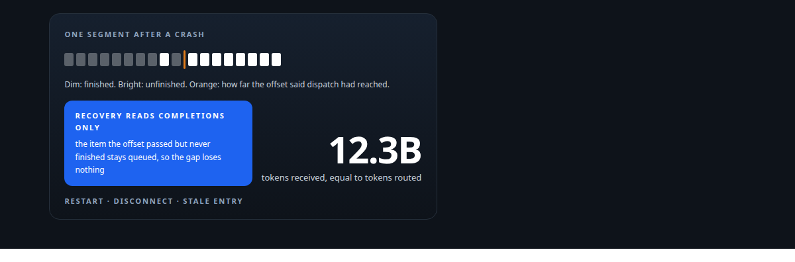
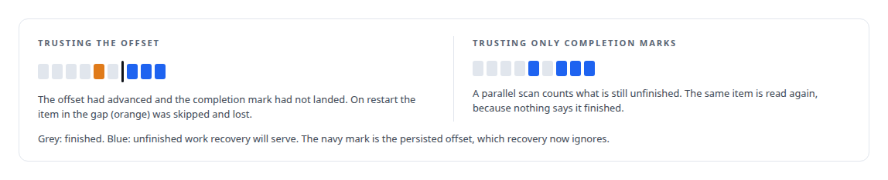
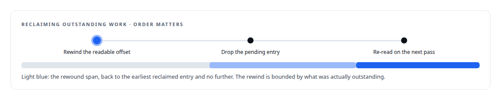
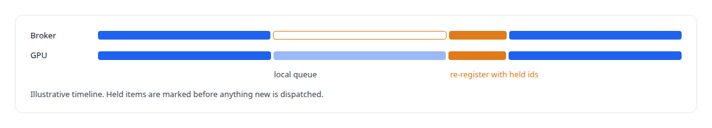
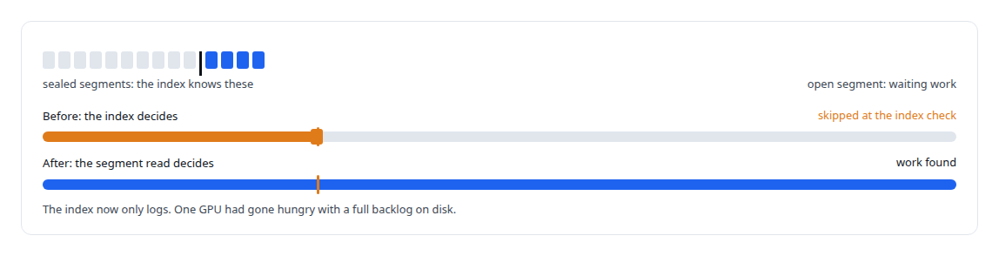
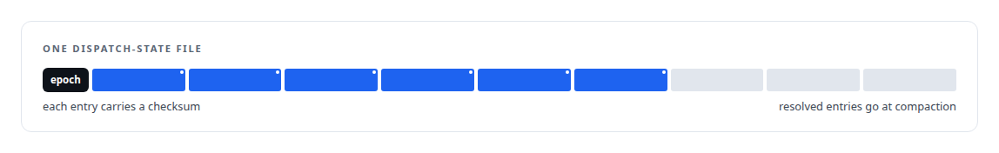

# Recovery that trusts only what happened

**Tombstones as the single source of truth, a parallel scan on restart, a stale entry rewound before it is forgotten, a reconnecting GPU that reports what it still holds, and advisory checks that may never decide**

Canonical: https://coreyjames.ai/stories/recovery-that-trusts-only-what-happened/  
Author: Corey James · Published: 2026-10-28 · Kind: story  
DOI: https://doi.org/10.5281/zenodo.23735148 (this page is a chapter of the system's report)  
Systems: [Inference Fabric](https://github.com/coreyjames-ai/inference-fabric)  
Technologies: [Append-only log and journal design](https://github.com/coreyjames-ai/portfolio/tree/main/technologies/append-only-log-and-journal-design) · [Distributed-systems reliability](https://github.com/coreyjames-ai/portfolio/tree/main/technologies/distributed-systems-reliability) · [Idempotency, exactly-once effects and crash recovery](https://github.com/coreyjames-ai/portfolio/tree/main/technologies/idempotency-exactly-once-effects-and-crash-recovery) · [Rust](https://github.com/coreyjames-ai/portfolio/tree/main/technologies/rust)  
Skills: [distributed systems correctness](https://github.com/coreyjames-ai/portfolio/tree/main/skills/distributed-systems-correctness) · [message broker and queue design](https://github.com/coreyjames-ai/portfolio/tree/main/skills/message-broker-and-queue-design)  



## Result

| Figure | What it measures |
| --- | --- |
| **3** | kinds of interruption, each once a path to loss or duplicate work |
| **1 rule** | recovery believes only what physically happened |
| **100 ms** | between tombstone flushes to disk |

## What was built

A broker that holds tens of millions of queued items on disk has to survive three kinds of interruption: its own restart, a GPU consumer disconnecting mid-batch, and an item that was admitted for dispatch and then never heard of again. Each of those had, at one point, a path to permanent loss or duplicate work. The design that closed them rests on one rule: recovery believes only evidence of events that physically happened, and nothing that was merely intended. The durability model behind it is one of my filed inventions, [Family Two](https://coreyjames.ai/research/family-two-durable-work-and-lossless-recovery/), and this is how it behaves in the broker.

## Tombstones are the truth

When a GPU completes an item, the broker writes a tombstone over that item's entry in its segment, then increments the segment header's deleted count, in that order. Tombstones are buffered and flushed about every hundred milliseconds, and a segment is removed when its deleted count reaches its entry count. On restart, recovery collects the segment paths and scans the segments in parallel, counting unfinished tokens per segment, and it deliberately ignores the committed offsets it had persisted.




## Rewind before you forget

An item that was admitted for dispatch but never written to a socket, or written but never finished, has to be reclaimed. A watchdog that simply deleted a stale pending entry would lose the item for good. The same rule governs a consumer disconnect: every item the consumer had in either state is collected and its dispatchable tokens are restored.



## A GPU that says what it still holds

The consumer SDK keeps the GPU working while the broker is away. A heartbeat thread watches the broker on a separate stateless port; while it is down the consumer carries on through its local queue, and reconnection uses exponential backoff. When it reconnects, it re-registers with the list of sequence ids it still holds, and the broker marks those as held before it dispatches anything new. Without that step a restarted broker re-sent work the GPU was already doing, and the same items ran twice. Sessions are keyed by a fresh identifier rather than a friendly name, after reconnects under the old scheme produced index mismatches, and timeouts stay disabled until the broker has finished loading, so a restart cannot declare healthy GPUs dead.



## Hints, never gates

One starvation bug taught a rule that now runs through the dispatch path. An advisory structure that can veto dispatch is a bug waiting for the case it does not model.



## The files that make it possible

Dispatch state is kept in append-only files with a header epoch, set at broker start so entries from an earlier life are ignored, and a checksum on every entry. Writes are synced in batches of thirty-two entries or a hundred milliseconds, and compaction rewrites a file without its resolved or duplicate entries. Those files serve disconnect handling while the broker runs; restart recovery uses tombstones alone.



## What this demonstrates

Durability designed from the failure cases outward, with a single source of truth, rewinds bounded by evidence, and a consumer that participates in its own recovery. The accounting result is in [Millions of queued items that were not there](https://coreyjames.ai/stories/millions-of-queued-items-that-were-not-there).

The recovery rules were my design; AI coding agents, a mix of frontier and open-source models, implemented them under my governance system.

> An offset says how far dispatch had reached; a tombstone says what was finished.

## What was verified

Each line is a claim the canonical page supports, with the figure as the page states it.

- Exactly-once delivery and crash recovery: restart recovery that believes only tombstones written by completions and ignores persisted offsets, so an item past the offset but unfinished is never lost.
- Distributed systems correctness: stale or disconnected work reclaimed by rewinding the readable offset before dropping the pending entry, the rewind bounded by what was outstanding.
- Resilient GPU consumers: a consumer SDK that keeps working while the broker is away and re-registers the sequence ids it still holds, ending duplicate work after reconnects.
- Message broker and queue design: an advisory index demoted to logging after it starved a GPU with a full backlog on disk; only the authoritative segment read decides.

## Related

- [Millions of queued items that were not there](https://github.com/coreyjames-ai/inference-fabric/tree/main/stories/millions-of-queued-items-that-were-not-there) · https://coreyjames.ai/stories/millions-of-queued-items-that-were-not-there/
- [Done means delivered](https://github.com/coreyjames-ai/inference-fabric/tree/main/stories/done-means-delivered) · https://coreyjames.ai/stories/done-means-delivered/
- [A message broker that understands tokens](https://github.com/coreyjames-ai/inference-fabric/tree/main/stories/a-message-broker-that-understands-tokens) · https://coreyjames.ai/stories/a-message-broker-that-understands-tokens/
- [Family Two: Durable work, tombstones and lossless recovery](https://github.com/coreyjames-ai/portfolio/tree/main/research/patent-families/family-two-durable-work-and-lossless-recovery) · https://coreyjames.ai/research/family-two-durable-work-and-lossless-recovery/

## Citation

Corey James. "Recovery that trusts only what happened." coreyjames.ai, 2026. https://coreyjames.ai/stories/recovery-that-trusts-only-what-happened/ In: the Inference Fabric technical report, doi:10.5281/zenodo.23735148.

```bibtex
@misc{coreyjames-recovery-that-trusts-only-what-happened,
  author = {Corey James},
  title = {Recovery that trusts only what happened},
  year = {2026},
  howpublished = {\url{https://coreyjames.ai/stories/recovery-that-trusts-only-what-happened/}},
  note = {GitHub copy: https://github.com/coreyjames-ai/inference-fabric/tree/main/stories/recovery-that-trusts-only-what-happened},
  doi = {10.5281/zenodo.23735148}
}
```

Part of [Inference Fabric](https://github.com/coreyjames-ai/inference-fabric) and [Corey James's portfolio](https://github.com/coreyjames-ai/portfolio) · site: https://coreyjames.ai/ · MCP server: https://coreyjames.ai/mcp · agent card: https://coreyjames.ai/.well-known/agent.json
