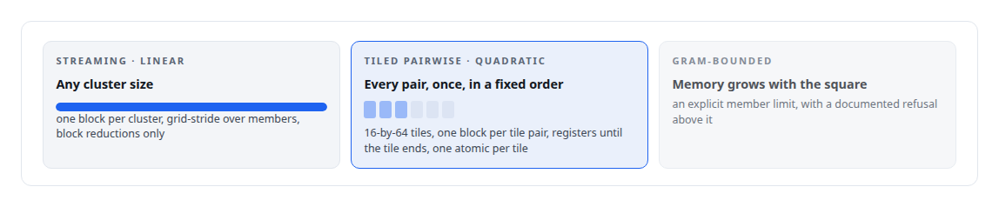
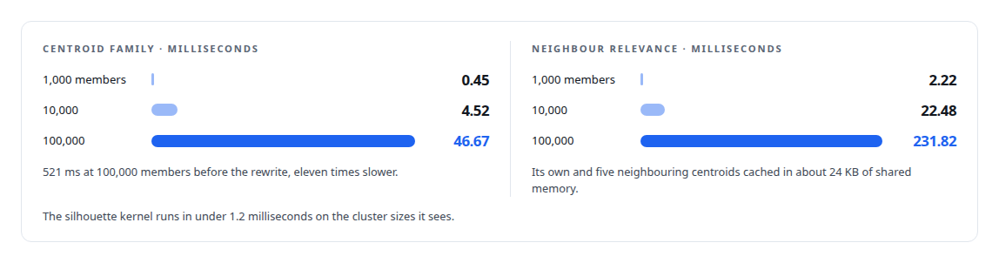

# Removing the sampling caps

**From kernels that looked at fifty members and twelve hundred pairs to exact statistics over a hundred thousand members, by redesigning every kernel into one of three scaling classes**

Canonical: https://coreyjames.ai/stories/removing-the-sampling-caps/  
Author: Corey James · Published: 2026-10-28 · Kind: story  
DOI: https://doi.org/10.5281/zenodo.23735148 (this page is a chapter of the system's report)  
Systems: [Inference Fabric](https://github.com/coreyjames-ai/inference-fabric)  
Technologies: [CPU reference implementations and GPU equivalence testing](https://github.com/coreyjames-ai/portfolio/tree/main/technologies/cpu-reference-implementations-and-gpu-equivalence-testing) · [CUDA C++](https://github.com/coreyjames-ai/portfolio/tree/main/technologies/cuda-c-plus-plus) · [Cluster-health metrics on the GPU](https://github.com/coreyjames-ai/portfolio/tree/main/technologies/cluster-health-metrics-on-the-gpu) · [GPU numerical kernel design](https://github.com/coreyjames-ai/portfolio/tree/main/technologies/gpu-numerical-kernel-design) · [Gaussian-kernel cluster analysis](https://github.com/coreyjames-ai/portfolio/tree/main/technologies/gaussian-kernel-cluster-analysis) · [NVIDIA Blackwell GPUs](https://github.com/coreyjames-ai/portfolio/tree/main/technologies/nvidia-blackwell-gpus) · [Performance engineering and benchmarking](https://github.com/coreyjames-ai/portfolio/tree/main/technologies/performance-engineering-and-benchmarking) · [Streaming statistics in CUDA](https://github.com/coreyjames-ai/portfolio/tree/main/technologies/streaming-statistics-in-cuda) · [Tiled pairwise kernels](https://github.com/coreyjames-ai/portfolio/tree/main/technologies/tiled-pairwise-kernels)  
Skills: [CUDA kernel development](https://github.com/coreyjames-ai/portfolio/tree/main/skills/cuda-kernel-development) · [embedding analytics and cluster metrics](https://github.com/coreyjames-ai/portfolio/tree/main/skills/embedding-analytics-and-cluster-metrics) · [GPU inference optimisation](https://github.com/coreyjames-ai/portfolio/tree/main/skills/gpu-inference-optimisation) · [AI-assisted engineering methodology](https://github.com/coreyjames-ai/portfolio/tree/main/skills/ai-assisted-engineering-methodology)  


## Result

| Figure | What it measures |
| --- | --- |
| **1,225** | pairs the old pairwise statistics were capped at |
| **2,000** | member limit for Gram-bounded kernels, refused above it |
| **6** | accumulator types in the shared tile library |
| **20** | legacy kernels kept, with sixteen tests against the references |

## What was built

The first generation of my cluster-metric kernels cheated, and I knew it. A cluster of a hundred thousand embeddings was scored from a sample of fifty members. The two-means split and the silhouette ran on fifty-member subsets. This is the story of taking every cap out.


## Why the caps were there

The early kernels were written one metric at a time, each with its own loop over members, each accumulating into global memory with atomics. At fifty members, contention on those atomics was invisible. At a hundred thousand it would have dominated, and a pairwise kernel over a hundred thousand members has five billion pairs. Sampling was the quick way to keep both problems out of sight.

## Three classes instead of one

The rewrite sorted every kernel into one of three scaling classes with a fixed shape each.



The tile loop runs with the dimension on the outside and the pair on the inside, so every thread reaches every barrier, and each kernel declares which accumulator it carries, so the loop stays the same.


## Removing atomics where they contended

Two kernels were rewritten with no atomics at all. The centroid kernel became three passes: a dimension-owning block reduction that writes each cluster's centroid once, a single sweep over the members that computes distances and norms into Welford accumulators, and a scan of the distance buffer for the sigma-threshold counts. The centroid it writes is reused by every downstream kernel. The two-means kernel keeps its assignments in a byte per member and its centroid update dimension-parallel, and runs at about half a million members per second, linearly.

## The numbers



## What was kept

The legacy kernels are still in the tree, with their tests against the CPU references, so a new kernel can be compared with the generation it replaced and a regression has a baseline to be measured against.

## What this demonstrates

A performance rewrite driven by a correctness goal. The caps were the shortcut, and taking them out meant choosing a scaling class for every statistic, bounding memory by design, and proving each kernel against a definition rather than against its faster self.

> The numbers came back fast and they were estimates of the thing I wanted rather than the thing itself.

## What was verified

Each line is a claim the canonical page supports, with the figure as the page states it.

- CUDA kernel development: every cluster-metric kernel sorted into three scaling classes, with Gram-bounded kernels refusing clusters above 2,000 members instead of sampling.
- Embedding analytics and cluster metrics: pairwise statistics once capped at 1,225 pairs computed on every pair, for clusters of up to 100,000 members.
- GPU performance engineering: a shared tile library with 6 accumulator types, and the centroid family at 46.67 ms for 100,000 members.
- Regression testing for kernels: 20 legacy kernels kept, with sixteen tests against the CPU references, so each rewrite has a baseline.

## Related

- [Thirty-eight metrics in a dozen passes](https://github.com/coreyjames-ai/inference-fabric/tree/main/stories/thirty-eight-metrics-in-a-dozen-passes) · https://coreyjames.ai/stories/thirty-eight-metrics-in-a-dozen-passes/
- [Every metric gets a CPU twin](https://github.com/coreyjames-ai/inference-fabric/tree/main/stories/every-metric-gets-a-cpu-twin) · https://coreyjames.ai/stories/every-metric-gets-a-cpu-twin/
- [Diversity in three kernels](https://github.com/coreyjames-ai/inference-fabric/tree/main/stories/diversity-in-three-kernels) · https://coreyjames.ai/stories/diversity-in-three-kernels/

## Citation

Corey James. "Removing the sampling caps." coreyjames.ai, 2026. https://coreyjames.ai/stories/removing-the-sampling-caps/ In: the Inference Fabric technical report, doi:10.5281/zenodo.23735148.

```bibtex
@misc{coreyjames-removing-the-sampling-caps,
  author = {Corey James},
  title = {Removing the sampling caps},
  year = {2026},
  howpublished = {\url{https://coreyjames.ai/stories/removing-the-sampling-caps/}},
  note = {GitHub copy: https://github.com/coreyjames-ai/inference-fabric/tree/main/stories/removing-the-sampling-caps},
  doi = {10.5281/zenodo.23735148}
}
```

Part of [Inference Fabric](https://github.com/coreyjames-ai/inference-fabric) and [Corey James's portfolio](https://github.com/coreyjames-ai/portfolio) · site: https://coreyjames.ai/ · MCP server: https://coreyjames.ai/mcp · agent card: https://coreyjames.ai/.well-known/agent.json
