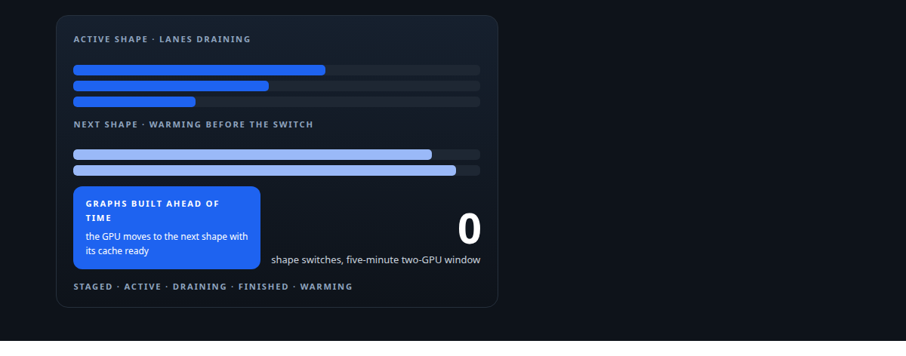
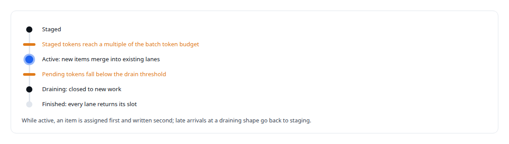
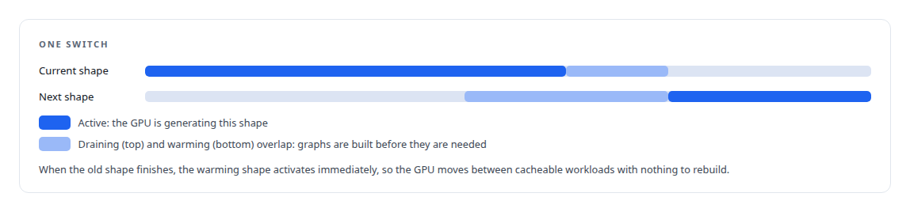
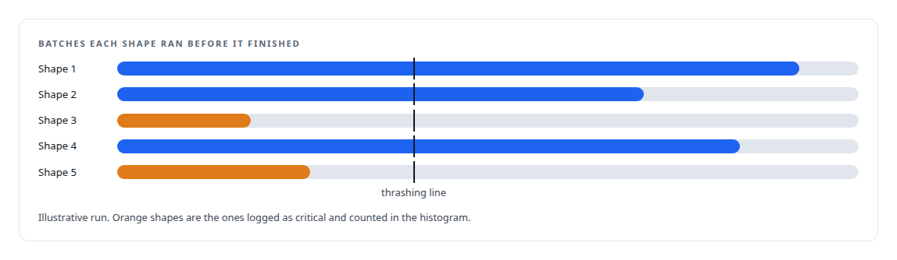
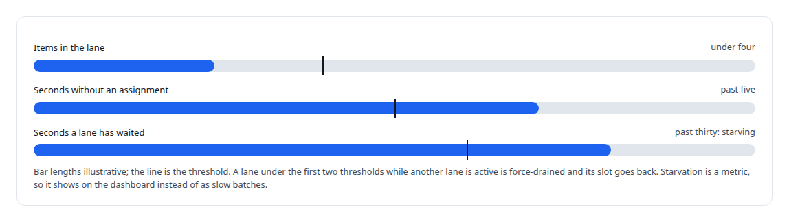

# Shapes have a lifecycle

**Every switch of prompt shape costs a GPU its prefix cache, so the broker stages a shape until it is worth running, warms the next one before the current one drains, and alarms when a shape ran too briefly**

Canonical: https://coreyjames.ai/stories/shapes-have-a-lifecycle/  
Author: Corey James · Published: 2026-10-28 · Kind: story  
Systems: [Inference Fabric](https://github.com/coreyjames-ai/inference-fabric)  
Technologies: [KV-cache engineering](https://github.com/coreyjames-ai/portfolio/tree/main/technologies/kv-cache-engineering) · [Rust](https://github.com/coreyjames-ai/portfolio/tree/main/technologies/rust) · [State-machine design for multi-agent workflows](https://github.com/coreyjames-ai/portfolio/tree/main/technologies/state-machine-design-for-multi-agent-workflows) · [Token-aware GPU batch scheduling](https://github.com/coreyjames-ai/portfolio/tree/main/technologies/token-aware-gpu-batch-scheduling)  
Skills: [observability and alerting](https://github.com/coreyjames-ai/portfolio/tree/main/skills/observability-and-alerting) · [GPU inference optimisation](https://github.com/coreyjames-ai/portfolio/tree/main/skills/gpu-inference-optimisation) · [token-aware scheduling](https://github.com/coreyjames-ai/portfolio/tree/main/skills/token-aware-scheduling) · [inference serving architecture](https://github.com/coreyjames-ai/portfolio/tree/main/skills/inference-serving-architecture)  



## Result

| Figure | What it measures |
| --- | --- |
| **5** | states every prompt shape moves through |
| **99.9%** | key-value hit rate in a five-minute two-GPU window |
| **100** | batches: a shape that finishes sooner is flagged as thrashing |

## What was built

A shape, in my broker, is a set of prompts that share the same ordered prefixes, which is what makes them cacheable together on the GPU. Switching from one shape to another throws away the engine's prefix cache and may force a rebuild of its CUDA graphs. A broker that interleaves shapes freely therefore pays that price constantly, and the engine spends its time rebuilding rather than generating. So shapes in my broker have a lifecycle, and the lifecycle is a state machine with thresholds, not a heuristic.

## Five states

A new shape is staged. Its items accumulate per signature, and nothing is dispatched, because opening lanes for a handful of items wastes structure the engine could use. Items that arrive for a shape that is already active are merged into its existing lanes one by one; an early version created a fresh shape object instead and orphaned the old lanes with their data.




## Warming the next shape

The expensive moment is the switch, so the broker prepares for it. When an active shape's pending tokens drop below a pre-warm threshold, the broker picks the staged shape with the most tokens above the activation threshold and marks it warming. Only one shape warms at a time. Consumers receive a pre-warm signal naming the shape and lane, and can build the CUDA graphs for it ahead of time in a cache keyed by lane and shape epoch. Every packed batch carries its shape epoch and a homogeneous output-token limit, so the engine can size its key-value allocation for the batch before it arrives.



## The thrashing alarm

A shape that finishes after fewer than a hundred batches did not run long enough to pay for its own switch. The broker logs that as a critical event and feeds a batches-per-shape histogram, so a workload whose shapes are too small to amortise shows up on the dashboard as a pattern rather than as mysteriously low throughput.



## What the lifecycle replaced

The first design cut static lane boundaries from a per-shape token histogram: 512 piecewise bins, percentile splits with interpolation, gap detection over runs of empty bins. It worked and it was rigid; rolling lanes replaced the static boundaries, and the histogram survives as per-shape statistics copied onto the shape at activation. Lanes themselves are recycled when they stop earning their slot.



## What this demonstrates

Treating the GPU's cache behaviour as a first-class scheduling constraint: the broker knows what a switch costs, stages work until the switch is worth it, prepares the engine before the switch happens, and reports when a workload defeats the design. The two-GPU result is told in [From 44K to 163K tokens per second](https://coreyjames.ai/stories/from-44k-to-163k-tokens-per-second).

The lifecycle and its thresholds were my design; AI coding agents, a mix of frontier and open-source models, implemented them under my governance system.

> Draining shapes never take new items, which is the invariant the whole design rests on.

## What was verified

Each line is a claim the canonical page supports, with the figure as the page states it.

- Token-aware scheduling: prompt shapes with a state-machine lifecycle, staged, active, draining and finished, so the GPU's prefix cache and CUDA graphs are rebuilt only when a switch is worth it.
- GPU inference optimisation: a pre-warm signal names the next shape and lane so graphs are built before the switch, with a 99.9% key-value hit rate in a five-minute two-GPU window.
- Observability and alerting: a thrashing alarm for any shape that finishes in fewer than 100 batches, and lane starvation counted as a metric rather than seen as slow batches.

## Related

- [A message broker that understands tokens](https://github.com/coreyjames-ai/inference-fabric/tree/main/stories/a-message-broker-that-understands-tokens) · https://coreyjames.ai/stories/a-message-broker-that-understands-tokens/
- [The 128-lane wall](https://github.com/coreyjames-ai/inference-fabric/tree/main/stories/the-128-lane-wall) · https://coreyjames.ai/stories/the-128-lane-wall/
- [From 44K to 163K tokens per second](https://github.com/coreyjames-ai/inference-fabric/tree/main/stories/from-44k-to-163k-tokens-per-second) · https://coreyjames.ai/stories/from-44k-to-163k-tokens-per-second/

## Citation

Corey James. "Shapes have a lifecycle." coreyjames.ai, 2026. https://coreyjames.ai/stories/shapes-have-a-lifecycle/

```bibtex
@misc{coreyjames-shapes-have-a-lifecycle,
  author = {Corey James},
  title = {Shapes have a lifecycle},
  year = {2026},
  howpublished = {\url{https://coreyjames.ai/stories/shapes-have-a-lifecycle/}},
  note = {GitHub copy: https://github.com/coreyjames-ai/inference-fabric/tree/main/stories/shapes-have-a-lifecycle}
}
```

Part of [Inference Fabric](https://github.com/coreyjames-ai/inference-fabric) and [Corey James's portfolio](https://github.com/coreyjames-ai/portfolio) · site: https://coreyjames.ai/ · MCP server: https://coreyjames.ai/mcp · agent card: https://coreyjames.ai/.well-known/agent.json
