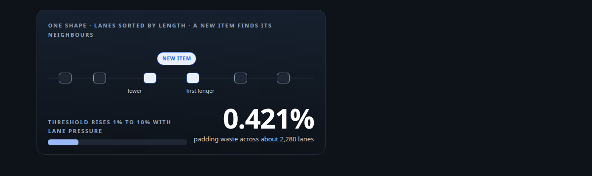
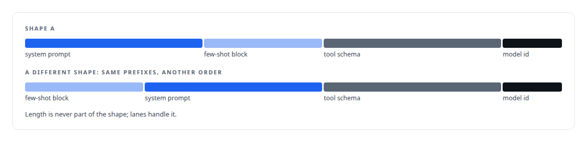
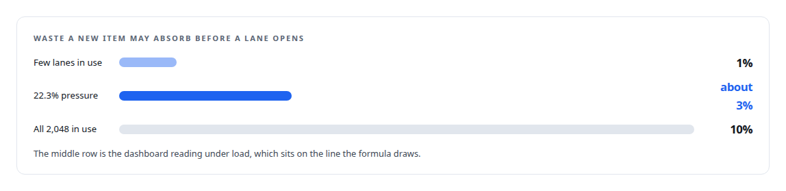
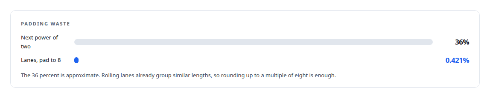

# Spend structure before spending waste

**The lane-packing algorithms that let a GPU broker pad 0.4 percent and keep two different cards at a 99.9 percent cache hit rate**

Canonical: https://coreyjames.ai/stories/spend-structure-before-spending-waste/  
Author: Corey James · Published: 2026-10-28 · Kind: story  
Systems: [Inference Fabric](https://github.com/coreyjames-ai/inference-fabric)  
Technologies: [Append-only log and journal design](https://github.com/coreyjames-ai/portfolio/tree/main/technologies/append-only-log-and-journal-design) · [NVIDIA Blackwell GPUs](https://github.com/coreyjames-ai/portfolio/tree/main/technologies/nvidia-blackwell-gpus) · [Rust](https://github.com/coreyjames-ai/portfolio/tree/main/technologies/rust) · [Token-aware GPU batch scheduling](https://github.com/coreyjames-ai/portfolio/tree/main/technologies/token-aware-gpu-batch-scheduling)  
Skills: [token-aware scheduling](https://github.com/coreyjames-ai/portfolio/tree/main/skills/token-aware-scheduling) · [message broker and queue design](https://github.com/coreyjames-ai/portfolio/tree/main/skills/message-broker-and-queue-design) · [distributed systems correctness](https://github.com/coreyjames-ai/portfolio/tree/main/skills/distributed-systems-correctness) · [GPU inference optimisation](https://github.com/coreyjames-ai/portfolio/tree/main/skills/gpu-inference-optimisation)  



## Result

| Figure | What it measures |
| --- | --- |
| **2,048** | rolling lanes per prompt shape |
| **17,800/s** | lane reuses, against 0.49 new lanes per second |
| **99.9%** | key-value cache hit rate on both cards |
| **12.3 B** | tokens received and the same routed, difference zero |

## What was built

Padding is the tax a GPU pays for batching sequences of different lengths, and cache misses are the tax it pays for mixing prompts that share nothing. A queue that moves bytes knows about neither. I built the broker in my inference pipeline to know about both, with a set of algorithms that decide, for every item, which batch it belongs in and when it goes.

## The problem

Two prompts can share a batch cheaply only if they share cacheable structure, the system prompt, the few-shot block, the tool schema, and have similar lengths. Length is cheap to read. Shared structure is not, and the broker must never parse prompts or know the model. Fixed power-of-two length buckets waste up to half of every bucket; fixed 64-token ranges either waste or fragment into hundreds of queues. And once a batch is packed, feeding the engine a different prompt shape than the last one flushes its prefix cache.

## Shape signatures

The producer knows the prompt template, so the producer declares the shape. When it builds a work item it hashes each cacheable component in order into a vector of 64-bit values, and the protocol reduces that vector to one 64-bit signature. The same prefixes in a different order are a different shape. The model is a separate id. Everywhere in the broker the key is the pair of model and signature, and nothing is shared across shapes: lane state, pressure and thresholds are local to one shape. Length is deliberately left out of the signature, so one shape can span many lengths without fragmenting the signature space. The broker stays content-blind and the cost is one hash per component at the producer.



## Rolling lanes

Within a shape, items still vary in length. Each shape keeps up to 2,048 rolling lanes, sorted by a target length, with a free list of released lane ids. Assigning an item is a binary search for the first lane whose target is at least the item's length, then a comparison of that lane and its lower neighbour on waste fraction. The decision to open a new lane depends on a threshold that moves with lane pressure: one percent waste when few lanes are in use, rising linearly to ten percent as the 2,048-lane budget fills. A new lane opens when the waste exceeds that threshold and is at least 16 tokens, or whenever the waste exceeds 128 tokens outright. Accepting an item into a lane can only raise the lane's target. At the lane cap, the item is force-fitted to its best lane.

The policy is in the title: when structure is cheap, be strict and spend it; as structure runs out, tolerate waste rather than run out of lanes. The 16-token floor stops lanes being opened for trivial waste on short prompts. The 128-token cap stops a long prompt from ever absorbing large padding just because its percentage looks small. A maintenance tick marks a lane quiescing when it has fewer than four items and has seen nothing for five seconds, drains it, and returns its id to the free list. Lanes are never merged, which keeps their identity stable for the on-disk layout.

The earlier budget was 128 lanes per shape. Under sustained load every shape hit full pressure and waste climbed without limit, so the budget went to 2,048.



## Packing to a four-integer contract

A consumer registers four numbers: the model, the maximum batch size, the maximum tokens per batch, and the maximum input length. The broker is math-only; it knows nothing else about either card or engine. In memory mode it drains one lane's queue in arrival order, computes a pad-to length as the queue's longest item rounded up to a multiple of eight tokens, and adds items until either the batch size or the padded-token budget is reached. The budget is in padded tokens because padded tokens are what reach the GPU. Overflow goes back to the front of the queue in its original order so another consumer sees it next.



I took input-length filtering out of the broker entirely. It stranded items no consumer would take and forced linear reads. Oversized items now reach the runtime, which returns them as empty completions.

## Shape-pure segments and sticky draining

On disk, segments are files keyed by model, shape and lane, so shape purity is a property of the storage layout rather than a filter applied at read time, and deletion is whole-file. The routing keys live once in the segment header. Open segments advance their readable boundary only after data is flushed, so a reader never sees unflushed bytes. There is no separate write-ahead log; the segment is the durable copy.

When a consumer asks for work, the broker stays on the shape it is currently draining as long as that shape has dispatchable tokens, and only then picks the shape with the most. Within a shape it tries lanes in descending token order. A hard guard checks every chunk's signature against the current shape and crashes the process on a mismatch.


The current shape is one field on the storage tier, so every consumer of a model drains the same shape at the same time, which is what keeps both cards' caches warm on shared prefixes.

## Dispatch that cannot lose work

Reads peek without advancing. A batch is committed only after the consumer's channel has taken it, in three steps: compute every segment's new boundary and check every segment exists before touching anything, then advance the per-segment cursors, then add each entry to a pending map keyed by segment and offset. The pending map is deliberately not persisted; on a crash its entries simply become available again. That verify-before-mutate order makes the commit failure-atomic without a transaction log. Completion is a four-byte tombstone written in place at the entry's offset, with the tombstone written before the segment's deleted count, so a crash between the two is repaired by a scan. Recovery reads only tombstones.

A separate fix bounded how long the single-owner dispatch loop could run before servicing heartbeats, after a fill of 3,099 batches blocked it for seventeen seconds and healthy GPUs were declared dead. The loop now yields after 100 milliseconds, and every socket error, not only end-of-file, counts as a disconnect.

## Results

Serving a 7-billion-parameter dense model in FP8 on two NVIDIA Blackwell GPUs, the broker never switched shapes mid-stream.

## What this demonstrates

Algorithm design driven by the economics of the hardware: the producer declares what only it knows, the broker schedules by what the GPU pays for, the storage layout enforces the invariant the engine needs, and every structure has a reason stated in the code.

> A poisoned cache is worse than a restart.

## What was verified

Each line is a claim the canonical page supports, with the figure as the page states it.

- Token-aware scheduling: shape signatures from ordered prefix hashes and 2,048 rolling lanes per shape, keeping two cards at a 99.9% key-value cache hit rate.
- Batch padding optimisation: a waste threshold that rises from one percent to ten percent with lane pressure, with a 16-token floor and a 128-token cap, for 0.421% padding.
- Message broker and queue design: lane reuse at 17,800/s against 0.49 new lanes per second, and 12.3 B tokens received and routed with a difference of zero.
- Distributed systems correctness: a dispatch loop that yields after 100 milliseconds, after a fill of 3,099 batches blocked heartbeats long enough for healthy GPUs to be declared dead.

## Related

- [A message broker that understands tokens](https://github.com/coreyjames-ai/inference-fabric/tree/main/stories/a-message-broker-that-understands-tokens) · https://coreyjames.ai/stories/a-message-broker-that-understands-tokens/
- [Millions of queued items that were not there](https://github.com/coreyjames-ai/inference-fabric/tree/main/stories/millions-of-queued-items-that-were-not-there) · https://coreyjames.ai/stories/millions-of-queued-items-that-were-not-there/
- [From 44K to 163K tokens per second](https://github.com/coreyjames-ai/inference-fabric/tree/main/stories/from-44k-to-163k-tokens-per-second) · https://coreyjames.ai/stories/from-44k-to-163k-tokens-per-second/

## Citation

Corey James. "Spend structure before spending waste." coreyjames.ai, 2026. https://coreyjames.ai/stories/spend-structure-before-spending-waste/

```bibtex
@misc{coreyjames-spend-structure-before-spending-waste,
  author = {Corey James},
  title = {Spend structure before spending waste},
  year = {2026},
  howpublished = {\url{https://coreyjames.ai/stories/spend-structure-before-spending-waste/}},
  note = {GitHub copy: https://github.com/coreyjames-ai/inference-fabric/tree/main/stories/spend-structure-before-spending-waste}
}
```

Part of [Inference Fabric](https://github.com/coreyjames-ai/inference-fabric) and [Corey James's portfolio](https://github.com/coreyjames-ai/portfolio) · site: https://coreyjames.ai/ · MCP server: https://coreyjames.ai/mcp · agent card: https://coreyjames.ai/.well-known/agent.json
