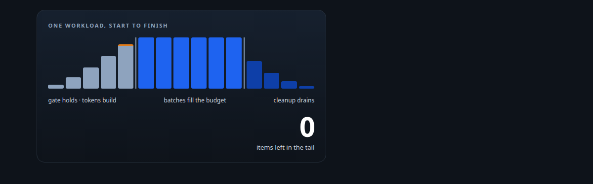
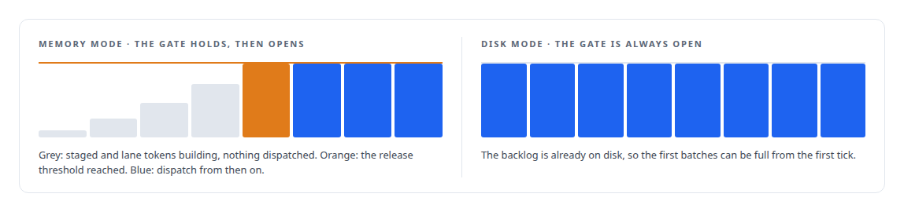
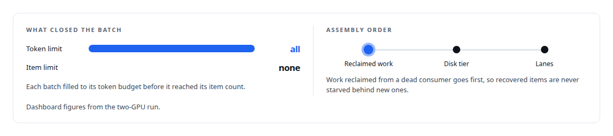
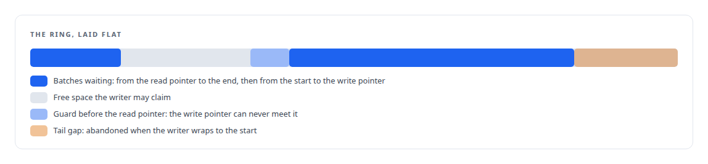
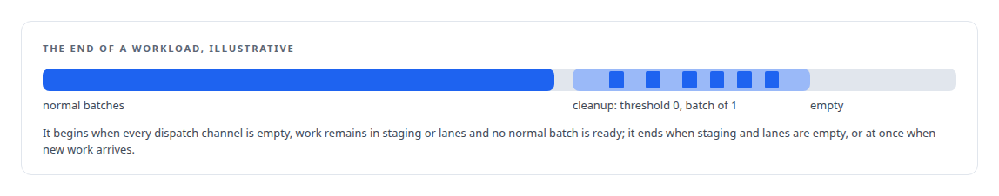

# Starting full and ending clean

**A pressure gate holds dispatch until the first batches can be good, every batch closes on its token budget, and a cleanup mode drains the tail when the GPUs go quiet**

Canonical: https://coreyjames.ai/stories/starting-full-and-ending-clean/  
Author: Corey James · Published: 2026-10-28 · Kind: story  
DOI: https://doi.org/10.5281/zenodo.23735148 (this page is a chapter of the system's report)  
Systems: [Inference Fabric](https://github.com/coreyjames-ai/inference-fabric)  
Technologies: [Performance engineering and benchmarking](https://github.com/coreyjames-ai/portfolio/tree/main/technologies/performance-engineering-and-benchmarking) · [Prometheus](https://github.com/coreyjames-ai/portfolio/tree/main/technologies/prometheus) · [Rust](https://github.com/coreyjames-ai/portfolio/tree/main/technologies/rust) · [Token-aware GPU batch scheduling](https://github.com/coreyjames-ai/portfolio/tree/main/technologies/token-aware-gpu-batch-scheduling)  
Skills: [high-throughput batch inference](https://github.com/coreyjames-ai/portfolio/tree/main/skills/high-throughput-batch-inference) · [token-aware scheduling](https://github.com/coreyjames-ai/portfolio/tree/main/skills/token-aware-scheduling) · [GPU inference optimisation](https://github.com/coreyjames-ai/portfolio/tree/main/skills/gpu-inference-optimisation) · [inference serving architecture](https://github.com/coreyjames-ai/portfolio/tree/main/skills/inference-serving-architecture)  



## Result

| Figure | What it measures |
| --- | --- |
| **523 µs** | average time to assemble a batch |
| **~100%** | batch fill at the median, the ninetieth and the ninety-ninth percentile |
| **4** | integers each GPU registers: batch size, tokens, input length, model |

## What was built

A batching broker is judged on its steady state, and its steady state is the easy part. The beginning and the end of a workload are where batches get small, caches get rebuilt and GPUs sit idle, and both needed their own mechanism.

## The release gate

At the start of a run, items trickle in. A broker that dispatches the first trickle produces tiny batches and poor graph reuse, and the engine spends its first minutes doing badly what it could do well a moment later. So nothing is dispatched until staged and lane tokens together reach a release threshold.




## Batches that fill to the budget

Packing follows the contract each GPU registered with. In memory mode the padded length of a batch is the longest item rounded up to eight tokens and the budget is counted in padded tokens; in disk mode it is counted in actual tokens. Input-length filtering was removed from the broker after it stranded items, and the runtime applies that limit itself. The ready-batch search scans lanes round-robin from the last lane served for an active lane holding at least the first consumer's batch size.



## On a single host, no copies

For consumers on the same host, batches go through a shared-memory ring on two-megabyte huge pages rather than a socket: a lock-free allocator with cache-line alignment and a compare-and-exchange loop to claim space. Batches are offset-addressed with no pointers, written with alignment safe for ARM, and mapped read-only by the consumer.



## Cleanup mode

At the end of a workload, staged shapes that never reached their activation threshold and lanes holding less than a full batch would otherwise sit forever.



Entries, duration, and batches and items dispatched in cleanup are metrics, so a run that spends too long in its tail is visible.

## What this demonstrates

Engineering the edges of a workload as deliberately as its middle: a start condition that guarantees good first batches, packing measured against its own budget rather than its item count, and an end state that drains to zero rather than leaving a tail behind.

The gate, the packing rules and cleanup mode were my design; AI coding agents, a mix of frontier and open-source models, implemented them under my governance system.

> Once open, the gate stays open for the life of the process; it is a start condition rather than a throttle.

## What was verified

Each line is a claim the canonical page supports, with the figure as the page states it.

- Token-aware scheduling: a release gate that holds dispatch until staged and lane tokens reach a threshold, so the first batches of a run are full.
- High-throughput batch inference: every batch in a two-GPU run closed on its token budget, at about 100% fill at the median and tail percentiles, assembled in 523 µs on average.
- Lock-free shared-memory IPC: same-host batches through a ring on huge pages with a compare-and-exchange claim loop, offset-addressed batches and read-only mapping by the consumer.
- Workload tail handling: a cleanup mode with activation threshold 0 and a minimum batch of 1 that drains staged shapes and short lanes when the GPUs go quiet.

## Related

- [A message broker that understands tokens](https://github.com/coreyjames-ai/inference-fabric/tree/main/stories/a-message-broker-that-understands-tokens) · https://coreyjames.ai/stories/a-message-broker-that-understands-tokens/
- [Shapes have a lifecycle](https://github.com/coreyjames-ai/inference-fabric/tree/main/stories/shapes-have-a-lifecycle) · https://coreyjames.ai/stories/shapes-have-a-lifecycle/
- [The 128-lane wall](https://github.com/coreyjames-ai/inference-fabric/tree/main/stories/the-128-lane-wall) · https://coreyjames.ai/stories/the-128-lane-wall/

## Citation

Corey James. "Starting full and ending clean." coreyjames.ai, 2026. https://coreyjames.ai/stories/starting-full-and-ending-clean/ In: the Inference Fabric technical report, doi:10.5281/zenodo.23735148.

```bibtex
@misc{coreyjames-starting-full-and-ending-clean,
  author = {Corey James},
  title = {Starting full and ending clean},
  year = {2026},
  howpublished = {\url{https://coreyjames.ai/stories/starting-full-and-ending-clean/}},
  note = {GitHub copy: https://github.com/coreyjames-ai/inference-fabric/tree/main/stories/starting-full-and-ending-clean},
  doi = {10.5281/zenodo.23735148}
}
```

Part of [Inference Fabric](https://github.com/coreyjames-ai/inference-fabric) and [Corey James's portfolio](https://github.com/coreyjames-ai/portfolio) · site: https://coreyjames.ai/ · MCP server: https://coreyjames.ai/mcp · agent card: https://coreyjames.ai/.well-known/agent.json
