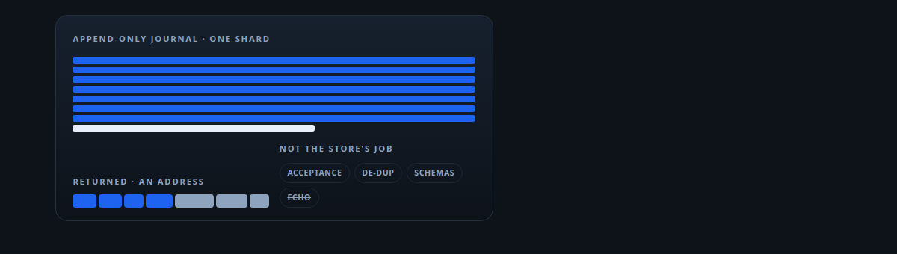
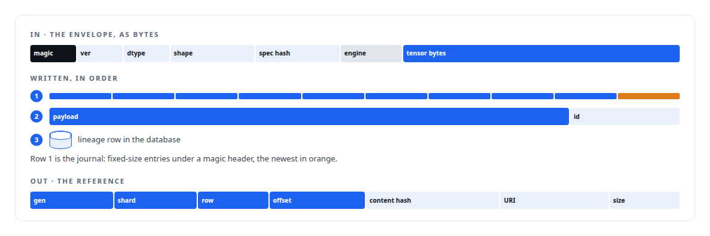
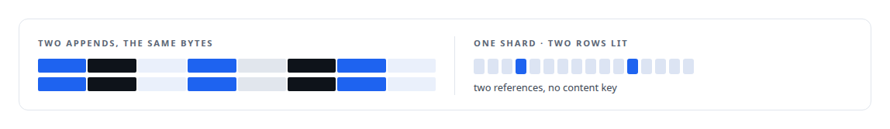
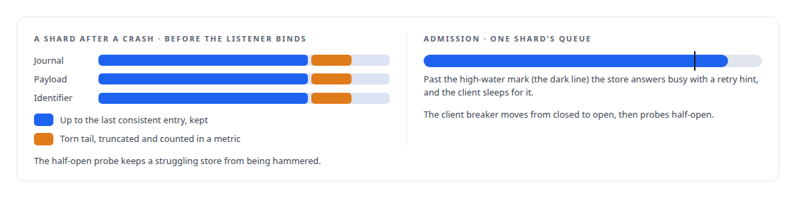

# Storage that refuses to become a coordinator

**A tensor store that appends, returns a stable address and knows nothing about its consumers; the coordinator tables it once had were removed and the boundary is enforced by checks in the build**

Canonical: https://coreyjames.ai/stories/storage-that-refuses-to-become-a-coordinator/  
Author: Corey James · Published: 2026-10-28 · Kind: story  
DOI: https://doi.org/10.5281/zenodo.23735148 (this page is a chapter of the system's report)  
Systems: [Inference Fabric](https://github.com/coreyjames-ai/inference-fabric)  
Technologies: [Append-only log and journal design](https://github.com/coreyjames-ai/portfolio/tree/main/technologies/append-only-log-and-journal-design) · [Binary wire protocol design](https://github.com/coreyjames-ai/portfolio/tree/main/technologies/binary-wire-protocol-design) · [Idempotency, exactly-once effects and crash recovery](https://github.com/coreyjames-ai/portfolio/tree/main/technologies/idempotency-exactly-once-effects-and-crash-recovery) · [Rust](https://github.com/coreyjames-ai/portfolio/tree/main/technologies/rust)  
Skills: [append-only log design](https://github.com/coreyjames-ai/portfolio/tree/main/skills/append-only-log-design) · [exactly-once delivery and crash recovery](https://github.com/coreyjames-ai/portfolio/tree/main/skills/exactly-once-delivery-and-crash-recovery) · [distributed systems correctness](https://github.com/coreyjames-ai/portfolio/tree/main/skills/distributed-systems-correctness) · [database admission control](https://github.com/coreyjames-ai/portfolio/tree/main/skills/database-admission-control)  



## Result

| Figure | What it measures |
| --- | --- |
| **4** | refusals the build checks for in the source |
| **~800** | lines of acceptance test holding the contract |

## What was built

The vector store under my research pipeline receives tensors from the extraction engines and the embedders and hands back an address. For a while it also tracked which consumers had accepted which payloads, de-duplicated by content, and answered questions about consumer schemas, because each of those was convenient for someone. I took them out and wrote the boundary down.


## What an append is

A producer sends an envelope. The store parses the envelope, recomputes the content hash over the tensor bytes, and checks the envelope's characteristics against the current generation; any mismatch is a hard reject. It writes a journal entry first, then the payload and the identifier, then a lineage row in the database, and the call returns a reference. Generations roll automatically on payload count, byte size or age, with the reason logged.



## What it refuses to be

The store does not de-duplicate, and the lineage hash over work item, specification and content is metadata, never a key. Those rules are enforced by checks in the build that fail if the forbidden patterns appear in the source, so the boundary survives the next person's convenience.



## Durability and admission

Before the listener binds, every shard that was being written when the daemon died is walked and its journal replayed. A per-shard lock serialises appends to one shard while other shards proceed.



## What this demonstrates

Knowing what a component is for and defending it: a store that does one thing durably, returns an address, and keeps coordination where coordination belongs, with the rules enforced mechanically rather than by review.

The boundary and the decision to remove the coordinator state were mine; AI coding agents, a mix of frontier and open-source models, implemented the store under my governance system.

> Every one of them made the store a coordinator, and a coordinator is a single point of contention and a second source of truth.

## What was verified

Each line is a claim the canonical page supports, with the figure as the page states it.

- Append-only log design: a tensor store that journals each append before payload and lineage and returns a stable address of generation, shard, row, offset and content hash.
- System boundary design: coordinator duties removed from a storage service, with 4 refusals enforced by build checks that fail if the forbidden patterns reappear.
- Exactly-once delivery and crash recovery: shards replayed and truncated to the last consistent journal entry before the listener binds, with torn tails counted in a metric.
- Backpressure and admission control: a high-water mark answering busy with a retry hint and a client circuit breaker with a half-open probe, held by an acceptance test of about 800 lines.

## Related

- [A detector for a silent corruption](https://github.com/coreyjames-ai/inference-fabric/tree/main/stories/a-detector-for-a-silent-corruption) · https://coreyjames.ai/stories/a-detector-for-a-silent-corruption/
- [Three shards that move together](https://github.com/coreyjames-ai/inference-fabric/tree/main/stories/three-shards-that-move-together) · https://coreyjames.ai/stories/three-shards-that-move-together/
- [Recovery that trusts only what happened](https://github.com/coreyjames-ai/inference-fabric/tree/main/stories/recovery-that-trusts-only-what-happened) · https://coreyjames.ai/stories/recovery-that-trusts-only-what-happened/

## Citation

Corey James. "Storage that refuses to become a coordinator." coreyjames.ai, 2026. https://coreyjames.ai/stories/storage-that-refuses-to-become-a-coordinator/ In: the Inference Fabric technical report, doi:10.5281/zenodo.23735148.

```bibtex
@misc{coreyjames-storage-that-refuses-to-become-a-coordinator,
  author = {Corey James},
  title = {Storage that refuses to become a coordinator},
  year = {2026},
  howpublished = {\url{https://coreyjames.ai/stories/storage-that-refuses-to-become-a-coordinator/}},
  note = {GitHub copy: https://github.com/coreyjames-ai/inference-fabric/tree/main/stories/storage-that-refuses-to-become-a-coordinator},
  doi = {10.5281/zenodo.23735148}
}
```

Part of [Inference Fabric](https://github.com/coreyjames-ai/inference-fabric) and [Corey James's portfolio](https://github.com/coreyjames-ai/portfolio) · site: https://coreyjames.ai/ · MCP server: https://coreyjames.ai/mcp · agent card: https://coreyjames.ai/.well-known/agent.json
