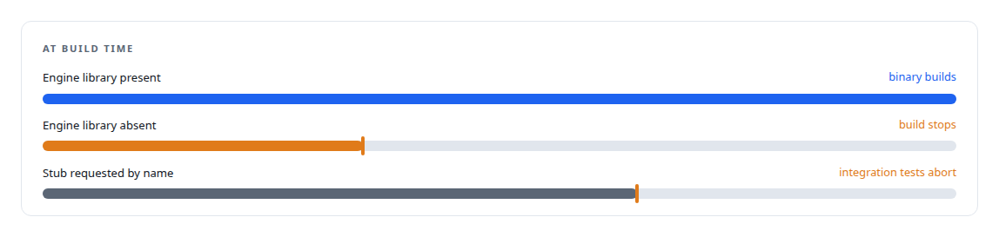
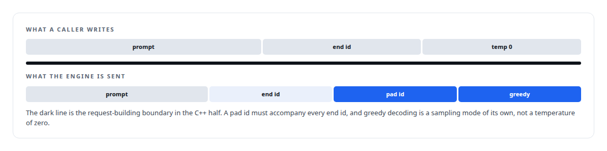
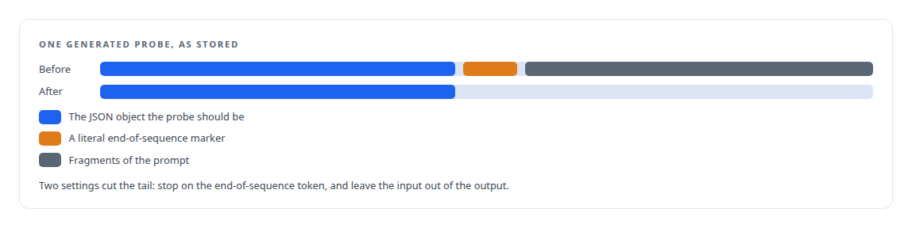

# Tests that passed without a GPU

**Stub builds returned fake tokens and every test went green; the build now refuses to produce a binary without the real engine library, and the generation contract was fixed at the engine boundary before a corpus was reused**

Canonical: https://coreyjames.ai/stories/tests-that-passed-without-a-gpu/  
Author: Corey James · Published: 2026-10-28 · Kind: story  
DOI: https://doi.org/10.5281/zenodo.23735148 (this page is a chapter of the system's report)  
Systems: [Inference Fabric](https://github.com/coreyjames-ai/inference-fabric)  
Technologies: [C++](https://github.com/coreyjames-ai/portfolio/tree/main/technologies/c-plus-plus) · [ML evaluation methodology](https://github.com/coreyjames-ai/portfolio/tree/main/technologies/ml-evaluation-methodology) · [NVIDIA TensorRT-LLM](https://github.com/coreyjames-ai/portfolio/tree/main/technologies/nvidia-tensorrt-llm) · [Rust](https://github.com/coreyjames-ai/portfolio/tree/main/technologies/rust) · [Static analysis as tests](https://github.com/coreyjames-ai/portfolio/tree/main/technologies/static-analysis-as-tests)  
Skills: [TensorRT and TensorRT-LLM engineering](https://github.com/coreyjames-ai/portfolio/tree/main/skills/tensorrt-and-tensorrt-llm-engineering) · [distributed systems correctness](https://github.com/coreyjames-ai/portfolio/tree/main/skills/distributed-systems-correctness) · [AI-assisted engineering methodology](https://github.com/coreyjames-ai/portfolio/tree/main/skills/ai-assisted-engineering-methodology) · [inference serving architecture](https://github.com/coreyjames-ai/portfolio/tree/main/skills/inference-serving-architecture)  


## Result

| Figure | What it measures |
| --- | --- |
| **65,462** | tokens in a rejected batch, under a 65,536-token limit |
| **148** | candidate sequences in that batch, nothing out of bounds |
| **159 M** | tokens dispatched upstream against an expected eight million |

## What was built

The inference runtime links a C++ library against the vendor's engine, and for a while the build could substitute a stub when the library was absent. The stub returned a fake token for every sequence, and the test suite passed against it. Two further bugs in the same period made the same point under real load.


## The build that refuses

The build script now refuses to produce a binary unless the real engine library is present, and stubs must be requested by name. The integration tests abort if they find themselves running against a stub. That turned a silent substitution into a loud one, and it is the reason every figure on the runtime's pages came from the hardware it names.



## Rejected batches

Under real load the vendor's executor rejected every batch with an invalid-argument error. Two contract details were wrong. Both were fixed at the request-building boundary in the C++ half, where the vendor's contract is translated, so no caller has to know either rule.



## Garbage after the JSON

The generated probes are a replay corpus: they are stored and run again, so what is in them matters more than how they were made. A sample showed text after each JSON object. Both causes were fixed before the corpus was reused. Had they not been, every replay would have carried the contamination forward.



## Over-dispatch upstream

One more defect sat above the runtime. The conductor that feeds the broker was over-dispatching, because of a budget function that never ran. The fix lives in the orchestration layer; the account lives beside the runtime, because the runtime is where the symptom appeared.


## What this demonstrates

The difference between a passing test and a proven system. The build, the request contract and the corpus each had a way to look correct without being correct, and each got a check that fails loudly at the boundary where the truth is known.

The fail-loud build rule and the corpus decision were mine; AI coding agents, a mix of frontier and open-source models, implemented the fixes under my governance system.

> A green suite that has never touched an engine is worse than no suite, because it says something true about the harness and nothing about the runtime.

## What was verified

Each line is a claim the canonical page supports, with the figure as the page states it.

- Test integrity for GPU software: a build that refuses to produce a binary without the real inference engine library, after a stub returning fake tokens let every test pass.
- TensorRT and TensorRT-LLM engineering: an executor rejecting every batch, 148 sequences and 65,462 tokens under a 65,536-token limit, fixed at the C++ request-building boundary.
- ML evaluation data hygiene: a replay corpus cleaned of end-of-sequence markers and prompt fragments before reuse, by stopping on the end-of-sequence token and excluding input from output.
- Distributed systems debugging: an upstream conductor dispatching 159 M tokens against an expected eight million, traced to a budget function imported and never called.

## Related

- [The workload that shaped the platform](https://github.com/coreyjames-ai/fafo-core/tree/main/stories/the-workload-that-shaped-the-platform) · https://coreyjames.ai/stories/the-workload-that-shaped-the-platform/
- [A second engine behind the same door](https://github.com/coreyjames-ai/inference-fabric/tree/main/stories/a-second-engine-behind-the-same-door) · https://coreyjames.ai/stories/a-second-engine-behind-the-same-door/
- [Engines for the card you have](https://github.com/coreyjames-ai/inference-fabric/tree/main/stories/engines-for-the-card-you-have) · https://coreyjames.ai/stories/engines-for-the-card-you-have/

## Citation

Corey James. "Tests that passed without a GPU." coreyjames.ai, 2026. https://coreyjames.ai/stories/tests-that-passed-without-a-gpu/ In: the Inference Fabric technical report, doi:10.5281/zenodo.23735148.

```bibtex
@misc{coreyjames-tests-that-passed-without-a-gpu,
  author = {Corey James},
  title = {Tests that passed without a GPU},
  year = {2026},
  howpublished = {\url{https://coreyjames.ai/stories/tests-that-passed-without-a-gpu/}},
  note = {GitHub copy: https://github.com/coreyjames-ai/inference-fabric/tree/main/stories/tests-that-passed-without-a-gpu},
  doi = {10.5281/zenodo.23735148}
}
```

Part of [Inference Fabric](https://github.com/coreyjames-ai/inference-fabric) and [Corey James's portfolio](https://github.com/coreyjames-ai/portfolio) · site: https://coreyjames.ai/ · MCP server: https://coreyjames.ai/mcp · agent card: https://coreyjames.ai/.well-known/agent.json
