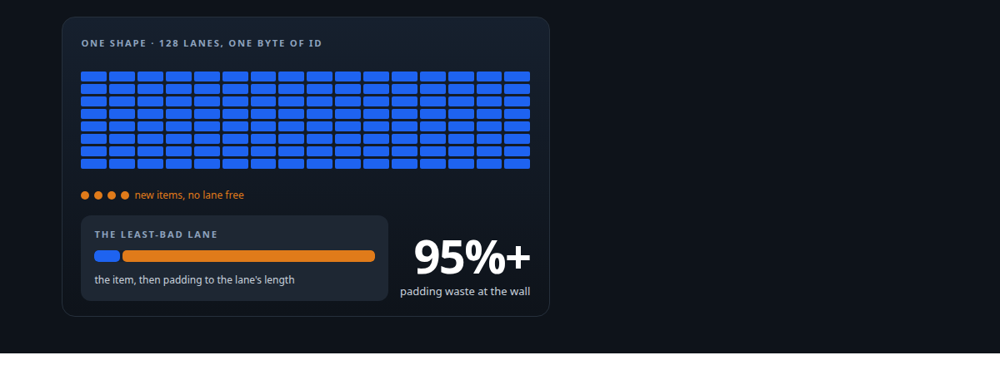
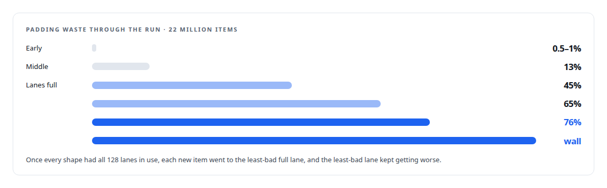
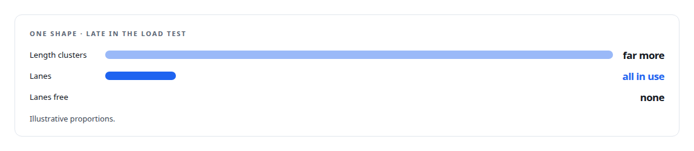
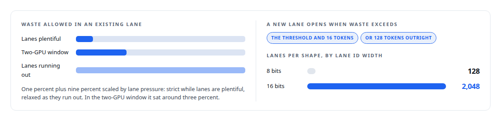
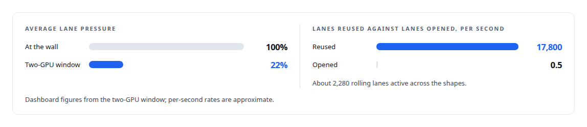

# The 128-lane wall

**Padding waste ran under one percent until every shape used all of its 128 lanes, then climbed past 95 percent on a 22-million-item load test; the fix was structural**

Canonical: https://coreyjames.ai/stories/the-128-lane-wall/  
Author: Corey James · Published: 2026-10-28 · Kind: story  
DOI: https://doi.org/10.5281/zenodo.23735148 (this page is a chapter of the system's report)  
Systems: [Inference Fabric](https://github.com/coreyjames-ai/inference-fabric)  
Technologies: [Capacity engineering, backpressure and load testing](https://github.com/coreyjames-ai/portfolio/tree/main/technologies/capacity-engineering-backpressure-and-load-testing) · [Performance engineering and benchmarking](https://github.com/coreyjames-ai/portfolio/tree/main/technologies/performance-engineering-and-benchmarking) · [Rust](https://github.com/coreyjames-ai/portfolio/tree/main/technologies/rust) · [Token-aware GPU batch scheduling](https://github.com/coreyjames-ai/portfolio/tree/main/technologies/token-aware-gpu-batch-scheduling)  
Skills: [token-aware scheduling](https://github.com/coreyjames-ai/portfolio/tree/main/skills/token-aware-scheduling) · [GPU inference optimisation](https://github.com/coreyjames-ai/portfolio/tree/main/skills/gpu-inference-optimisation) · [AI-assisted engineering methodology](https://github.com/coreyjames-ai/portfolio/tree/main/skills/ai-assisted-engineering-methodology) · [vLLM internals](https://github.com/coreyjames-ai/portfolio/tree/main/skills/vllm-internals)  



## Result

| Figure | What it measures |
| --- | --- |
| **10B** | tokens in the 22-million-item load test that found the wall |
| **0.421%** | padding waste in the two-GPU window after the fix |
| **8** | phases of changes to widen the lane id |

## What was built

My broker packs prompts of similar length into lanes so that a batch pads as little as possible. Each lane has a target length, items go to the lane that wastes the least, and a new lane opens when the waste would be too high. The first version gave each shape 128 lanes, because the lane id was a byte and 128 seemed like plenty. A load test showed exactly what plenty was worth.

## The curve

As the run went on, every shape reached a hundred percent lane pressure, meaning every one of its 128 lanes was in use and no new lane could open. The broker was doing exactly what it was designed to do: with no lane free, it assigned each item to the least-bad existing lane, and the least-bad lane was eventually terrible. Throughput did not fall gracefully. It collapsed, because the GPU was spending nearly all of its work on padding.



## Why it was structural

The assignment algorithm was choosing correctly among the lanes it had. The budget was the problem. A workload with ten billion tokens has far more than 128 distinct length clusters per shape, and once the lanes were exhausted the algorithm had no good move left.




## The fix

The lane id became sixteen bits and the budget grew with it. With the budget raised, the threshold logic could do its job. Lane targets only grow, so an item never lands in a lane that has shrunk beneath it.



## The result

The budget is large enough that pressure never approaches the wall, and the threshold stays near its strict end.



## What this demonstrates

Reading a performance collapse correctly. The symptom was waste, the tempting fix was the waste threshold, and the cause was a capacity limit that the algorithm could not work around. Raising the budget by an order of magnitude and letting the pressure-scaled threshold operate turned a collapse into a sub-one-percent steady state, told alongside the broader spend analysis in [Spend structure before spending waste](https://coreyjames.ai/stories/spend-structure-before-spending-waste).

The diagnosis and the decision to widen the budget were mine; AI coding agents, a mix of frontier and open-source models, implemented the programme under my governance system.

> Tuning the waste threshold could not help, because the threshold only decides when to open a lane, and no lane could be opened.

## What was verified

Each line is a claim the canonical page supports, with the figure as the page states it.

- Performance diagnosis: traced padding waste of 95%+ on a 22-million-item load test to a structural budget of 128 lanes per shape, a capacity limit that no threshold tuning could fix.
- Token-aware scheduling: widened the lane id to 16 bits across 8 phases of changes, raising the budget to 2,048 lanes so the pressure-scaled waste threshold could work.
- GPU inference optimisation: padding waste at 0.421% in the two-GPU window after the fix, with average lane pressure at 22% instead of 100%.

## Related

- [A message broker that understands tokens](https://github.com/coreyjames-ai/inference-fabric/tree/main/stories/a-message-broker-that-understands-tokens) · https://coreyjames.ai/stories/a-message-broker-that-understands-tokens/
- [Shapes have a lifecycle](https://github.com/coreyjames-ai/inference-fabric/tree/main/stories/shapes-have-a-lifecycle) · https://coreyjames.ai/stories/shapes-have-a-lifecycle/
- [Spend structure before spending waste](https://github.com/coreyjames-ai/inference-fabric/tree/main/stories/spend-structure-before-spending-waste) · https://coreyjames.ai/stories/spend-structure-before-spending-waste/

## Citation

Corey James. "The 128-lane wall." coreyjames.ai, 2026. https://coreyjames.ai/stories/the-128-lane-wall/ In: the Inference Fabric technical report, doi:10.5281/zenodo.23735148.

```bibtex
@misc{coreyjames-the-128-lane-wall,
  author = {Corey James},
  title = {The 128-lane wall},
  year = {2026},
  howpublished = {\url{https://coreyjames.ai/stories/the-128-lane-wall/}},
  note = {GitHub copy: https://github.com/coreyjames-ai/inference-fabric/tree/main/stories/the-128-lane-wall},
  doi = {10.5281/zenodo.23735148}
}
```

Part of [Inference Fabric](https://github.com/coreyjames-ai/inference-fabric) and [Corey James's portfolio](https://github.com/coreyjames-ai/portfolio) · site: https://coreyjames.ai/ · MCP server: https://coreyjames.ai/mcp · agent card: https://coreyjames.ai/.well-known/agent.json
