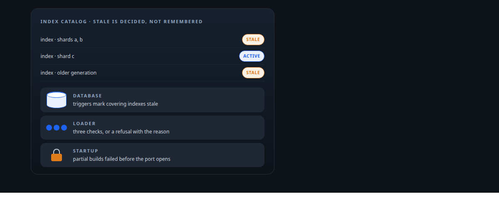
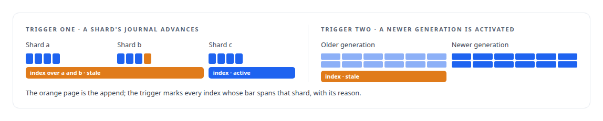
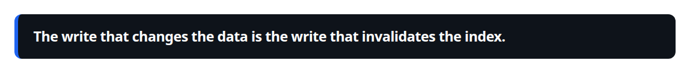
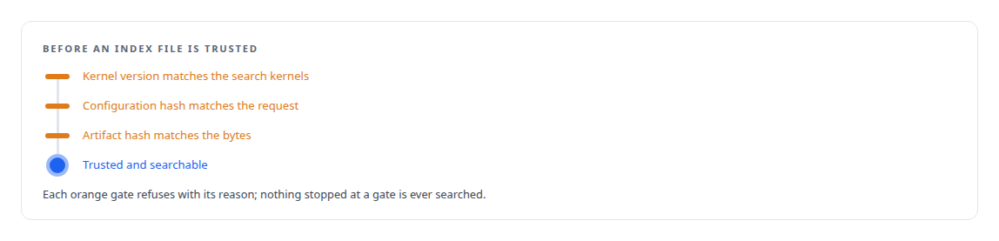
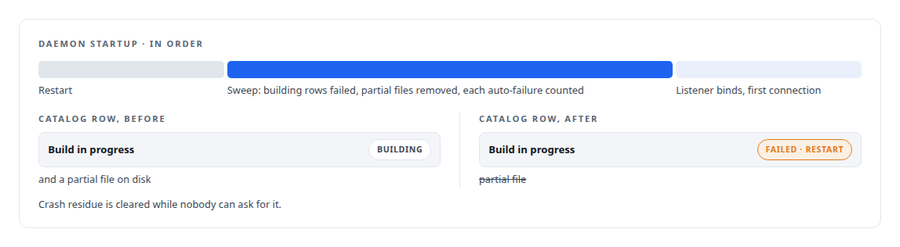
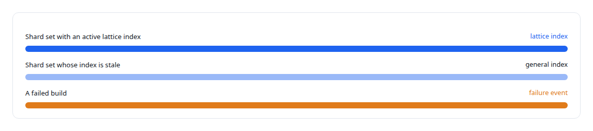

# The database decides when an index goes stale

**Index invalidation moved into SQL triggers and load-time checks, so a stale index cannot be served, and partial builds are failed before the daemon accepts its first connection**

Canonical: https://coreyjames.ai/stories/the-database-decides-when-an-index-goes-stale/  
Author: Corey James · Published: 2026-10-28 · Kind: story  
DOI: https://doi.org/10.5281/zenodo.23735148 (this page is a chapter of the system's report)  
Systems: [Inference Fabric](https://github.com/coreyjames-ai/inference-fabric) · [PostgreSQL Fabric](https://github.com/coreyjames-ai/postgresql-fabric)  
Technologies: [Approximate nearest-neighbour search](https://github.com/coreyjames-ai/portfolio/tree/main/technologies/approximate-nearest-neighbour-search) · [Idempotency, exactly-once effects and crash recovery](https://github.com/coreyjames-ai/portfolio/tree/main/technologies/idempotency-exactly-once-effects-and-crash-recovery) · [PostgreSQL](https://github.com/coreyjames-ai/portfolio/tree/main/technologies/postgresql) · [Rust](https://github.com/coreyjames-ai/portfolio/tree/main/technologies/rust)  
Skills: [exactly-once delivery and crash recovery](https://github.com/coreyjames-ai/portfolio/tree/main/skills/exactly-once-delivery-and-crash-recovery) · [distributed systems correctness](https://github.com/coreyjames-ai/portfolio/tree/main/skills/distributed-systems-correctness) · [vector search and ANN indexes](https://github.com/coreyjames-ai/portfolio/tree/main/skills/vector-search-and-ann-indexes) · [evidence-gated acceptance](https://github.com/coreyjames-ai/portfolio/tree/main/skills/evidence-gated-acceptance)  



## Result

| Figure | What it measures |
| --- | --- |
| **2** | triggers in the database that mark an index stale |
| **3** | load-time checks, in order, before a file is trusted |

## What was built

An approximate index is a summary of the vectors it was built over. When those vectors change, the index is wrong, and a service that keeps serving it will return confident, stale neighbours with no error. The usual defence is a rule in the application: remember to rebuild. I put the rule in the database instead, where it cannot be forgotten, and backed it with checks at load time and at startup.

## Two triggers in the database

Vectors live in append-only shards, each with a journal whose entry count advances on every append. A trigger on the catalog marks every active index that covers a shard as stale the moment that shard's journal count advances, with a reason attached. A second trigger fires when a newer generation of payload shards is activated and marks the indexes built over older generations as stale.





## Three checks at load time

Before an index file is trusted, the loader checks that the kernel version it was built with matches the kernels that will search it and that its configuration hash matches the configuration being requested. Only then is the artifact hash checked against the file's bytes.



## Startup before the port opens

A build that was in progress when the daemon died has a catalog row saying it is building and a partial file on disk. On startup, before the listener binds, every such row is failed with a reason naming the restart. The step never has to be remembered.



## What a reader gets

Search looks up the active index for a shard set, loads and checks it, and falls back to the general index when no lattice index is active. A stale index is never a candidate. A build that fails emits a failure event on the same channel as a success, so the absence of an index is as visible as its presence.



## What this demonstrates

Correctness rules placed at the layer that cannot forget them: the database for data changes, the loader for compatibility, and startup for crash residue, so that the service either serves a current index or says why it cannot.

The placement of the rules was my decision; AI coding agents, a mix of frontier and open-source models, implemented the triggers, checks and recovery under my governance system.

> The write that changes the data is the write that invalidates the index.

## What was verified

Each line is a claim the canonical page supports, with the figure as the page states it.

- Database-enforced invariants: index invalidation moved into PostgreSQL catalog triggers, so the write that changes vector data marks every covering index stale.
- Fail-closed artifact loading: 3 ordered checks before an index file is trusted, kernel version, configuration hash and artifact hash, each mismatch a refusal with its reason.
- Exactly-once delivery and crash recovery: partial index builds failed and their files removed before the daemon binds its listener, a sweep that is a no-op on a clean database.
- Vector search and ANN indexes: search that loads only an active, checked index for a shard set and falls back to the general index, so a stale index is never a candidate.

## Related

- [An index you can rebuild from its receipt](https://github.com/coreyjames-ai/inference-fabric/tree/main/stories/an-index-you-can-rebuild-from-its-receipt) · https://coreyjames.ai/stories/an-index-you-can-rebuild-from-its-receipt/
- [Rebuild only what moved](https://github.com/coreyjames-ai/inference-fabric/tree/main/stories/rebuild-only-what-moved) · https://coreyjames.ai/stories/rebuild-only-what-moved/
- [Three shards that move together](https://github.com/coreyjames-ai/inference-fabric/tree/main/stories/three-shards-that-move-together) · https://coreyjames.ai/stories/three-shards-that-move-together/

## Citation

Corey James. "The database decides when an index goes stale." coreyjames.ai, 2026. https://coreyjames.ai/stories/the-database-decides-when-an-index-goes-stale/ In: the Inference Fabric technical report, doi:10.5281/zenodo.23735148.

```bibtex
@misc{coreyjames-the-database-decides-when-an-index-goes-stale,
  author = {Corey James},
  title = {The database decides when an index goes stale},
  year = {2026},
  howpublished = {\url{https://coreyjames.ai/stories/the-database-decides-when-an-index-goes-stale/}},
  note = {GitHub copy: https://github.com/coreyjames-ai/inference-fabric/tree/main/stories/the-database-decides-when-an-index-goes-stale},
  doi = {10.5281/zenodo.23735148}
}
```

Part of [Inference Fabric](https://github.com/coreyjames-ai/inference-fabric) and [Corey James's portfolio](https://github.com/coreyjames-ai/portfolio) · site: https://coreyjames.ai/ · MCP server: https://coreyjames.ai/mcp · agent card: https://coreyjames.ai/.well-known/agent.json
