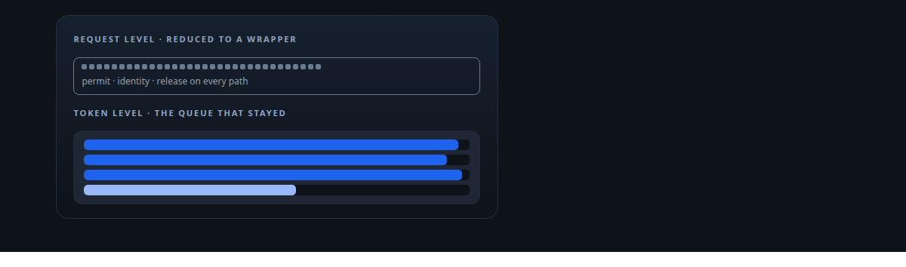
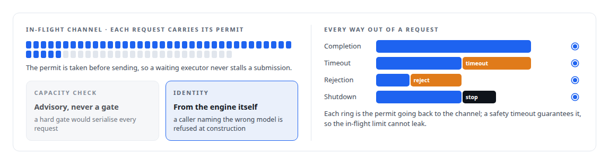
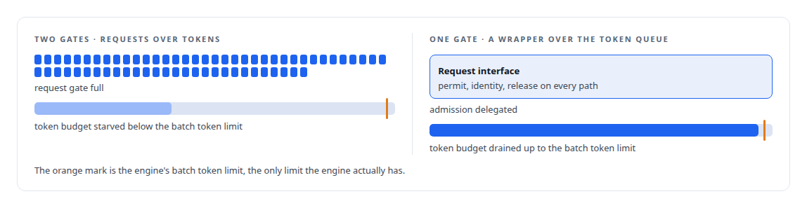

# The queue that should not exist

**I built an inference queue manager with two-stage backpressure and permit-carrying requests, then found the runtime already had a token-based queue, and reduced mine to a wrapper**

Canonical: https://coreyjames.ai/stories/the-queue-that-should-not-exist/  
Author: Corey James · Published: 2026-10-28 · Kind: story  
DOI: https://doi.org/10.5281/zenodo.23735148 (this page is a chapter of the system's report)  
Systems: [Inference Fabric](https://github.com/coreyjames-ai/inference-fabric)  
Technologies: [Capacity engineering, backpressure and load testing](https://github.com/coreyjames-ai/portfolio/tree/main/technologies/capacity-engineering-backpressure-and-load-testing) · [Contract-first interface design](https://github.com/coreyjames-ai/portfolio/tree/main/technologies/contract-first-interface-design) · [NVIDIA TensorRT-LLM](https://github.com/coreyjames-ai/portfolio/tree/main/technologies/nvidia-tensorrt-llm) · [Rust](https://github.com/coreyjames-ai/portfolio/tree/main/technologies/rust)  
Skills: [inference serving architecture](https://github.com/coreyjames-ai/portfolio/tree/main/skills/inference-serving-architecture) · [message broker and queue design](https://github.com/coreyjames-ai/portfolio/tree/main/skills/message-broker-and-queue-design) · [token-aware scheduling](https://github.com/coreyjames-ai/portfolio/tree/main/skills/token-aware-scheduling) · [vLLM internals](https://github.com/coreyjames-ai/portfolio/tree/main/skills/vllm-internals)  



## Result

| Figure | What it measures |
| --- | --- |
| **64** | requests in flight at most, bounded by a channel |
| **~1,200** | lines in the wrapper that remains |
| **1,600** | lines in the token queue it almost duplicated |

## What was built

Between the services that need text generated and the engine that generates it, I built a queue manager. It was a good one. Then I read the runtime underneath it properly.



## What was already there

The saturated inference runtime already had a token-capacity queue: a lock-free multi-producer queue that reserved token budget with an atomic compare-and-swap, drained up to the engine's batch token limit, and returned a typed backpressure error when full. It did at the token level, where the engine actually has limits, what my manager did at the request level.




## The decision

The planning notes state the discovery and the resolution: the queue manager is reduced to a thin wrapper that presents the request-level interface the services want and delegates admission to the token queue. The permit, the identity check and the release-on-every-path discipline stayed, because they are properties of the interface rather than of the queue. The second queue went.

## What this demonstrates

The willingness to delete a layer I had just built, and the habit of reading the runtime before adding to it. The wrapper and the queue it almost duplicated do different jobs now.

The decision to collapse the layer was mine; AI coding agents, a mix of frontier and open-source models, built both under my governance system.

> Two layers of backpressure with different units would have fought each other, and the request-level one would have won by starving the token-level one of work.

## What was verified

Each line is a claim the canonical page supports, with the figure as the page states it.

- Backpressure design: a request-level queue with permit-carrying requests, at most 64 in flight and the permit released on every path, built and then reduced to a wrapper.
- Inference serving architecture: the runtime's lock-free token-capacity queue recognised as doing admission where the engine has its limits, and admission delegated to it.
- Software architecture simplification: a second backpressure layer in different units removed before it could starve the token queue; the wrapper is about 1,200 lines and the queue 1,600.

## Related

- [Machinery I built and then did not need](https://github.com/coreyjames-ai/inference-fabric/tree/main/stories/machinery-i-built-and-then-did-not-need) · https://coreyjames.ai/stories/machinery-i-built-and-then-did-not-need/
- [Trying the industrial path first](https://github.com/coreyjames-ai/capabilities-model/tree/main/stories/trying-the-industrial-path-first) · https://coreyjames.ai/stories/trying-the-industrial-path-first/
- [Throughput that finished nothing](https://github.com/coreyjames-ai/inference-fabric/tree/main/stories/throughput-that-finished-nothing) · https://coreyjames.ai/stories/throughput-that-finished-nothing/

## Citation

Corey James. "The queue that should not exist." coreyjames.ai, 2026. https://coreyjames.ai/stories/the-queue-that-should-not-exist/ In: the Inference Fabric technical report, doi:10.5281/zenodo.23735148.

```bibtex
@misc{coreyjames-the-queue-that-should-not-exist,
  author = {Corey James},
  title = {The queue that should not exist},
  year = {2026},
  howpublished = {\url{https://coreyjames.ai/stories/the-queue-that-should-not-exist/}},
  note = {GitHub copy: https://github.com/coreyjames-ai/inference-fabric/tree/main/stories/the-queue-that-should-not-exist},
  doi = {10.5281/zenodo.23735148}
}
```

Part of [Inference Fabric](https://github.com/coreyjames-ai/inference-fabric) and [Corey James's portfolio](https://github.com/coreyjames-ai/portfolio) · site: https://coreyjames.ai/ · MCP server: https://coreyjames.ai/mcp · agent card: https://coreyjames.ai/.well-known/agent.json
