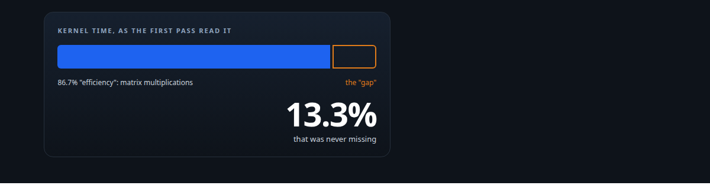
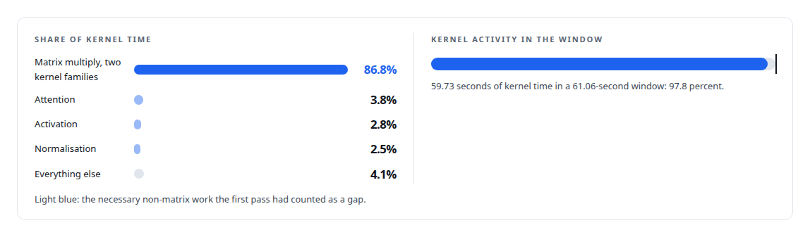
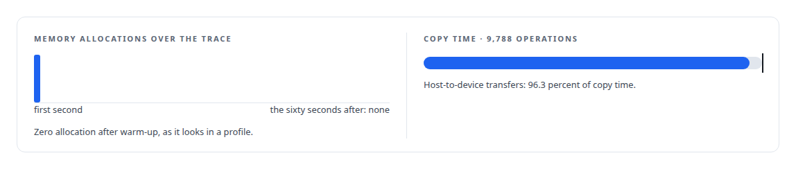
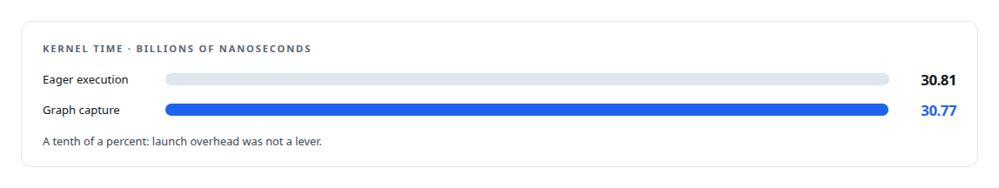
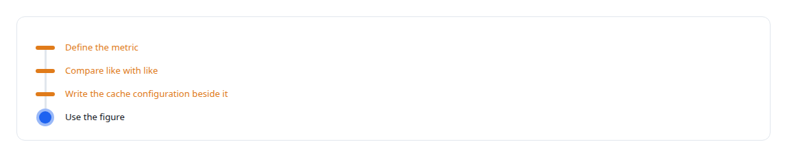

# The thirteen percent that was never missing

**A profile said thirteen percent of the GPU was idle; it was the share of time in non-matrix kernels. Reading what each metric measured before optimising found utilisation at 98.7 percent**

Canonical: https://coreyjames.ai/stories/the-thirteen-percent-that-was-never-missing/  
Author: Corey James · Published: 2026-10-28 · Kind: story  
Systems: [Inference Fabric](https://github.com/coreyjames-ai/inference-fabric)  
Technologies: [GPU profiling and tracing](https://github.com/coreyjames-ai/portfolio/tree/main/technologies/gpu-profiling-and-tracing) · [NVIDIA Nsight Systems](https://github.com/coreyjames-ai/portfolio/tree/main/technologies/nvidia-nsight-systems) · [NVIDIA TensorRT-LLM](https://github.com/coreyjames-ai/portfolio/tree/main/technologies/nvidia-tensorrt-llm) · [Performance engineering and benchmarking](https://github.com/coreyjames-ai/portfolio/tree/main/technologies/performance-engineering-and-benchmarking)  
Skills: [GPU profiling (Nsight)](https://github.com/coreyjames-ai/portfolio/tree/main/skills/gpu-profiling-nsight) · [GPU inference optimisation](https://github.com/coreyjames-ai/portfolio/tree/main/skills/gpu-inference-optimisation) · [AI-assisted engineering methodology](https://github.com/coreyjames-ai/portfolio/tree/main/skills/ai-assisted-engineering-methodology) · [evidence-gated acceptance](https://github.com/coreyjames-ai/portfolio/tree/main/skills/evidence-gated-acceptance)  



## Result

| Figure | What it measures |
| --- | --- |
| **98.7%** | streaming-multiprocessor utilisation in the trace |
| **332,965** | kernel launches in sixty seconds |
| **4,236** | memory allocations, every one in the first second |

## What was built

An early profiling pass on the inference runtime reported a GPU compute efficiency figure and a gap, and the obvious next step was a programme of work to close the gap. Before starting it, I went back to the profile to find out what the number measured. It was the share of kernel time spent in matrix multiplications. The rest was attention, activation and normalisation kernels, all of them necessary, none of them idle.

## What the profile said

A sixty-second trace on one consumer Blackwell GPU gave the whole picture.





## The experiment it saved and the one it ran

The gap-closing programme would have chased a number that could not move, because the only way to reduce the non-matrix share is to remove the model's own layers. Instead the profile was used to test a different hypothesis. Fixed-size epochs and a dense slot map had been built so the runtime could capture its decode steps as CUDA graphs, on the theory that launch overhead was a lever. Profiling settled it, because the vendor's executor already manages graphs internally.



 The epoch machinery stays for slot integrity, and graph capture was dropped as a lever.

## The written rule

The runtime's performance notes now open with the rule this produced.



The same rule separated the cached and uncached tier sweeps into two tables that are never shown as one curve, and overturned a bandwidth-bound conclusion that had rested on an estimate for one card and a measurement for the other.

## What this demonstrates


A tenth of a percent and a thirteen percent that was not there are both results, and both are written down.

The decision to re-read the profile and the measurement rules were mine; AI coding agents, a mix of frontier and open-source models, ran the profiling under my governance system.

> The habit that matters most in performance work: reading the definition of a metric before acting on its value.

## What was verified

Each line is a claim the canonical page supports, with the figure as the page states it.

- GPU profiling (Nsight): re-read a reported thirteen percent compute gap as necessary non-matrix kernel time and found streaming-multiprocessor utilisation at 98.7%.
- Performance benchmarking methodology: graph capture against eager execution measured at 30.77 against 30.81 billion nanoseconds of kernel time, and launch overhead dropped as a lever.
- Memory discipline in inference runtimes: 4,236 memory allocations in a sixty-second trace of 332,965 kernel launches, every allocation in the first second.
- Measurement discipline: a written rule to define each metric before reading it, compare like with like and write the cache configuration beside every figure.

## Related

- [From 44K to 163K tokens per second](https://github.com/coreyjames-ai/inference-fabric/tree/main/stories/from-44k-to-163k-tokens-per-second) · https://coreyjames.ai/stories/from-44k-to-163k-tokens-per-second/
- [Throughput that finished nothing](https://github.com/coreyjames-ai/inference-fabric/tree/main/stories/throughput-that-finished-nothing) · https://coreyjames.ai/stories/throughput-that-finished-nothing/
- [Engines for the card you have](https://github.com/coreyjames-ai/inference-fabric/tree/main/stories/engines-for-the-card-you-have) · https://coreyjames.ai/stories/engines-for-the-card-you-have/

## Citation

Corey James. "The thirteen percent that was never missing." coreyjames.ai, 2026. https://coreyjames.ai/stories/the-thirteen-percent-that-was-never-missing/

```bibtex
@misc{coreyjames-the-thirteen-percent-that-was-never-missing,
  author = {Corey James},
  title = {The thirteen percent that was never missing},
  year = {2026},
  howpublished = {\url{https://coreyjames.ai/stories/the-thirteen-percent-that-was-never-missing/}},
  note = {GitHub copy: https://github.com/coreyjames-ai/inference-fabric/tree/main/stories/the-thirteen-percent-that-was-never-missing}
}
```

Part of [Inference Fabric](https://github.com/coreyjames-ai/inference-fabric) and [Corey James's portfolio](https://github.com/coreyjames-ai/portfolio) · site: https://coreyjames.ai/ · MCP server: https://coreyjames.ai/mcp · agent card: https://coreyjames.ai/.well-known/agent.json
