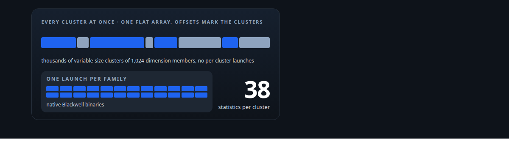
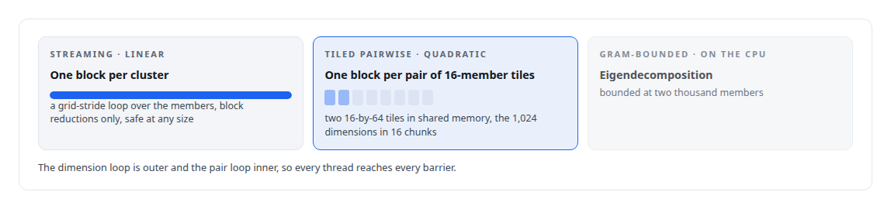
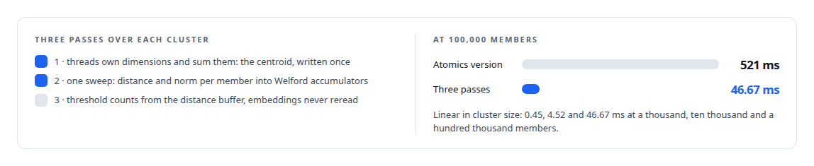

# Thirty-eight metrics in a dozen passes

**A hand-written CUDA engine for Blackwell that scores thousands of embedding clusters at once and searches them with the same kernels**

Canonical: https://coreyjames.ai/stories/thirty-eight-metrics-in-a-dozen-passes/  
Author: Corey James · Published: 2026-10-28 · Kind: story  
DOI: https://doi.org/10.5281/zenodo.23735148 (this page is a chapter of the system's report)  
Systems: [Inference Fabric](https://github.com/coreyjames-ai/inference-fabric)  
Technologies: [Approximate nearest-neighbour search](https://github.com/coreyjames-ai/portfolio/tree/main/technologies/approximate-nearest-neighbour-search) · [CPU reference implementations and GPU equivalence testing](https://github.com/coreyjames-ai/portfolio/tree/main/technologies/cpu-reference-implementations-and-gpu-equivalence-testing) · [CUDA C++](https://github.com/coreyjames-ai/portfolio/tree/main/technologies/cuda-c-plus-plus) · [CUDA Driver API](https://github.com/coreyjames-ai/portfolio/tree/main/technologies/cuda-driver-api) · [Cluster-health metrics on the GPU](https://github.com/coreyjames-ai/portfolio/tree/main/technologies/cluster-health-metrics-on-the-gpu) · [Determinism and numerical reproducibility](https://github.com/coreyjames-ai/portfolio/tree/main/technologies/determinism-and-numerical-reproducibility) · [GPU numerical kernel design](https://github.com/coreyjames-ai/portfolio/tree/main/technologies/gpu-numerical-kernel-design) · [Gaussian-kernel cluster analysis](https://github.com/coreyjames-ai/portfolio/tree/main/technologies/gaussian-kernel-cluster-analysis) · [NVIDIA Blackwell GPUs](https://github.com/coreyjames-ai/portfolio/tree/main/technologies/nvidia-blackwell-gpus) · [Rust](https://github.com/coreyjames-ai/portfolio/tree/main/technologies/rust) · [Streaming statistics in CUDA](https://github.com/coreyjames-ai/portfolio/tree/main/technologies/streaming-statistics-in-cuda) · [Tiled pairwise kernels](https://github.com/coreyjames-ai/portfolio/tree/main/technologies/tiled-pairwise-kernels)  
Skills: [CUDA kernel development](https://github.com/coreyjames-ai/portfolio/tree/main/skills/cuda-kernel-development) · [embedding analytics and cluster metrics](https://github.com/coreyjames-ai/portfolio/tree/main/skills/embedding-analytics-and-cluster-metrics) · [vector search and ANN indexes](https://github.com/coreyjames-ai/portfolio/tree/main/skills/vector-search-and-ann-indexes) · [Rust systems engineering](https://github.com/coreyjames-ai/portfolio/tree/main/skills/rust-systems-engineering)  



## Result

| Figure | What it measures |
| --- | --- |
| **11×** | faster centroid family at 100,000 members after the rewrite |
| **500K/s** | members through two-means, no atomics |
| **0.85** | minimum recall at ten against exact search, held in CI |
| **11,600** | lines of Rust around about 11,000 of CUDA |

## What was built

My distillation research produces millions of embeddings grouped into clusters, and it needs to know, for every cluster, how tight it is, whether it has sub-structure, how it relates to its neighbours, and how much information it carries. That is thirty-eight statistics per cluster, over vectors of 1,024 dimensions, for thousands of clusters at a time. I wrote a CUDA engine for it, from Rust against the driver API, compiled natively for Blackwell, with a CPU reference and equivalence tests for every kernel. The same engine does exact, inverted-file and lattice vector search, and a fused variant computes cluster health as a side effect of the search it was already doing.

## The shape of the engine

Every metric kernel takes all clusters at once: a flat array of member vectors plus an offsets array in compressed sparse row form. One launch processes thousands of variable-size clusters. There are no per-cluster launches.

Kernels fall into three scaling classes. A tiled pairwise block finds its tile pair by decoding a flat grid through a prefix sum of tiles squared per cluster, and each thread keeps up to four pair accumulators in registers across chunks.



Reductions are warp shuffles followed by a block reduction through static shared memory. Moments use Welford's method per thread and Chan's parallel merge across lanes and warps, in the population convention because a cluster is the whole population. Nothing samples and nothing caps: the earlier kernels sampled fifty members and capped at 1,225 pairs, and I removed every cap so that all metrics run on full clusters. Diagnostic outputs are unclamped, thresholds are kernel arguments, and every edge case has a defined sentinel.

## The centroid family

Eight statistics depend on member-to-centroid distances. The first version accumulated the centroid with atomics, a thousand per member per thread, and re-read embeddings for threshold counts. The rewrite is three passes. From those come cohesion, inertia, spread, skew, embedding quality, novelty against the global centroid, outlier ratio and the core-periphery ratio.



Fusing spread and skew into this kernel replaced a separate diversity kernel.

## Sub-structure, scale and diversity

Two-means runs one block per cluster: a pass for the single-centroid inertia, two centroids seeded at the first and last member, then exactly three Lloyd iterations, each a grid-stride classification pass and a dimension-parallel centroid update where every thread owns dimensions and walks members. The iteration count is part of the metric's definition. There are no atomics, which removed the contention that limited the earlier version. Silhouette tiles over the two-means assignments with square roots deferred to a finalize kernel.

The characteristic scale sigma is the median pairwise distance, which cannot be stored for a large cluster. The tiled kernel adds every distance to a 256-bin shared-memory histogram and thread zero walks the cumulative counts to the median bin. The median is approximate to one bin width, which is the trade for not storing the quadratic set. Sigma feeds a family of Gaussian-potential metrics that treat members as potentials of that width: depth at the centroid, curvature, an escape probability from the nearest cluster's distance, and an entanglement score over the upper triangle with no Gram matrix materialised. The diversity family uses one tiled pass for every non-histogram statistic and a second pass for a 20-bin histogram whose edges only exist after the first.


## Search with the same discipline

Exact nearest-neighbour search stages the query and 16-row database tiles through shared memory in 64-dimension chunks, keeps a top-k buffer per block with replace-worst insertion, and never writes a query-by-database score matrix. Ties break on ascending row position so results are deterministic. One reusable top-k engine, with a two-pass workspace merge across blocks, serves exact, inverted-file, lattice and fused search; cooperative launches, grid-wide sync and persistent schedulers were excluded on purpose.

The inverted-file build splits its k-means++ seeding: the GPU computes each row's squared distance to the centroids chosen so far, and the host draws the next seed with a seeded pseudo-random generator, so the random step is bit-exact and outside any floating-point reduction. Then Lloyd's iterations alternate an assignment kernel and a one-block-per-centroid update. Lattice search is two-level: one block per query picks the top clusters from published centroids, then one block per query-cluster pair reads the cluster's members and writes a partial top-k that the shared engine merges.

The fused variant is the payoff. Search already computes distances to every member of the probed clusters. Sibling kernels, with the unfused files left byte-frozen, reuse every scoring and top-k primitive and add one side-band: for each member scored, its distance to its own centroid, written into a strided buffer pre-filled with NaN so unwritten slots are detectable. A reducer then computes cohesion and inertia per cluster from that buffer. Search output is byte-identical to the unfused path and the health values match the standalone kernel within fixed tolerances.


## Built for Blackwell

The engine talks to the CUDA 13 driver API through a 300-line safe wrapper generated from the headers, because no Rust CUDA crate supported the new generation when I needed it. Kernels compile to native SM 120 binaries, with no PTX fallback for a known target. The primary context is retained and made current as the first CUDA call of every executor, because asynchronous worker threads carry no context. Everything is single-precision with hand-written reductions: no tensor cores, no cuBLAS, no quantised paths, k at most 128. The kernels compile with fast-math, so transcendental functions and divisions are approximate, and equivalence against the CPU references is checked at a relative tolerance of one in ten thousand with an absolute floor, a tolerance chosen because reduction order and fast-math together make tighter ones fail spuriously on long vectors.

## What this demonstrates

Numerical kernel design with a reason for every structure: which pass owns which memory, why a histogram replaces a median, why atomics went and where they stayed, why the fused kernel is a sibling rather than a flag. Each kernel has a lineage note naming its formula, wrapper and timings.

> The quadratic distance matrix never exists.

## What was verified

Each line is a claim the canonical page supports, with the figure as the page states it.

- CUDA kernel development: a hand-written CUDA engine for NVIDIA Blackwell scoring thirty-eight statistics per cluster over 1,024-dimension vectors, with no sampling and no caps.
- Embedding analytics and cluster metrics: the centroid family made 11x faster at 100,000 members, and two-means at about 500K/s members with no atomics.
- Vector search and ANN indexes: exact, inverted-file and lattice search on the same kernels, with recall at ten held at 0.85 or better against exact search in CI.
- Rust systems engineering: 11,600 lines of Rust around about 11,000 of CUDA, reaching the CUDA 13 driver API through a 300-line safe wrapper.

## Related

- [From 44K to 163K tokens per second](https://github.com/coreyjames-ai/inference-fabric/tree/main/stories/from-44k-to-163k-tokens-per-second) · https://coreyjames.ai/stories/from-44k-to-163k-tokens-per-second/
- [Spend structure before spending waste](https://github.com/coreyjames-ai/inference-fabric/tree/main/stories/spend-structure-before-spending-waste) · https://coreyjames.ai/stories/spend-structure-before-spending-waste/

## Citation

Corey James. "Thirty-eight metrics in a dozen passes." coreyjames.ai, 2026. https://coreyjames.ai/stories/thirty-eight-metrics-in-a-dozen-passes/ In: the Inference Fabric technical report, doi:10.5281/zenodo.23735148.

```bibtex
@misc{coreyjames-thirty-eight-metrics-in-a-dozen-passes,
  author = {Corey James},
  title = {Thirty-eight metrics in a dozen passes},
  year = {2026},
  howpublished = {\url{https://coreyjames.ai/stories/thirty-eight-metrics-in-a-dozen-passes/}},
  note = {GitHub copy: https://github.com/coreyjames-ai/inference-fabric/tree/main/stories/thirty-eight-metrics-in-a-dozen-passes},
  doi = {10.5281/zenodo.23735148}
}
```

Part of [Inference Fabric](https://github.com/coreyjames-ai/inference-fabric) and [Corey James's portfolio](https://github.com/coreyjames-ai/portfolio) · site: https://coreyjames.ai/ · MCP server: https://coreyjames.ai/mcp · agent card: https://coreyjames.ai/.well-known/agent.json
