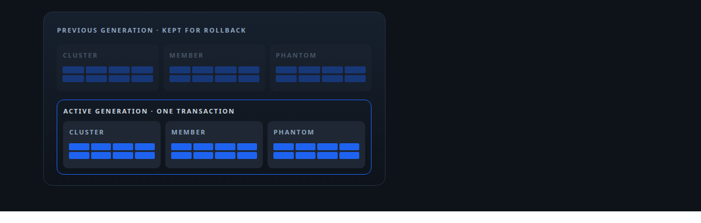
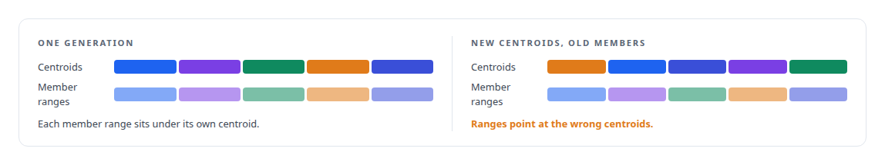
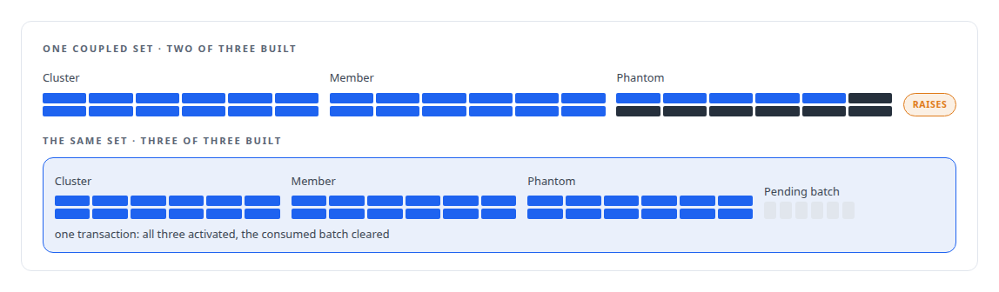
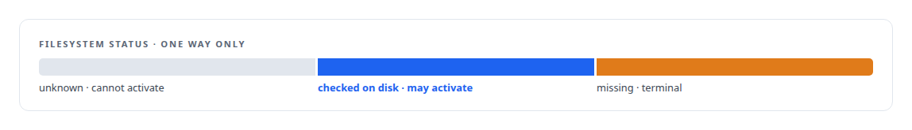
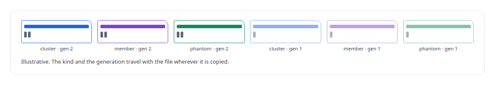

# Three shards that move together

**Cluster, member and phantom vector files are interdependent, so they activate together in one transaction or not at all, only after the files are confirmed on disk, with a single-active invariant the database enforces**

Canonical: https://coreyjames.ai/stories/three-shards-that-move-together/  
Author: Corey James · Published: 2026-10-28 · Kind: story  
DOI: https://doi.org/10.5281/zenodo.23735148 (this page is a chapter of the system's report)  
Systems: [Inference Fabric](https://github.com/coreyjames-ai/inference-fabric) · [PostgreSQL Fabric](https://github.com/coreyjames-ai/postgresql-fabric)  
Technologies: [Idempotency, exactly-once effects and crash recovery](https://github.com/coreyjames-ai/portfolio/tree/main/technologies/idempotency-exactly-once-effects-and-crash-recovery) · [Large-scale GPU data pipelines](https://github.com/coreyjames-ai/portfolio/tree/main/technologies/large-scale-gpu-data-pipelines) · [PostgreSQL](https://github.com/coreyjames-ai/portfolio/tree/main/technologies/postgresql) · [Rust](https://github.com/coreyjames-ai/portfolio/tree/main/technologies/rust)  
Skills: [distributed systems correctness](https://github.com/coreyjames-ai/portfolio/tree/main/skills/distributed-systems-correctness) · [exactly-once delivery and crash recovery](https://github.com/coreyjames-ai/portfolio/tree/main/skills/exactly-once-delivery-and-crash-recovery)  



## Result

| Figure | What it measures |
| --- | --- |
| **3** | vector files that activate in one transaction or not at all |
| **1** | active generation per schema and kind, held by a unique index |
| **2** | generations kept so a rollback has somewhere to go |

## What was built

The GPU analytics in [Where a cluster sits](https://coreyjames.ai/stories/where-a-cluster-sits) read three kinds of vector file: the cluster centroids, the members with their per-cluster offsets, and the phantom candidates. The member offsets index into the centroid file, and the phantoms are scored against both. A reader that saw a new centroid file beside an old member file would compute nonsense without an error. So the three files form a coupled set, and the set is the unit of activation.



## Built apart, activated together

Each kind is built by its own request, and the three requests share a coupled-set identifier. The activation function in the database checks the whole set, and a unique index guards the result.




## Checked before served

A generation whose files are missing from disk must never be served. Each generation carries a filesystem status, and the check runs before activation.



## Named so they cannot be swapped

File names carry the kind and the generation number explicitly, so a centroid file from one generation cannot be mistaken for a member file or for another generation's file even after it has been copied somewhere else. Row order is deterministic, cluster identifier for centroids and cluster then row for members, so two builds of the same data are the same bytes, and every shard carries a signature with a collision-resistant hash over the generation.



## What this demonstrates

Treating a set of interdependent artifacts as one transactional unit, with the invariants enforced by the database and the filesystem rather than by the discipline of whoever runs the build.

The coupled-set rule and the single-active invariant were mine; AI coding agents, a mix of frontier and open-source models, implemented them under my governance system.

> A partial activation is impossible by construction rather than by convention.

## What was verified

Each line is a claim the canonical page supports, with the figure as the page states it.

- Transactional artifact management: 3 interdependent vector files activated together in one PostgreSQL transaction or not at all, with a unique index allowing 1 active generation per kind.
- Fail-closed artifact pipelines: generations checked on disk before activation, missing as a terminal status, and 2 generations kept so a rollback has somewhere to go.
- Deterministic data layout: file names carrying kind and generation, and row order fixed so two builds of the same data are the same bytes, each shard signed with a collision-resistant hash.

## Related

- [Where a cluster sits](https://github.com/coreyjames-ai/inference-fabric/tree/main/stories/where-a-cluster-sits) · https://coreyjames.ai/stories/where-a-cluster-sits/
- [Rebuild only what moved](https://github.com/coreyjames-ai/inference-fabric/tree/main/stories/rebuild-only-what-moved) · https://coreyjames.ai/stories/rebuild-only-what-moved/
- [The database decides when an index goes stale](https://github.com/coreyjames-ai/inference-fabric/tree/main/stories/the-database-decides-when-an-index-goes-stale) · https://coreyjames.ai/stories/the-database-decides-when-an-index-goes-stale/
- [Storage that refuses to become a coordinator](https://github.com/coreyjames-ai/inference-fabric/tree/main/stories/storage-that-refuses-to-become-a-coordinator) · https://coreyjames.ai/stories/storage-that-refuses-to-become-a-coordinator/

## Citation

Corey James. "Three shards that move together." coreyjames.ai, 2026. https://coreyjames.ai/stories/three-shards-that-move-together/ In: the Inference Fabric technical report, doi:10.5281/zenodo.23735148.

```bibtex
@misc{coreyjames-three-shards-that-move-together,
  author = {Corey James},
  title = {Three shards that move together},
  year = {2026},
  howpublished = {\url{https://coreyjames.ai/stories/three-shards-that-move-together/}},
  note = {GitHub copy: https://github.com/coreyjames-ai/inference-fabric/tree/main/stories/three-shards-that-move-together},
  doi = {10.5281/zenodo.23735148}
}
```

Part of [Inference Fabric](https://github.com/coreyjames-ai/inference-fabric) and [Corey James's portfolio](https://github.com/coreyjames-ai/portfolio) · site: https://coreyjames.ai/ · MCP server: https://coreyjames.ai/mcp · agent card: https://coreyjames.ai/.well-known/agent.json
