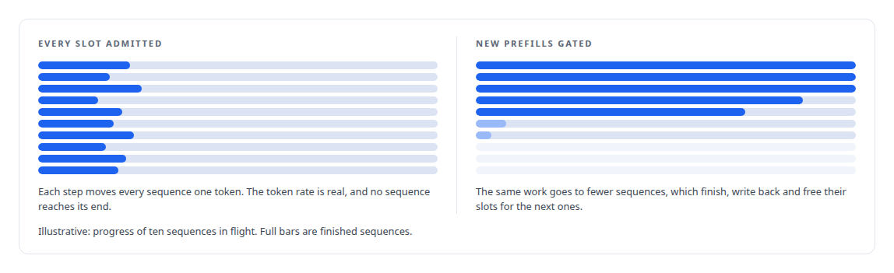
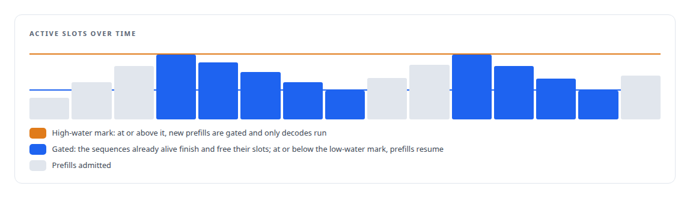
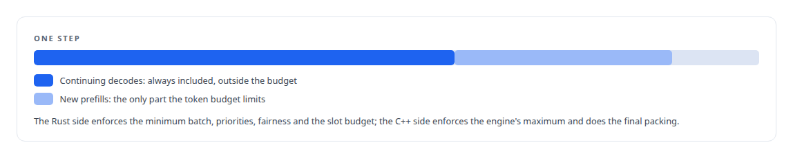
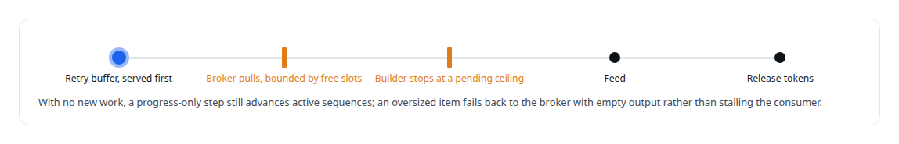

# Throughput that finished nothing

**The runtime reported more tokens per second than it ever had while finished sequences fell below one per second; the fix gated new work on how many sequences were already alive**

Canonical: https://coreyjames.ai/stories/throughput-that-finished-nothing/  
Author: Corey James · Published: 2026-10-28 · Kind: story  
DOI: https://doi.org/10.5281/zenodo.23735148 (this page is a chapter of the system's report)  
Systems: [Inference Fabric](https://github.com/coreyjames-ai/inference-fabric)  
Technologies: [C++](https://github.com/coreyjames-ai/portfolio/tree/main/technologies/c-plus-plus) · [NVIDIA TensorRT-LLM](https://github.com/coreyjames-ai/portfolio/tree/main/technologies/nvidia-tensorrt-llm) · [Performance engineering and benchmarking](https://github.com/coreyjames-ai/portfolio/tree/main/technologies/performance-engineering-and-benchmarking) · [Rust](https://github.com/coreyjames-ai/portfolio/tree/main/technologies/rust) · [Token-aware GPU batch scheduling](https://github.com/coreyjames-ai/portfolio/tree/main/technologies/token-aware-gpu-batch-scheduling)  
Skills: [GPU inference optimisation](https://github.com/coreyjames-ai/portfolio/tree/main/skills/gpu-inference-optimisation) · [inference serving architecture](https://github.com/coreyjames-ai/portfolio/tree/main/skills/inference-serving-architecture) · [vLLM internals](https://github.com/coreyjames-ai/portfolio/tree/main/skills/vllm-internals) · [Rust systems engineering](https://github.com/coreyjames-ai/portfolio/tree/main/skills/rust-systems-engineering)  


## Result

| Figure | What it measures |
| --- | --- |
| **4,096** | sequences per step on the largest engine tier |
| **524,288** | tokens per step on the same tier |
| **~4,100** | sequences active when nothing was finishing |

## What was built

The first time the runtime ran the largest engine tier I built for the dense 7B model under full load, the token rate and the completion counter disagreed. The GPU was generating at full speed and finishing nothing.

## What was happening

Continuous batching lets the engine admit a new sequence into any step that has room. With no limit on admissions, the runtime filled every slot, and each step then advanced four thousand sequences by one token each. Every sequence made progress, so the token rate was real, and every sequence made progress so slowly that none of them reached its end. The workload needed finished sequences, with their outputs written back, and a steady state of four thousand half-finished ones was worth nothing to it.



## The latch

The fix is a high-water and low-water latch on active slots.



The two thresholds come from the provisioner with the engine, both or neither, so an engine cannot be provisioned with half a policy. A second defect was fixed in the same pass: finished slots are now reclaimed before every allocation, which ended a starvation in which allocation failures spiked while one to three slots stayed free.

## Who enforces what

The batching contract is split between the two halves of the runtime. The token budget rule has a regression test, because an earlier version let a budget squeeze out sequences that were already mid-generation.



Behind the admission rule is a ladder of backpressure in the decode loop.



## What this demonstrates

Choosing the right metric.


The latch trades a little peak rate for sequences that finish, and the runtime's two-card figures were measured with it in place.

The latch and the split of batching duties were my design; AI coding agents, a mix of frontier and open-source models, implemented them under my governance system.

> Tokens per second is what an inference runtime advertises, and under a batch-oriented workload it can be maximised while delivering nothing.

## What was verified

Each line is a claim the canonical page supports, with the figure as the page states it.

- GPU inference optimisation: diagnosed a runtime generating at full speed while finishing fewer than one sequence a second with ~4,100 sequences active on a 4,096-sequence engine tier.
- Continuous batching admission control: a high-water and low-water latch on active slots that gates new prefills so the sequences in flight finish and free their slots.
- Inference runtime design in Rust and C++: batching duties split between halves, with continuing decodes always included and the token budget applied only to new prefills, held by a regression test.
- Backpressure design: a decode-loop ladder with a retry buffer served first, broker pulls bounded by free slots and oversized items failed back with empty output.

## Related

- [From 44K to 163K tokens per second](https://github.com/coreyjames-ai/inference-fabric/tree/main/stories/from-44k-to-163k-tokens-per-second) · https://coreyjames.ai/stories/from-44k-to-163k-tokens-per-second/
- [Engines for the card you have](https://github.com/coreyjames-ai/inference-fabric/tree/main/stories/engines-for-the-card-you-have) · https://coreyjames.ai/stories/engines-for-the-card-you-have/
- [The thirteen percent that was never missing](https://github.com/coreyjames-ai/inference-fabric/tree/main/stories/the-thirteen-percent-that-was-never-missing) · https://coreyjames.ai/stories/the-thirteen-percent-that-was-never-missing/

## Citation

Corey James. "Throughput that finished nothing." coreyjames.ai, 2026. https://coreyjames.ai/stories/throughput-that-finished-nothing/ In: the Inference Fabric technical report, doi:10.5281/zenodo.23735148.

```bibtex
@misc{coreyjames-throughput-that-finished-nothing,
  author = {Corey James},
  title = {Throughput that finished nothing},
  year = {2026},
  howpublished = {\url{https://coreyjames.ai/stories/throughput-that-finished-nothing/}},
  note = {GitHub copy: https://github.com/coreyjames-ai/inference-fabric/tree/main/stories/throughput-that-finished-nothing},
  doi = {10.5281/zenodo.23735148}
}
```

Part of [Inference Fabric](https://github.com/coreyjames-ai/inference-fabric) and [Corey James's portfolio](https://github.com/coreyjames-ai/portfolio) · site: https://coreyjames.ai/ · MCP server: https://coreyjames.ai/mcp · agent card: https://coreyjames.ai/.well-known/agent.json
