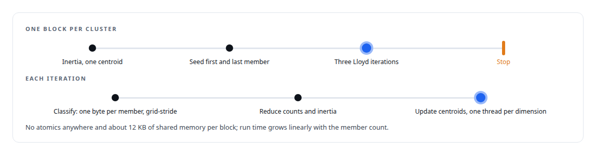
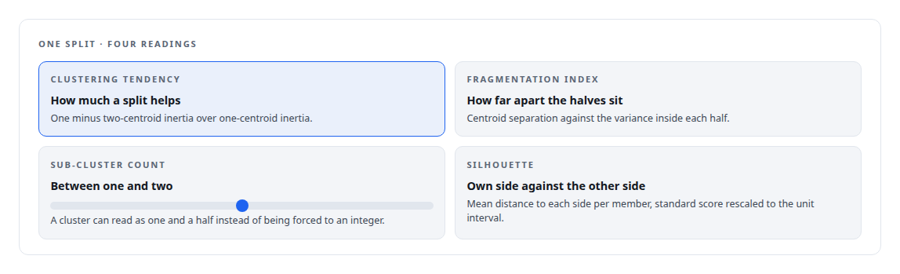
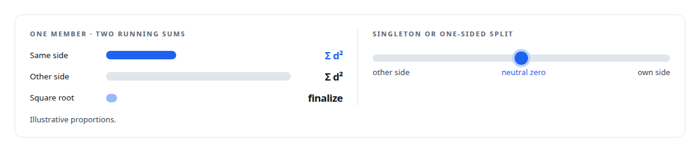
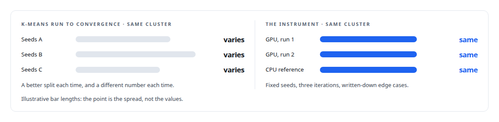

# Two-means as a measuring instrument

**Exactly three Lloyd iterations, seeded at the first and last member, as the fixed definition behind clustering tendency, fragmentation, sub-cluster count and silhouette**

Canonical: https://coreyjames.ai/stories/two-means-as-a-measuring-instrument/  
Author: Corey James · Published: 2026-10-28 · Kind: story  
Systems: [Inference Fabric](https://github.com/coreyjames-ai/inference-fabric)  
Technologies: [CPU reference implementations and GPU equivalence testing](https://github.com/coreyjames-ai/portfolio/tree/main/technologies/cpu-reference-implementations-and-gpu-equivalence-testing) · [CUDA C++](https://github.com/coreyjames-ai/portfolio/tree/main/technologies/cuda-c-plus-plus) · [Cluster-health metrics on the GPU](https://github.com/coreyjames-ai/portfolio/tree/main/technologies/cluster-health-metrics-on-the-gpu) · [Determinism and numerical reproducibility](https://github.com/coreyjames-ai/portfolio/tree/main/technologies/determinism-and-numerical-reproducibility) · [GPU numerical kernel design](https://github.com/coreyjames-ai/portfolio/tree/main/technologies/gpu-numerical-kernel-design) · [Gaussian-kernel cluster analysis](https://github.com/coreyjames-ai/portfolio/tree/main/technologies/gaussian-kernel-cluster-analysis) · [Streaming statistics in CUDA](https://github.com/coreyjames-ai/portfolio/tree/main/technologies/streaming-statistics-in-cuda) · [Tiled pairwise kernels](https://github.com/coreyjames-ai/portfolio/tree/main/technologies/tiled-pairwise-kernels)  
Skills: [embedding analytics and cluster metrics](https://github.com/coreyjames-ai/portfolio/tree/main/skills/embedding-analytics-and-cluster-metrics) · [CUDA kernel development](https://github.com/coreyjames-ai/portfolio/tree/main/skills/cuda-kernel-development) · [GPU inference optimisation](https://github.com/coreyjames-ai/portfolio/tree/main/skills/gpu-inference-optimisation) · [AI-assisted engineering methodology](https://github.com/coreyjames-ai/portfolio/tree/main/skills/ai-assisted-engineering-methodology)  


## Result

| Figure | What it measures |
| --- | --- |
| **4** | cluster metrics read from one fixed split |
| **0.5M** | members per second, about half a million, linear in size |
| **1.2 ms** | or less for the silhouette on the clusters it meets |

## What was built

Does this cluster want to be two clusters? The usual answer is to run k-means with k equal to two and look at the result, and the usual problem is that k-means is an optimiser: it runs until it converges, converges somewhere different depending on its seeds, and gives a different answer on a different day. I wanted the answer to be a metric, which means a fixed procedure with a fixed result. So the two-means split in my engine is defined as a measuring instrument, and four metrics read from it.

## The fixed procedure

One block per cluster. A first pass computes the single-centroid inertia, the sum of squared distances to the cluster's own centroid. Two centroids are then seeded at the first and the last member of the cluster, deterministically, and exactly three Lloyd iterations follow. Three iterations is the definition; there is no convergence test.



## Four metrics from one split

Every metric is defined in terms of that one split, so all four agree on which members sit on which side. The sub-cluster count is derived from the other readings and how balanced the split is.



## Silhouette without the square roots

The silhouette kernel is tiled over the split assignments and accumulates squared-distance sums and counts per member, same side and other side, with no atomics and the square root deferred to the finalize. Degenerate cases have fixed answers: a singleton or a cluster whose split put everyone on one side scores a neutral zero rather than a division error. A second finalize writes the per-member silhouette alongside the cluster value for analysis.



## Why fixed beats converged

Three fixed iterations from fixed seeds give the same number for the same cluster every time, on the GPU and in the CPU reference, which is what makes the tendency score comparable across a corpus and across runs. The pressure model that decides whether to split a cluster reads this score, and a decision rule needs an instrument.




## What this demonstrates

Turning an algorithm into a measurement by fixing its degrees of freedom: seeds, iterations and edge cases written down, and four metrics defined in terms of the result.

I set the fixed procedure and the metric definitions; the kernels and references were implemented by AI coding agents, a mix of frontier and open-source models, under my governance system.

> A converged k-means gives a better split and a worse metric.

## What was verified

Each line is a claim the canonical page supports, with the figure as the page states it.

- Deterministic GPU computation: a fixed two-means procedure, first and last member as seeds and exactly three Lloyd iterations, so a cluster splits the same way on the GPU and in the CPU reference.
- CUDA kernel development: one block per cluster with no atomics and about 12 KB of shared memory, at about 0.5M members a second, linear in size.
- Embedding analytics and cluster metrics: four metrics read from one split, tendency, fragmentation, sub-cluster count and silhouette, the silhouette in 1.2 ms or less for the clusters it meets.
- Measurement design: a fixed instrument chosen over a converged optimiser, because a decision rule needs a number that is comparable across a corpus and across runs.

## Related

- [Thirty-eight metrics in a dozen passes](https://github.com/coreyjames-ai/inference-fabric/tree/main/stories/thirty-eight-metrics-in-a-dozen-passes) · https://coreyjames.ai/stories/thirty-eight-metrics-in-a-dozen-passes/
- [Removing the sampling caps](https://github.com/coreyjames-ai/inference-fabric/tree/main/stories/removing-the-sampling-caps) · https://coreyjames.ai/stories/removing-the-sampling-caps/
- [Where a cluster sits](https://github.com/coreyjames-ai/inference-fabric/tree/main/stories/where-a-cluster-sits) · https://coreyjames.ai/stories/where-a-cluster-sits/

## Citation

Corey James. "Two-means as a measuring instrument." coreyjames.ai, 2026. https://coreyjames.ai/stories/two-means-as-a-measuring-instrument/

```bibtex
@misc{coreyjames-two-means-as-a-measuring-instrument,
  author = {Corey James},
  title = {Two-means as a measuring instrument},
  year = {2026},
  howpublished = {\url{https://coreyjames.ai/stories/two-means-as-a-measuring-instrument/}},
  note = {GitHub copy: https://github.com/coreyjames-ai/inference-fabric/tree/main/stories/two-means-as-a-measuring-instrument}
}
```

Part of [Inference Fabric](https://github.com/coreyjames-ai/inference-fabric) and [Corey James's portfolio](https://github.com/coreyjames-ai/portfolio) · site: https://coreyjames.ai/ · MCP server: https://coreyjames.ai/mcp · agent card: https://coreyjames.ai/.well-known/agent.json
