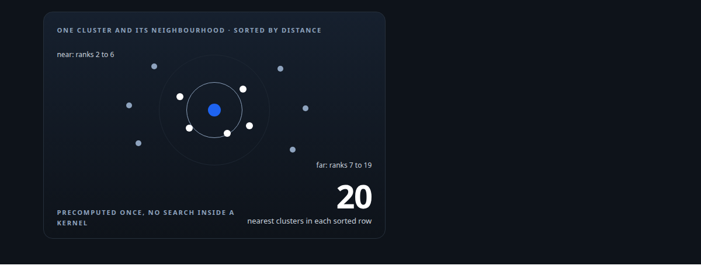
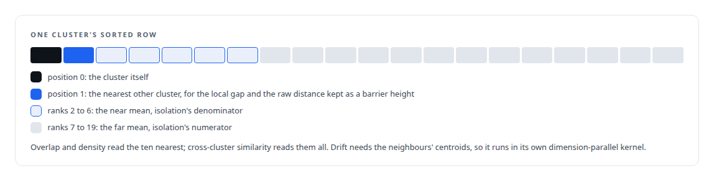
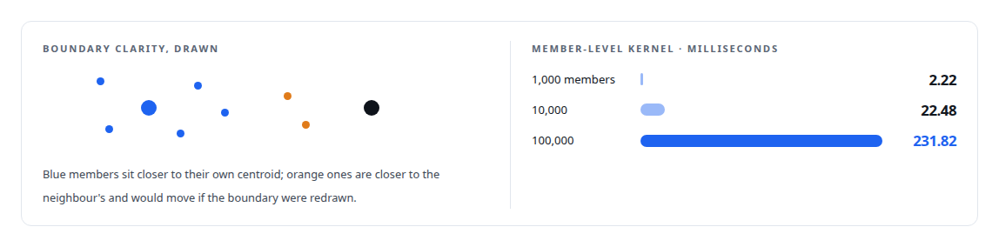

# Where a cluster sits

**Ten neighbourhood metrics that place each cluster among the clusters around it, computed from precomputed neighbour lists in a handful of GPU launches**

Canonical: https://coreyjames.ai/stories/where-a-cluster-sits/  
Author: Corey James · Published: 2026-10-28 · Kind: story  
DOI: https://doi.org/10.5281/zenodo.23735148 (this page is a chapter of the system's report)  
Systems: [Inference Fabric](https://github.com/coreyjames-ai/inference-fabric)  
Technologies: [CPU reference implementations and GPU equivalence testing](https://github.com/coreyjames-ai/portfolio/tree/main/technologies/cpu-reference-implementations-and-gpu-equivalence-testing) · [CUDA C++](https://github.com/coreyjames-ai/portfolio/tree/main/technologies/cuda-c-plus-plus) · [Cluster-health metrics on the GPU](https://github.com/coreyjames-ai/portfolio/tree/main/technologies/cluster-health-metrics-on-the-gpu) · [FAISS](https://github.com/coreyjames-ai/portfolio/tree/main/technologies/faiss) · [GPU numerical kernel design](https://github.com/coreyjames-ai/portfolio/tree/main/technologies/gpu-numerical-kernel-design) · [Gaussian-kernel cluster analysis](https://github.com/coreyjames-ai/portfolio/tree/main/technologies/gaussian-kernel-cluster-analysis) · [Hybrid retrieval](https://github.com/coreyjames-ai/portfolio/tree/main/technologies/hybrid-retrieval) · [Streaming statistics in CUDA](https://github.com/coreyjames-ai/portfolio/tree/main/technologies/streaming-statistics-in-cuda) · [Tiled pairwise kernels](https://github.com/coreyjames-ai/portfolio/tree/main/technologies/tiled-pairwise-kernels)  
Skills: [embedding analytics and cluster metrics](https://github.com/coreyjames-ai/portfolio/tree/main/skills/embedding-analytics-and-cluster-metrics) · [CUDA kernel development](https://github.com/coreyjames-ai/portfolio/tree/main/skills/cuda-kernel-development) · [vector search and ANN indexes](https://github.com/coreyjames-ai/portfolio/tree/main/skills/vector-search-and-ann-indexes) · [GPU inference optimisation](https://github.com/coreyjames-ai/portfolio/tree/main/skills/gpu-inference-optimisation)  



## Result

| Figure | What it measures |
| --- | --- |
| **6** | values from one sorted row, one thread per cluster |
| **0** | distance computations inside the cluster-level kernels |
| **24 KB** | shared memory for a cluster's own and five neighbour centroids |
| **2** | metrics that need every member |

## What was built

Most cluster statistics look inward: how tight, how spread, how many sub-groups. The questions that decide what to do with a cluster look outward. Is it crowded by neighbours or alone? Do its members belong to it or to the cluster next door? Does it sit on the topic its neighbours share, or off it? Has it drifted from the group it was part of? My engine answers those with a neighbourhood family of metrics that runs from precomputed neighbour lists, so none of the kernels has to search.

## The neighbour lists

For every cluster, an approximate-nearest-neighbour index over the centroids returns a sorted row of the twenty nearest clusters and their distances, with the cluster itself at position zero. The member-level kernels take the neighbour centroids themselves and cache them in shared memory.

## Cluster-level metrics from one row

The local centroid gap is one over one plus the distance to the nearest other cluster. Overlap is one over one plus the mean distance to the ten nearest. The raw nearest-cluster distance is kept as its own output because the Gaussian family needs it as a barrier height. Neighbourhood density is one over one plus the mean neighbour distance, and cross-cluster similarity is the mean of one over one plus distance across the neighbours.

A second kernel, one block per cluster and dimension-parallel, computes centroid drift as one over one plus the distance between the cluster's own centroid and the mean of its neighbours' centroids. A fused variant runs the row metrics and the drift together in one launch.



## Member-level metrics against neighbour centroids

Relevance is the mean over members of the mean over neighbours of one over one plus distance, which says how close the cluster's members are to its neighbourhood as a whole. Boundary clarity is the fraction of members closer to their own centroid than to any neighbour's centroid, which says how many members would be reassigned if the boundary were redrawn. The kernel runs one block per cluster with its own and five neighbouring centroids, and it works in squared distances throughout.




## Topic alignment

Topic alignment asks whether a cluster sits on its neighbourhood's subject. The kernel forms the mean of the neighbouring centroids, takes the cosine between the cluster's own centroid and that mean, takes the mean cosine between each member and that mean, and folds the two into a score in the unit interval. Four variants exist: a base kernel, one that parallelises the neighbour mean across threads, a one-thread-per-cluster batch version for many small clusters, and the streaming version in use, with the cluster offsets in compressed-row form.

## Phantom candidates

When a new cluster is proposed, the engine scores it against a set of phantom candidates, hypothetical centroids that a redistribution might create. Phantom proximity is the mean similarity to the k nearest phantoms, with a weighted variant that gives closer candidates more say, and a batched kernel that returns the phantom distance and spread for every cluster at once. Those scores feed the pressure model in [Redistribution inside the database](https://coreyjames.ai/stories/redistribution-inside-the-database).

## Question and answer divergence

Clusters of question-and-answer pairs carry one more outward metric: the mean over members of one minus the cosine between the question embedding and the answer embedding, halved. A cluster whose questions and answers point in different directions is one where the pairing has gone wrong. It is a streaming kernel over paired embeddings with a single block reduction and no atomics.

## What this demonstrates

Cluster analytics designed around the decisions they inform. Each metric names a question about a cluster's position, the neighbour lists are computed once and shared, and the kernels are the cheapest shape that answers the question at a hundred thousand members.

> The comparison is the same and the square root is wasted work.

## What was verified

Each line is a claim the canonical page supports, with the figure as the page states it.

- Embedding analytics and cluster metrics: ten neighbourhood metrics per cluster from precomputed neighbour lists, with 0 distance computations inside the cluster-level kernels.
- CUDA kernel development: a member-level kernel caching a cluster's own and five neighbour centroids in 24 KB of shared memory, 231.82 ms at 100,000 members.
- Vector search and ANN indexes: an approximate nearest-neighbour index over centroids giving each cluster a sorted row of its 20 nearest clusters.

## Related

- [Thirty-eight metrics in a dozen passes](https://github.com/coreyjames-ai/inference-fabric/tree/main/stories/thirty-eight-metrics-in-a-dozen-passes) · https://coreyjames.ai/stories/thirty-eight-metrics-in-a-dozen-passes/
- [Redistribution inside the database](https://github.com/coreyjames-ai/fafo-core/tree/main/stories/redistribution-inside-the-database) · https://coreyjames.ai/stories/redistribution-inside-the-database/
- [Two-means as a measuring instrument](https://github.com/coreyjames-ai/inference-fabric/tree/main/stories/two-means-as-a-measuring-instrument) · https://coreyjames.ai/stories/two-means-as-a-measuring-instrument/

## Citation

Corey James. "Where a cluster sits." coreyjames.ai, 2026. https://coreyjames.ai/stories/where-a-cluster-sits/ In: the Inference Fabric technical report, doi:10.5281/zenodo.23735148.

```bibtex
@misc{coreyjames-where-a-cluster-sits,
  author = {Corey James},
  title = {Where a cluster sits},
  year = {2026},
  howpublished = {\url{https://coreyjames.ai/stories/where-a-cluster-sits/}},
  note = {GitHub copy: https://github.com/coreyjames-ai/inference-fabric/tree/main/stories/where-a-cluster-sits},
  doi = {10.5281/zenodo.23735148}
}
```

Part of [Inference Fabric](https://github.com/coreyjames-ai/inference-fabric) and [Corey James's portfolio](https://github.com/coreyjames-ai/portfolio) · site: https://coreyjames.ai/ · MCP server: https://coreyjames.ai/mcp · agent card: https://coreyjames.ai/.well-known/agent.json
